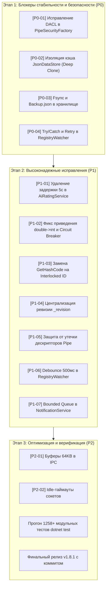

# Сводный план комплексного устранения дефектов Startup Monitor (v1.8.x)

Документ сформирован на основе независимого параллельного аудита триадами разнородных моделей OpenCode (`DeepSeek V4.1 Flash`, `Space Bunny`, `LongCat 2.5 Preview`) с полным циклом рассуждений до 1 часа.

---

## Матрица приоритетов и готовности к реализации

| Приоритет | Категория | Количество замечаний | Влияние на систему |
| :---: | :--- | :---: | :--- |
| **P0** | **Блокеры безопасности и целостности** | **4** | LPE от SYSTEM, падение службы при старте, разрушение JSON-файла данных при сбое питания, гонки кэша в памяти. |
| **P1** | **Высокий риск / Обязательно к релизу** | **8** | Падение в ThreadPool при ошибках реестра, искусственная задержка 5 сек в AI, утечки дескрипторов pipe, зависание UI на `NotModified`. |
| **P2** | **Производительность и отказоустойчивость** | **5** | Буферизация 64KB в IPC, ограничение очереди уведомлений, дедупликация повторных сканирований. |

---

## 1. Блокеры (Приоритет P0) — Немедленное устранение

### [P0-01] Устранение уязвимости Local Privilege Escalation (LPE) в дескрипторе Named Pipe
- **Файл:** [`src/StartupMonitor.Service/Pipe/PipeSecurityFactory.cs`](file:///d:/Nas/Coding/StartupMonitor/src/StartupMonitor.Service/Pipe/PipeSecurityFactory.cs#L41-L52)
- **Проблема:** Правило `AuthenticatedUserSid` с `PipeAccessRights.ReadWrite` включает флаг `CreateNewInstance`. Непривилегированный пользователь может создать экземпляр канала от имени SYSTEM-службы и отправить команды `ShutdownService`, `KillProcessById`, `RemoveFromSystem`.
- **Решение:**
  - Ограничить полный контроль (`FullControl`) только для `LocalSystemSid`, `BuiltinAdministratorsSid` и `currentUser`.
  - Для интерактивных пользователей (`InteractiveSid`) разрешить строго чтение (`Read`).

---

### [P0-02] Ликвидация раздачи живой ссылки `_cache` и изоляция транзакций в `JsonDataStore`
- **Файл:** [`src/StartupMonitor.Shared/Models/JsonDataStore.cs`](file:///d:/Nas/Coding/StartupMonitor/src/StartupMonitor.Shared/Models/JsonDataStore.cs#L87-L126)
- **Проблема:** Метод `Load()` возвращает живую ссылку `_cache` (или поверхностный список `ToList()`, элементы которого общие). Внешние службы меняют свойства элементов без захвата `_lock`. В момент сохранения `JsonSerializer` падает с `InvalidOperationException: Collection was modified` или записывает разорванный JSON.
- **Решение:**
  - Предоставлять для чтения только неизменяемый глубокий снимок (deep clone/immutable snapshot).
  - Любые изменения (`AddOrUpdate`, `Remove`, `UpdateStatus`) выполнять исключительно через потокобезопасные методы хранилища с атомарной подменой ссылки.

---

### [P0-03] Защита от повреждения хранилища при BSOD / сбое питания (`fsync` + ротируемый бэкап)
- **Файл:** [`src/StartupMonitor.Shared/Models/JsonDataStore.cs`](file:///d:/Nas/Coding/StartupMonitor/src/StartupMonitor.Shared/Models/JsonDataStore.cs)
- **Проблема:** Метод сохранения во временный файл не вызывает принудительный сброс дисковых кэшей Windows (`Flush(flushToDisk: true)`). При аварийном отключении питания файл становится нулевого размера, а служба при старте отправляет его в карантин и теряет всю базу автозагрузки.
- **Решение:**
  - Добавить `FileStream.Flush(flushToDisk: true)` перед `File.Replace`.
  - Внедрить автоматическое создание `startup_entries.backup.json` и автоматическое восстановление из него при повреждении основного файла.

---

### [P0-04] Изоляция исключений `RegistryWatcher` от падения процесса службы (Zero-Crash)
- **Файл:** [`src/StartupMonitor.Service/Services/RegistryWatcher.cs`](file:///d:/Nas/Coding/StartupMonitor/src/StartupMonitor.Service/Services/RegistryWatcher.cs)
- **Проблема:** Необработанное исключение внутри асинхронного коллбэка потока ThreadPool (`RegNotifyChangeKeyValue`) по правилам среды CLR .NET немедленно крашит весь процесс службы Windows.
- **Решение:**
  - Заключить весь внутренний цикл коллбэка в изолирующий `try/catch`.
  - При ошибке дескриптора (`ERROR_KEY_DELETED`) выполнять контролируемый retry и переоткрытие ключа реестра вместо фатального сбоя.

---

## 2. Высокий приоритет (Приоритет P1) — Обязательно к релизу

### [P1-01] Ликвидация искусственной 5-секундной задержки в `AiRatingService`
- **Файл:** [`src/StartupMonitor.Service/Services/Ai/AiRatingService.cs`](file:///d:/Nas/Coding/StartupMonitor/src/StartupMonitor.Service/Services/Ai/AiRatingService.cs#L395-L398)
- **Проблема:** В блоке `finally` безусловно вызывается `await Task.Delay(5000 + jitter)`, из-за чего абсолютно каждый вызов (даже успешный) замедляется на 5.5 секунд.
- **Решение:** Перенести задержку строго в ветку обработки превышения лимитов (`429 Too Many Requests`), убрав задержку из штатного успешного пути.

---

### [P1-02] Исправление бага приведения типов и обхода Circuit Breaker в `AiRatingService`
- **Файл:** [`src/StartupMonitor.Service/Services/Ai/AiRatingService.cs`](file:///d:/Nas/Coding/StartupMonitor/src/StartupMonitor.Service/Services/Ai/AiRatingService.cs#L316)
- **Проблема:** Выражение `(int)` от `double` вне диапазона дает `int.MinValue`, что ломает логику задержки и обходит защитный предохранитель Circuit Breaker.
- **Решение:** Добавить валидацию и ограничение значения через `Math.Clamp((int)delay, 1000, 60000)`.

---

### [P1-03] Замена нестабильного `pipe.GetHashCode()` на атомарный счетчик клиентов
- **Файл:** [`src/StartupMonitor.Service/Pipe/EventPipeServer.cs`](file:///d:/Nas/Coding/StartupMonitor/src/StartupMonitor.Service/Pipe/EventPipeServer.cs#L97)
- **Проблема:** `GetHashCode()` стрима не гарантирует уникальности. Коллизия приводит к перезаписи активного клиента в словаре и утечке дескриптора канала.
- **Решение:** Использовать атомарный генератор ID: `Interlocked.Increment(ref _nextClientId)`.

---

### [P1-04] Централизация инкремента ревизий данных (`_revision`) для UI
- **Файлы:** [`src/StartupMonitor.Service/Pipe/PipeServer.cs`](file:///d:/Nas/Coding/StartupMonitor/src/StartupMonitor.Service/Pipe/PipeServer.cs), [`src/StartupMonitor.Shared/Models/JsonDataStore.cs`](file:///d:/Nas/Coding/StartupMonitor/src/StartupMonitor.Shared/Models/JsonDataStore.cs)
- **Проблема:** В 4 местах при добавлении, очистке или редактировании записей ревизия не увеличивается. Клиентское приложение UI постоянно получает ответ `NotModified` и не отображает свежие события автозагрузки.
- **Решение:** Перенести инкремент ревизии непосредственно в транзакционные методы `JsonDataStore`, сделав ревизию непрерывно возрастающим `long`.

---

### [P1-05] Предотвращение утечки `NamedPipeServerStream` в `EventPipeServer`
- **Файл:** [`src/StartupMonitor.Service/Pipe/EventPipeServer.cs`](file:///d:/Nas/Coding/StartupMonitor/src/StartupMonitor.Service/Pipe/EventPipeServer.cs#L100-L114)
- **Проблема:** При сетевом сбое во время ожидания клиента дескриптор канала не освобождается через `Dispose()`, накапливая системные утечки ядра.
- **Решение:** Обеспечить безопасную очистку стрима в блоке `finally` в случае неудачного `WaitForConnectionAsync`.

---

### [P1-06] Защита от шторма событий реестра (Debounce & Single-Flight)
- **Файл:** [`src/StartupMonitor.Service/Services/RegistryWatcher.cs`](file:///d:/Nas/Coding/StartupMonitor/src/StartupMonitor.Service/Services/RegistryWatcher.cs)
- **Проблема:** При массовой установке ПО генерируется до 1000 изменений в секунду, запуская 1000 параллельных ресурсоемких сканирований.
- **Решение:** Реализовать таймер агрегации (Debounce 500 мс) с атомарным флагом `_scanInProgress` для объединения пачки изменений в единый проход.

---

### [P1-07] Ограничение емкости очереди уведомлений (Bounded Queue)
- **Файл:** [`src/StartupMonitor.Service/Services/NotificationService.cs`](file:///d:/Nas/Coding/StartupMonitor/src/StartupMonitor.Service/Services/NotificationService.cs)
- **Проблема:** Очередь не имеет лимита. Если клиент отсоединен, некритичные события накапливаются в памяти до сотен мегабайт.
- **Решение:** Ограничить буфер до 10 000 сообщений с политикой `DropOldest` для телеметрии и метрик.

---

### [P1-08] Защита от зависаний на сетевых (UNC) путях в `AiRatingService`
- **Файл:** [`src/StartupMonitor.Service/Services/Ai/AiRatingService.cs`](file:///d:/Nas/Coding/StartupMonitor/src/StartupMonitor.Service/Services/Ai/AiRatingService.cs#L409-L470)
- **Проблема:** Синхронные вызовы `FileVersionInfo.GetVersionInfo` блокируют поток на 30–60 с при недоступности сетевых дисков.
- **Решение:** Выполнять сбор метаданных асинхронно с таймаутом 2 секунды.

---

### [P1-09] Полноценный белый список программы и порта в `NetworkConnectionAlertService`
- **Файлы:** [`src/StartupMonitor.Service/Services/Firewall/NetworkConnectionAlertService.cs`](file:///d:/Nas/Coding/StartupMonitor/src/StartupMonitor.Service/Services/Firewall/NetworkConnectionAlertService.cs), [`src/StartupMonitor.UI/Views/Dialogs/NetworkConnectionAlertWindow.xaml.cs`](file:///d:/Nas/Coding/StartupMonitor/src/StartupMonitor.UI/Views/Dialogs/NetworkConnectionAlertWindow.xaml.cs)
- **Проблема:** 
  1. При нажатии «Добавить программу в белый список» во всплывающем окне нового соединения сервис должен разрешать программе **любые** сетевые подключения и навсегда исключать повторные алерты по этой программе.
  2. Если пользователь разрешает соединение по определенному удаленному/локальному порту — создавать правило для порта и прекращать всплывающие окна по этому порту.
- **Решение:**
  - При `Resolution == WhitelistProgram`: создавать правило брандмауэра `Direction = Outbound/Inbound, Action = Allow, ApplicationPath = path` без привязки к конкретному IP/порту, и кэшировать программу в `_sessionDecisions` / постоянный список разрешенных.
  - При разрешении по порту: фиксировать `AllowedPorts.Add(port)` и отсекать проверку в `ScanNewConnections()`.

---

### [P1-10] Тихий режим для неизвестных процессов (`PID = 0`) и глубокий резолв процесса
- **Файлы:** [`src/StartupMonitor.Service/Services/Firewall/NetworkConnectionAlertService.cs`](file:///d:/Nas/Coding/StartupMonitor/src/StartupMonitor.Service/Services/Firewall/NetworkConnectionAlertService.cs), [`src/StartupMonitor.Service/Services/ProcessNetworkTracker.cs`](file:///d:/Nas/Coding/StartupMonitor/src/StartupMonitor.Service/Services/ProcessNetworkTracker.cs), [`src/StartupMonitor.UI/Views/NetworkSecurityHubView.xaml`](file:///d:/Nas/Coding/StartupMonitor/src/StartupMonitor.UI/Views/NetworkSecurityHubView.xaml)
- **Проблема:** Сокеты в состоянии `TIME_WAIT` / `CLOSE_WAIT` или системные драйверы возвращают `PID = 0` (System Idle / System). Окно всплывает на неизвестный процесс, раздражая пользователя.
- **Решение:**
  - **Тихий режим (Silent Mode для PID = 0)**: Добавить настройку `IgnoreUnknownProcessesWithZeroPid` (по умолчанию `true` или управляемый чекбокс в настройках страницы «Сетевая безопасность» в UI). Если `socket.ProcessId <= 0`, алерт не создается и окно не открывается.
  - **Глубокий резолв процессов с PID = 0**:
    1. Использовать `GetExtendedTcpTable` с флагом `TCP_TABLE_OWNER_MODULE_ALL` (`AllocateAndGetTcpExTableFromStack` / `GetOwnerModuleFromTcpEntry`) для извлечения имени модуля или драйвера ядра.
    2. Если сокет принадлежит системному стеку (`PID 4 - System` или `svchost.exe`), классифицировать его как доверенный системный процесс `System` и не спамить алертами.

---

### [P1-11] Синхронизация COM-вызовов и изоляция гонок в `WindowsFirewallService`
- **Файл:** [`src/StartupMonitor.Service/Services/WindowsFirewallService.cs`](file:///d:/Nas/Coding/StartupMonitor/src/StartupMonitor.Service/Services/WindowsFirewallService.cs#L460-L490)
- **Проблема:** Метод `GetAllRules()` выполняет долгий перебор сотен правил брандмауэра COM без захвата блокировки `lock (_sync)`. В то же время параллельный вызов `CreateOrUpdateRule` / `DeleteRule` под `lock` модифицирует коллекцию правил, вызывая `COMException: The object invoked has disconnected from its clients` или `RPC_E_SERVERCALL_RETRYLATER`.
- **Решение:**
  - Защитить `GetAllRules()` и чтение статуса общей блокировкой `_sync` (или ReaderWriterLockSlim).
  - Обеспечить гарантированное освобождение COM-дескрипторов `Marshal.ReleaseComObject` для всех итераторов правил в блоках `finally`.

---

### [P1-12] Устранение Sync-over-Async блокировок в `SystemScannerService`
- **Файл:** [`src/StartupMonitor.Service/Services/SystemScannerService.cs`](file:///d:/Nas/Coding/StartupMonitor/src/StartupMonitor.Service/Services/SystemScannerService.cs)
- **Проблема:** В методе `WriteEntry` используется синхронное блокирование `sink.WriteAsync(entry).AsTask().GetAwaiter().GetResult()`, вызывающее ThreadPool starvation при параллельном сканировании дисков и реестра.
- **Решение:** Перевести внутренний конвейер сканирования на полностью асинхронный `await sink.WriteAsync(entry)`.

---

### [P1-13] Утечка памяти в `SlidingWindowTracker` и очистка устаревших банов в `ProcessPortDefenderService`
- **Файл:** [`src/StartupMonitor.Service/Services/Firewall/ProcessPortDefenderService.cs`](file:///d:/Nas/Coding/StartupMonitor/src/StartupMonitor.Service/Services/Firewall/ProcessPortDefenderService.cs)
- **Проблема:** При постоянном потоке новых внешних IP-адресов очереди подключений в `SlidingWindowTracker` не удаляются для неактивных адресов, приводя к непрерывному росту памяти процесса.
- **Решение:** Внедрить периодическую очистку очередей IP-адресов, по которым не было сетевой активности дольше периода скользящего окна.

---

### [P1-14] Защита от ложных блокировок (False Positives) системных служб в `AutoGuardEngine`
- **Файл:** [`src/StartupMonitor.Service/Services/Guards/AutoGuardEngine.cs`](file:///d:/Nas/Coding/StartupMonitor/src/StartupMonitor.Service/Services/Guards/AutoGuardEngine.cs)
- **Проблема:** Политика эвристики блокирует все сторонние службы и драйверы (`Location == Service`), даже если они имеют валидную цифровую подпись доверенного вендора.
- **Решение:** Добавить валидацию доверенных издателей (`DigitalSignatureStatus.ValidTrusted`) в исключения автоматической блокировки.

---

## 3. Оптимизация и масштабируемость (Приоритет P2)

1. **[P2-01] Настройка буферизации Named Pipe (64 КБ)**: В `PipeServer.cs` и `PipeClient.cs` задать явные размеры буферов в 65536 байт для предотвращения фрагментации при передаче снимков процессов >100 КБ.
2. **[P2-02] Добавление Idle-таймаута для Pipe-клиентов**: Автоматически закрывать соединения клиентов, которые подключились, но не передают команд более 60 секунд.
3. **[P2-03] Ограничение времени хранения снимков (Snapshot Retention)**: В `SnapshotManager.cs` добавить автоматическую ротацию старых снимков для экономии дискового пространства.
4. **[P2-04] Безопасная десериализация без блокировок**: В `PipeClient.cs` использовать `Channel<T>` для гарантированного сохранения строгого порядка входящих событий.
5. **[P2-05] Устранение повторного создания `HttpClient`**: Настроить `SocketsHttpHandler.PooledConnectionLifetime` в службах рейтинга и обновлений.

---

## 4. Порядок и график внедрения

