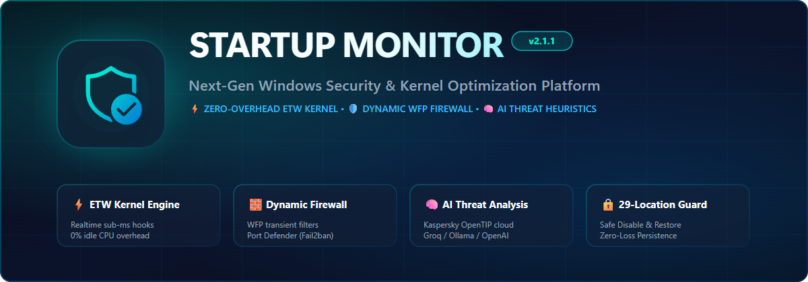

<div align="right">
  <strong>English</strong> | <a href="README.ru.md">Русский</a>
</div>

<p align="center">
  <picture>
    <source media="(prefers-color-scheme: dark)" srcset="assets/banner-dark.png">
    <source media="(prefers-color-scheme: light)" srcset="assets/banner-light.png">
    
  </picture>
</p>

<p align="center">
  <a href="https://github.com/gms-cod/SM/releases/latest"></a>
  
  
  
  
  <a href="LICENSE"></a>
</p>

<p align="center">
  <strong>Professional Windows Startup Sentinel, Kernel-Level Process Inspector &amp; Dynamic Network Defense Hub.</strong>
</p>

<p align="center">
  <a href="docs/USER_GUIDE.md"><strong>User Guide</strong></a> •
  <a href="docs/ARCHITECTURE.md"><strong>Architecture</strong></a> •
  <a href="docs/releases/v2.2.3.md"><strong>Release Notes</strong></a> •
  <a href="https://github.com/gms-cod/SM/releases/latest"><strong>Download Setup</strong></a>
</p>

---

## 💡 What is Startup Monitor?

Modern software, bloatware, background telemetry updaters, and evasive malware leverage dozens of obscure Windows persistence vectors to run on boot. Standard Windows Task Manager and basic startup managers inspect only a couple of registry keys, completely blind to Task Scheduler jobs, WMI subscriptions, Explorer shell hooks, services, Winlogon overrides, and DLL injection points.

**Startup Monitor** delivers complete visibility and real-time defense through a decoupled, high-resilience architecture:
1. **Background System Service (`NT AUTHORITY\SYSTEM`)**: Continuously monitors **29 persistence locations** via native Win32 APIs, asynchronous kernel notifications, and Event Tracing for Windows (**ETW**). Consumes **0% CPU in idle**.
2. **Dynamic Network & Perimeter Defense**: Powered by the **Windows Filtering Platform (WFP)** and **Port Defender** fail2ban engine to detect socket anomalies, block brute-force attempts on critical ports (RDP, SSH, SMB), and guard private RFC 1918 subnets.
3. **Fluent Design 2 User Interface**: A modern, 60 FPS hardware-accelerated desktop interface with dark/light Mica themes, interactive process hierarchies, boot duration tracing, and one-click safe deactivation.

---

## ⚡ Core Advantages & Architectural Pillars

| Advantage | Technology | Real-World Impact |
| :--- | :--- | :--- |
| ⚡ **ETW Kernel Engine** | `Microsoft-Windows-Kernel-Process` | Sub-millisecond process lifecycle telemetry (Start/Stop) without polling. Eliminates CPU spikes, protects against PID recycling attacks, and includes a fallback reconciler. |
| 🧱 **Dynamic WFP Firewall** | Windows Filtering Platform & IP Helper | Transient application-level filtering directly in the Windows network stack. Real-time outbound connection alerts with GeoIP attribution (Country, Flag, ASN). |
| 🏰 **Port Defender (Fail2ban)** | Port Sentinel & Sliding Window Tracker | Continuous monitoring of ports 3389 (RDP), 22 (SSH), and 445 (SMB). Automatically isolates brute-force IP addresses with strict protection for local subnets. |
| 🧠 **AI Threat Heuristics** | Groq (`openai/gpt-oss-120b`) & Local Ollama | Natural-language decomposition of startup commands, CLI arguments, and PE characteristics in Russian or English with 1–10 star safety rating. |
| 🛡️ **Kaspersky Threat Intel** | Kaspersky OpenTIP Gateway | Automated SHA-256 cloud reputation lookup classifying items into Green, Yellow, Red, or Grey risk zones with official malware attribution. |
| 🔒 **Safe 29-Location Control** | Reversible Deactivation & Shadow Vault | 3 distinct operations: **Disable** (temporary, keeps binaries intact), **Block** (persistent blacklist), and **Remove** (purged with safety backup in Recycle Bin). |
| 📸 **Differential Auditing** | Baseline Snapshots ("Before & After") | Compare system states before and after software installations with colored deltas: Added (`+`), Modified (`~`), Removed (`-`). |
| 📲 **24/7 Remote Alerts** | Telegram Bot & Discord Webhooks | Direct push notifications sent from the background service to your smartphone, even when the UI client is closed. |

---

## 🏛️ System Architecture

Startup Monitor adheres to strict privilege separation and defense-in-depth principles:

```
┌────────────────────────────────────────────────────────────────────────┐
│             StartupMonitor.UI (WPF .NET 8 Fluent 2, win-x64)           │
│                                                                        │
│  MainViewModel ─── TaskManagerVM ─── ThemeService ─── LocalizationSvc │
│         │                                                              │
│         ▼                                                              │
│  PipeClient (Named Pipe IPC) ─── TrayNotificationAggregator ───────────┘
│         ▲                                   ▲
│         │  \\.\pipe\StartupMonitor          │  \\.\pipe\StartupMonitor_Events
│         │  (Request-Response / Delta)       │  (Push Events / Coalesced)
│         ▼                                   │
┌────────────────────────────────────────────────────────────────────────┐
│      StartupMonitor.Service (Windows Service / NT AUTHORITY\SYSTEM)     │
│                                                                        │
│  ├─ ETW Process Engine (Microsoft-Windows-Kernel-Process, 0% CPU Idle) │
│  ├─ Watchers: 29 Registry Keys, Folders, SCM Services, Tasks, WMI     │
│  ├─ Network Security Hub: Dynamic WFP Filters, Port Defender, IP Helper │
│  ├─ ProcessInspectorService & NtSuspendProcess / NtResumeProcess APIs  │
│  ├─ AutoGuardEngine (Proactive Temp / Script / Unsigned Guard Rules)   │
│  ├─ DelayedStartupManager (Session 0 Bypass via DuplicateTokenEx)      │
│  ├─ KasperskyScanService & AiRatingService (Groq / Ollama / OpenAI)    │
│  ├─ JsonDataStore: Two-Phase Commit, fsync, automated .backup rotation │
│  └─ AuthenticodeVerifier (WinVerifyTrust) & CliHeuristicAnalyzer       │
└────────────────────────────────────────────────────────────────────────┘
```

---

## 🚀 Quick Start & Installation

### Option 1: Signed Installer (Recommended)
1. Download **`StartupMonitorSetup-v2.1.1.exe`** from the [**Latest GitHub Release**](https://github.com/gms-cod/SM/releases/latest).
2. Verify the SHA-256 hash against `StartupMonitorSetup-v2.1.1.exe.sha256`.
3. Run the installer. The wizard will automatically install binaries to `C:\Program Files\StartupMonitor\`, register and start the Windows Service, and launch the GUI.

> [!TIP]
> **Silent Deployment**: For enterprise rollout, execute:  
> `StartupMonitorSetup-v2.1.1.exe /VERYSILENT /SUPPRESSMSGBOXES /NORESTART`

### Option 2: Portable Package (`SMon2`)
1. Extract the `SMon2/` folder to any drive (fully self-contained .NET 8 x64, zero external dependencies).
2. Launch `StartupMonitor.UI.exe` as Administrator. On first run, it registers the background service via SCM and starts monitoring immediately.

---

## 🛠️ Building from Source

### Prerequisites
- Windows 10 (1809+) or Windows 11 (x64)
- [.NET 8.0 SDK](https://dotnet.microsoft.com/download/dotnet/8.0)
- PowerShell 7+ or Windows PowerShell 5.1

### Build Steps
```powershell
# 1. Clone repository
git clone https://github.com/gms-cod/SM.git
cd SM

# 2. Compile Release solution
dotnet build StartupMonitor.sln -c Release

# 3. Execute test suite (1,368 tests, 100% pass rate)
dotnet test tests/StartupMonitor.Tests -c Release

# 4. Generate self-contained distribution in SMon2/
powershell -ExecutionPolicy Bypass -File scripts/publish.ps1
```

---

## 📖 In-Depth Documentation

- 📘 **[User Guide (All 10 Tabs, Integrations & FAQ)](docs/USER_GUIDE.md)**
- 🏛️ **[Technical Architecture & Data Flows](docs/ARCHITECTURE.md)**
- 🔬 **[Swarm Security Audit & Code Verification](docs/SWARM_INSPECTION_AUDIT_2026-11-07.md)**
- 📝 **[Release Notes v2.1.1](docs/releases/v2.1.1.md)**
- 📚 **[Full Method Catalog (939 Subroutines)](docs/METHOD_CATALOG.md)**

---

## 📄 License

Startup Monitor is open-source software licensed under the **[MIT License](LICENSE)**.  
Iconography: [Fluent UI System Icons](https://github.com/microsoft/fluentui-system-icons) (MIT © Microsoft Corporation).
