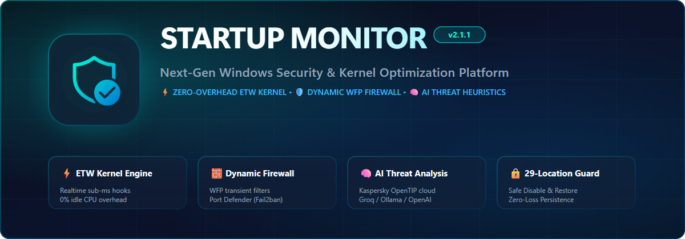

<div align="right">
  <a href="README.md">English</a> | <strong>Русский</strong>
</div>

<p align="center">
  <picture>
    <source media="(prefers-color-scheme: dark)" srcset="assets/banner-dark.png">
    <source media="(prefers-color-scheme: light)" srcset="assets/banner-light.png">
    
  </picture>
</p>

<p align="center">
  <a href="https://github.com/gms-cod/SM/releases/latest"></a>
  
  
  
  
  <a href="LICENSE"></a>
</p>

<p align="center">
  <strong>Профессиональный страж автозапуска, инспектор ядра процессов и центр динамической сетевой безопасности Windows.</strong>
</p>

<p align="center">
  <a href="docs/USER_GUIDE.ru.md"><strong>Руководство пользователя</strong></a> •
  <a href="docs/ARCHITECTURE.md"><strong>Архитектура</strong></a> •
  <a href="docs/releases/v2.2.1.md"><strong>История изменений</strong></a> •
  <a href="https://github.com/gms-cod/SM/releases/latest"><strong>Скачать инсталлятор</strong></a>
</p>

---

## 💡 Что такое Startup Monitor?

Современные приложения, фоновые агенты обновлений, нежелательное ПО и скрытые загрузчики используют десятки недокументированных механизмов Windows для закрепления в операционной системе. Стандартный «Диспетчер задач» отображает лишь малую часть записей реестра, полностью игнорируя планировщик задач, шелл-расширения Проводника, WMI-подписки, системные службы, Winlogon и точки внедрения библиотек.

**Startup Monitor** решает эту проблему на системном уровне благодаря архитектуре высокой надежности:
1. **Фоновая системная служба (`NT AUTHORITY\SYSTEM`)**: Непрерывно контролирует **29 категорий автозапуска** через системные API, асинхронные уведомления ядра и Event Tracing for Windows (**ETW**). В состоянии покоя потребляет **0% CPU**.
2. **Динамический сетевой шлюз и защита периметра**: Построен на технологиях **Windows Filtering Platform (WFP)** и механизме защиты критических портов **Port Defender (Fail2ban)**. Блокирует brute-force атаки на порты RDP, SSH, SMB и защищает локальные доверенные подсети RFC 1918.
3. **Графический интерфейс Fluent 2 (Windows 11)**: Высокопроизводительное аппаратное отображение (60 FPS), темная и светлая Mica-темы, визуализация иерархии процессов, трассировщик времени старта Windows и безопасное управление автозапуском.

---

## ⚡ Ключевые преимущества и архитектурные опоры

| Преимущество | Технология | Практическая ценность |
| :--- | :--- | :--- |
| ⚡ **Ядро ETW Kernel Engine** | `Microsoft-Windows-Kernel-Process` | Суб-миллисекундный перехват жизненного цикла процессов (Start/Stop) без опроса и нагрузки на CPU. Защита от коллизий PID и отказоустойчивая сверка. |
| 🧱 **Динамический WFP-брандмауэр** | Windows Filtering Platform & IP Helper | Временные фильтры уровня приложений прямо в сетевом стеке Windows. Мгновенные сетевые алерты с определением GeoIP (страна, флаг, город, ASN). |
| 🏰 **Защита портов Port Defender** | Port Sentinel & Скользящее окно | Защита портов 3389 (RDP), 22 (SSH) и 445 (SMB) от подбора паролей. Автоматическая изоляция атакующих IP с защитой домашних и корпоративных подсетей. |
| 🧠 **ИИ-анализ угроз** | Groq (`openai/gpt-oss-120b`) / Ollama | Нейросетевой разбор аргументов командной строки и PE-структуры на русском или английском языке с формированием рейтинга безопасности 1–10 звезд. |
| 🛡️ **Репутация Kaspersky OpenTIP** | Облачный шлюз Kaspersky OpenTIP | Автоматическая сверка SHA-256 хешей с базой угроз: точные зоны риска (Green, Yellow, Red, Grey) и наименования вредоносного ПО. |
| 🔒 **Безопасное управление 29 точками** | Обратимая деактивация & Теневой архив | Четкое разделение операций: **Отключить** (деактивация без удаления), **Заблокировать** (правило ЧС) и **Удалить** (с бэкапом в «Удалённые»). |
| 📸 **Дифференциальный аудит** | Эталонные снимки «Было — Стало» | Сравнение состояния системы до и после установки программ с наглядной цветовой маркировкой: Добавлено (`+`), Изменено (`~`), Удалено (`-`). |
| 📲 **Круглосуточные алерты 24/7** | Telegram-бот и Discord Webhooks | Мгновенная доставка push-уведомлений о новых точках автозапуска и сетевых инцидентах на смартфон прямо из системной службы. |

---

## 🏛️ Архитектура системы

Startup Monitor построен в соответствии с принципами наименьших привилегий и глубокой эшелонированной защиты:

```
┌────────────────────────────────────────────────────────────────────────┐
│             StartupMonitor.UI (WPF .NET 8 Fluent 2, win-x64)           │
│                                                                        │
│  MainViewModel ─── TaskManagerVM ─── ThemeService ─── LocalizationSvc │
│         │                                                              │
│         ▼                                                              │
│  PipeClient (Named Pipe IPC) ─── TrayNotificationAggregator ───────────┘
│         ▲                                   ▲
│         │  \\.\pipe\StartupMonitor          │  \\.\pipe\StartupMonitor_Events
│         │  (Request-Response / Delta)       │  (Push Events / Coalesced)
│         ▼                                   │
┌────────────────────────────────────────────────────────────────────────┐
│      StartupMonitor.Service (Windows Service / NT AUTHORITY\SYSTEM)     │
│                                                                        │
│  ├─ ETW Process Engine (Microsoft-Windows-Kernel-Process, 0% CPU Idle) │
│  ├─ Watchers: 29 веток реестра, папок, служб SCM, задач, WMI-подписок │
│  ├─ Network Security Hub: Dynamic WFP Filters, Port Defender, IP Helper │
│  ├─ ProcessInspectorService & NtSuspendProcess / NtResumeProcess APIs  │
│  ├─ AutoGuardEngine (Превентивные политики Temp / Script / Unsigned)   │
│  ├─ DelayedStartupManager (Session 0 Bypass через DuplicateTokenEx)    │
│  ├─ KasperskyScanService & AiRatingService (Groq / Ollama / OpenAI)    │
│  ├─ JsonDataStore: Two-Phase Commit, fsync, авторотация .backup        │
│  └─ AuthenticodeVerifier (WinVerifyTrust) & CliHeuristicAnalyzer       │
└────────────────────────────────────────────────────────────────────────┘
```

---

## 🚀 Быстрый старт и установка

### Вариант 1: Официальный инсталлятор с цифровой подписью (Рекомендуется)
1. Скачайте файл **`StartupMonitorSetup-v2.1.1.exe`** из раздела [**актуального релиза на GitHub**](https://github.com/gms-cod/SM/releases/latest).
2. Сверьте контрольную сумму SHA-256 с файлом `StartupMonitorSetup-v2.1.1.exe.sha256`.
3. Запустите установщик. Мастер автоматически установит файлы в `C:\Program Files\StartupMonitor\`, создаст и запустит фоновую службу Windows и откроет интерфейс.

> [!TIP]
> **Тихая установка в корпоративной среде**:  
> `StartupMonitorSetup-v2.1.1.exe /VERYSILENT /SUPPRESSMSGBOXES /NORESTART`

### Вариант 2: Портативный запуск (`SMon2`)
1. Распакуйте каталог `SMon2/` в любую папку (полностью автономный .NET 8 x64, установка сторонних сред не требуется).
2. Запустите `StartupMonitor.UI.exe` от имени Администратора. При первом старте программа зарегистрирует службу через SCM и активирует мониторинг.

---

## 🛠️ Сборка из исходного кода

### Системные требования
- Windows 10 (1809+) или Windows 11 (x64)
- [.NET 8.0 SDK](https://dotnet.microsoft.com/download/dotnet/8.0)
- PowerShell 7+ или Windows PowerShell 5.1

### Команды компиляции и тестов
```powershell
# 1. Клонирование репозитория
git clone https://github.com/gms-cod/SM.git
cd SM

# 2. Компиляция в конфигурации Release
dotnet build StartupMonitor.sln -c Release

# 3. Запуск полного набора тестов (1,368 тестов, 100% успешных)
dotnet test tests/StartupMonitor.Tests -c Release

# 4. Сборка автономного портативного пакета в SMon2/
powershell -ExecutionPolicy Bypass -File scripts/publish.ps1
```

---

## 📖 Подробная документация

- 📘 **[Руководство пользователя (все 10 вкладок, интеграции и FAQ)](docs/USER_GUIDE.ru.md)**
- 🏛️ **[Архитектура системы и потоки данных](docs/ARCHITECTURE.md)**
- 🔬 **[Отчет безопасности полного аудита роя субагентов](docs/SWARM_INSPECTION_AUDIT_2026-11-07.md)**
- 📝 **[История изменений выпуска v2.1.1](docs/releases/v2.1.1.md)**
- 📚 **[Каталог всех методов кодовой базы (939 функций)](docs/METHOD_CATALOG.md)**

---

## 📄 Лицензия

Startup Monitor распространяется под открытой лицензией **[MIT License](LICENSE)**.  
Графические пиктограммы: [Fluent UI System Icons](https://github.com/microsoft/fluentui-system-icons) (MIT © Microsoft Corporation).
