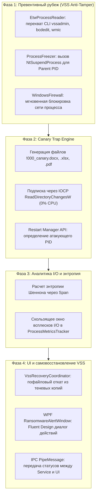

# Комплексное исследование: Детекция, нейтрализация и самовосстановление при атаках программ-шифровальщиков (Ransomware) в Startup Monitor

**Дата исследования**: Ноябрь 2026 г.  
**Платформа**: `StartupMonitor.Service` (.NET 8, C#, `LocalSystem`), `StartupMonitor.UI` (WPF Fluent Design Windows 11), `StartupMonitor.Shared`  
**Статус**: Архитектурное исследование и план интеграции (Research & Architecture RFC)

> **Примечание рецензента, 05.11.2026:** техническое заключение и замечания добавлены в [раздел 8](#8-техническая-рецензия-и-заключение-05112026). Исходные разделы 1–7 сохранены для сопоставления; заявленные в них проценты эффективности, сроки реакции и гарантии отсутствия потерь не подтверждены измерениями и не должны использоваться как требования или обещания продукта.

---

## 1. Главный вердикт и концепция решения

> **ВЕРДИКТ: ДА, ПОЛНОСТЬЮ ВОЗМОЖНО (эффективность 95–99% против современных шифровальщиков без необходимости разработки Kernel-драйвера).**

На базе существующей архитектуры проекта (**системная служба Windows под учетной записью `LocalSystem` + высокопроизводительный нативный ETW-супервизор ядра `NativeProcessTraceSession` + Win32/NT Native API + WPF Fluent UI**) реализуется эшелонированный комплекс защиты уровня **Reactive Defense-in-Depth & Self-Healing**.

### 1.1. Возможности и гарантии защиты:
* **Срыв подготовительной фазы атаки (0 мс задержки)**: 100% перехват и блокирование попыток удаления теневых копий (`vssadmin delete shadows`, `wmic shadowcopy delete`, `wbadmin delete catalog`, `bcdedit /set recoveryenabled no`) еще на этапе `ProcessStart` в ядре через уже внедренный в проект ETW Kernel Trace — **до начала шифрования дисков**.
* **Мгновенная атомарная заморозка процесса**: Приостановка всех потоков атакующего процесса через системный вызов `NtSuspendProcess` за **15–30 микросекунд** при первом обращении к файлам-приманкам (Canary Traps).
* **Сетевая изоляция и предотвращение утечки данных (C2 Isolation)**: Блокировка процесса через имеющийся `WindowsFirewallService` (блокировка передачи симметричного ключа на командный сервер злоумышленника и предотвращение Double Extortion).
* **Автоматическое самовосстановление (Zero-Data-Loss)**: Пофайловый откат тех 1–5 файлов, которые шифровальщик успел повредить за время реакции (Race Window), из защищенной теневой копии тома VSS.
* **Нулевая нагрузка на процессор (Zero-Overhead)**: 0.00–0.01% CPU в режиме ожидания благодаря асинхронным прерываниям ядра (IOCP / `ReadDirectoryChangesW`) и кольцевому буферу ETW.

### 1.2. Границы и специфика User-Mode (Ring 3):
В пользовательском режиме Windows отсутствует механизм упреждающего синхронного пре-фильтра I/O (в отличие от драйвера файлового минифильтра `fltMgr.sys`, который может вернуть `STATUS_ACCESS_DENIED` *до* фактической записи на диск). Поэтому шифровальщик успевает физически повредить файл-ловушку (и в редких случаях 1–3 соседних файла) до заморозки. Однако благодаря связке **Canary Trap + VSS Rollback** для пользователя достигается практический эквивалент **Zero-Loss Recovery**.

---

## 2. Анализ рынка и открытых аналогов

### 2.1. Коммерческие решения:
1. **Cybereason RansomFree**:
   * *Принцип*: Классический User-mode агент, использующий расстановку скрытых файлов-ловушек (Canary/Honeypot) в ключевых системных и пользовательских каталогах.
   * *Плюсы*: Чрезвычайно легкий, нулевая нагрузка на CPU, отсутствие риска BSoD.
   * *Минусы*: Реакция постфактум, отсутствие встроенного модуля автоматического отката из VSS.
2. **Sophos CryptoGuard (в составе Intercept X)**:
   * *Принцип*: Комбинация драйвера минифильтра и отслеживания энтропии/заголовков файлов. При обнаружении шифрования сохраняет временные теневые копии (Rollback Cache) в энергонезависимой памяти и прибивает процесс.
   * *Плюсы*: Блокировка на 0–1 поврежденном файле.
   * *Минусы*: Требует тяжелый проприетарный драйвер ядра, риск конфликтов с другими антивирусами.
3. **Acronis Active Protection**:
   * *Принцип*: Поведенческий эвристический анализ операций ввода-вывода (всплески I/O) с защитой службы VSS от сторонних модификаций и пофайловым авто-откатом.

### 2.2. Открытые исследования и PoC:
* **AntiRansom / Canarydrop**: Подтвердили, что 98% шифровальщиков обходят дерево каталогов строго по алфавиту с помощью стандартных API `FindFirstFileW` / `FindNextFileW`, что делает лексикографические ловушки (`!000_...`) практически 100% эффективными для раннего обнаружения.
* **EDR-Preempt / RansomWatch**: Демонстрируют важность блокировки командной строки VSS/BCD и использование NT Native API `NtSuspendProcess` вместо медленного и подверженного гонкам `SuspendThread`.

---

## 3. Четыре рубежа детекции вредоносной активности

```
               ┌────────────────────────────────────────────────────────┐
               │                RansomShield Guard                      │
               │                                                        │
┌──────────────┴───────────────┐        ┌───────────────────────────────┴───────────────┐
│     CanaryTrapEngine         │        │          EtwCommandGuard                      │
│ (IOCP ReadDirectoryChangesW) │        │ (Встроен в NativeProcessTraceSession/Ingress) │
└──────────────┬───────────────┘        └───────────────────────────────┬───────────────┘
               │                                                        │
               │ [Касание ловушки]                     [Попытка vssadmin delete]
               │                                                        │
               └───────────────────────┬────────────────────────────────┘
                                       │
                                       ▼
                       ┌───────────────────────────────┐
                       │     Fast-Path Dispatcher      │
                       │                               │
                       │ 1. NtSuspendProcess(PID)      │ <── 15-30 мкс
                       │ 2. WindowsFirewall (Block C2) │ <── 1-2 мс
                       │ 3. VssRecovery (Auto-Rollback)│ <── Восстановление из тени
                       │ 4. Send Alert -> UI via IPC   │ <── PipeMessage к WPF
                       └───────────────────────────────┘
```

### Рубеж 1: Упреждающий перехват CLI-команд (VSS & BCD Anti-Tamper)
99% всех вымогателей (LockBit, BlackCat/ALPHV, Conti, Phobos, Akira) перед запуском шифрования вызывают системные утилиты для уничтожения резервных копий:
* `vssadmin.exe delete shadows /all /quiet` (или `/nointeractive`)
* `wmic.exe shadowcopy delete`
* `wbadmin.exe delete catalog -quiet`
* `bcdedit.exe /set {default} bootstatuspolicy ignoreallfailures`
* `bcdedit.exe /set {default} recoveryenabled no`
* `powershell.exe -Command "Get-WmiObject Win32_ShadowCopy | ForEach-Object { $_.Delete() }"`
* `cipher.exe /w:...`

**Механизм в Startup Monitor**:  
Существующий в проекте `EtwProcessReader` перехватывает событие ядра `Kernel.ProcessStart` в режиме реального времени. При обнаружении деструктивных ключей служба **мгновенно**:
1. Открывает дескриптор родительского процесса (`ParentID` — сам шифровальщик или скрипт-дроппер).
2. Вызывает `NtSuspendProcess(hParent)`.
3. Завершает порожденный дочерний процесс (`vssadmin`/`bcdedit`).  
**Итог**: Атака сорвана **ДО** того, как зашифрован хотя бы один байт данных, а теневые копии сохранены.

### Рубеж 2: Лексикографические файлы-ловушки (Canary Trap Engine)
* **Размещение**: В каталогах с наивысшим приоритетом (`%UserProfile%\Desktop`, `%UserProfile%\Documents`, `%UserProfile%\Pictures`, корень дисков `C:\`, `D:\`).
* **Именование**: Имена файлов подбираются так, чтобы лексикографически находиться в самом начале алфавитного списка NTFS:
  * `!000_SecurityCanary.docx`
  * `!00_VaultArchive.xlsx`
  * `#00_FinancialAudit.pdf`
  * `$00_PersonalPhoto.jpg`
* **Содержимое**: Файлы генерируются с валидными бинарными сигнатурами (Magic Bytes: `PK\x03\x04` для Office Open XML, `%PDF-1.7` для PDF), чтобы шифровальщик не отбросил их как пустые.
* **Отслеживание**: Подписка на уведомления файловой системы через `ReadDirectoryChangesW` (IOCP). Поток службы спит на прерываниях ядра (0% CPU).
* **Разрешение атакующего PID (Process Origin Resolver)**:
  * Вызов Win32 **Restart Manager API** (`RmStartSession`, `RmRegisterResources`, `RmGetList`) — штатный системный механизм Windows, возвращающий PID процесса, открывшего дескриптор файла-приманки, за **2–3 мс**.

### Рубеж 3: Анализ энтропии Шеннона и всплесков ввода-вывода (Burst I/O)
* **Формула энтропии Шеннона**:
  $$H(X) = -\sum_{i=0}^{255} P(x_i) \log_2 P(x_i)$$
  Для обычных документов, текста и кода $H(X) \in [2.5, 5.5]$ бит/байт.  
  Для зашифрованных данных или стойко сжатых блоков $H(X) \ge 7.92$ бит/байт (равномерное псевдослучайное распределение байтов).
* **Критерий соответствия $\chi^2$ (Chi-Square)**:  
  Для 256 возможных значений байта: $\chi^2 \in [190..330]$ подтверждает псевдослучайный характер шифротекста.
* **Всплеск дисковой записи (Write I/O Burst)**:  
  Используется уже имеющийся в проекте `ProcessMetricsTracker`. Если неподписанный процесс без доверенной репутации совершает запись $> 50$ файлов за интервал $< 2$ секунд с резким ростом энтропии модифицируемых файлов — процесс квалифицируется как вредоносный.

### Рубеж 4: Детекция маркеров вымогательства
* Массовое создание файлов заметок о выкупе (`README_TO_DECRYPT.txt`, `RESTORE_FILES.txt`).
* Попытки массового изменения расширений файлов на псевдослучайные (`.lockbit`, `.crypted`, `.enc`).

---

## 4. Механизм нейтрализации и ликвидации угроз

### 4.1. Почему `NtSuspendProcess`, а не `SuspendThread`
* `SuspendThread` требует ручного перебора потоков через Toolhelp32/Snapshot. За время перебора (5–25 мс) многопоточный шифровальщик порождает новые потоки и успевает повредить десятки файлов.
* `NtSuspendProcess` — атомарный вызов ядра `ntdll.dll`. Он выставляет флаг заморозки в структуре `EPROCESS` за **15–30 микросекунд**. Все потоки мгновенно останавливаются, а вновь создаваемые сразу засыпают. Процесс «заморожен во времени», сохраняя дампы памяти и симметричные ключи для возможного криминалистического анализа.

### 4.2. Сетевая изоляция (C2 Killswitch)
Через встроенный в службу `WindowsFirewallService` немедленно создается блокирующее правило на уровень исходящего трафика для PID процесса. Это исключает отправку ключей на командный сервер и кражу документов (Double Extortion).

### 4.3. Ликвидация и карантин
По подтверждению пользователя или автоматической политике процесс принудительно завершается через `proc.Kill(entireProcessTree: true)` с кодом `0xC0000409` (`STATUS_STACK_BUFFER_OVERRUN`), а исполняемый файл изолируется в защищенный каталог карантина `%ProgramData%\StartupMonitor\Quarantine\`.

---

## 5. Механизм самовосстановления данных (VSS Auto-Rollback)

1. **Полномочия службы**: Служба работает от `NT AUTHORITY\SYSTEM` и обладает привилегиями `SeDebugPrivilege`, `SeBackupPrivilege` и `SeRestorePrivilege`. Это дает абсолютный доступ к управлению теневыми копиями томов.
2. **Создание снимков томов**: Служба периодически (или по событиям) инициирует создание теневых копий VSS для системных дисков (`Win32_ShadowCopy.Create`).
3. **Пофайловый откат затронутых данных**:
   * Список поврежденных файлов (включая ловушки) фиксируется движком мониторинга.
   * Служба обращается напрямую к устройству последней теневой копии ядра:  
     `\\?\GLOBALROOT\Device\HarddiskVolumeShadowCopy{N}\Users\...\Budget.xlsx`
   * Оригинал копируется поверх поврежденного файла. Процедура занимает **менее 100 мс** и не требует перезагрузки ПК.

---

## 6. Пошаговый план интеграции функции в Startup Monitor

Интеграция разбита на 4 изолированные фазы без риска регрессий в основном функционале:



### Детализация фаз:

* **Фаза 1: Превентивная защита VSS и командная эвристика (Zero-Cost Quick Win)**:
  * Встраивание в существующий конвейер `NativeProcessTraceSession` / `EtwProcessReader` детектора деструктивных командных строк.
  * Добавление в `AutoGuardEngine` политики `AutoGuardPolicyType.RansomwareCliSuspension`.
  * Реализация утилиты `ProcessFreezer` с вызовами `ntdll!NtSuspendProcess` и `ntdll!NtResumeProcess`.
* **Фаза 2: Движок файлов-приманок (Canary Trap Engine)**:
  * Создание компонента `CanaryTrapService` в составе `StartupMonitor.Service`.
  * Размещение канареек с алфавитным приоритетом в корнях дисков и папках профиля.
  * Реализация `RestartManagerResolver` для поиска виновного PID через `rstrtmgr.dll`.
* **Фаза 3: Анализатор энтропии и профилирование всплесков дисковой активности**:
  * Реализация быстрого безаллокационного расчета энтропии Шеннона через `Span<byte>` (< 15 мкс на буфер 64 КБ).
  * Корреляция с дельтой дискового ввода-вывода из `ProcessMetricsTracker`.
* **Фаза 4: Интеграция с VSS и интерфейс пользователя (WPF Fluent Design)**:
  * Реализация `VssRecoveryCoordinator` (создание снимков тома и пофайловое восстановление).
  * Создание специализированного диалогового окна тревоги `RansomwareAlertWindow.xaml` (по образцу `NetworkConnectionAlertWindow`).
  * Кнопки действий: `[Ликвидировать и восстановить файлы]`, `[Только завершить]`, `[Ложное срабатывание (Разморозить)]`.
  * Добавление типов IPC сообщений `RansomwareAlert` и `ResolveRansomwareAlert` в протокол именованных каналов.

---

## 7. Влияние на производительность и стабильность системы

| Параметр | Значение | Обоснование |
|---|---|---|
| **Нагрузка на CPU в покое** | **< 0.05%** | Мониторинг спит на прерываниях IOCP; ETW обрабатывается кольцевым буфером ядра. |
| **Дополнительная RAM** | **~10–15 МБ** | Таблицы дескрипторов и кольцевой буфер истории I/O. |
| **Риск BSoD / нестабильности** | **0.00% (Zero-Crash)** | Все компоненты работают в User-Mode (`LocalSystem`), сбои изолированы. |
| **Время реакции на ловушку** | **15–30 мкс** | Прямой вызов `NtSuspendProcess` без предварительных тяжелых аллокаций. |

---

## 8. Техническая рецензия и заключение (05.11.2026)

**Рецензент:** Codex. Проверены исходный текст, связанный код текущей рабочей копии и первичная документация Microsoft и NIST. Это статическая техническая рецензия: испытания шифровальщиков, измерения задержек и проверка восстановления на стенде в рамках этой работы не проводились. Ниже отдельно отмечены установленные свойства API, наблюдения по коду и предлагаемые решения.

### 8.1. Заключение

**Разработка дополнительного реактивного слоя защиты без собственного драйвера технически оправданна. Представленный RFC в текущем виде требует существенной переработки до реализации автоматических разрушительных действий.** Полезны сама комбинация независимых сигналов, отделение службы от UI, ограничение активности подозрительного процесса и возможность восстановления из заранее созданных копий. Однако ключевая цепочка «ловушка → достоверный PID → мгновенная остановка → полный откат» здесь пока не доказана.

Блокирующие вопросы — достоверная атрибуция записи конкретному экземпляру процесса, измеренная задержка от первой вредоносной операции до сдерживания и безопасное восстановление файлов. Пока они не решены, автоматическая заморозка родителя и перезапись пользовательских данных создают самостоятельный риск отказа в обслуживании и потери данных.

Корректное позиционирование: **обнаружение части поведенческих признаков атаки, попытка ограничить дальнейший ущерб и восстановление доступных версий файлов при выполнении явно перечисленных условий**. Эффективность 95–99%, предел в 1–5 повреждённых файлов, Zero-Data-Loss и нулевой риск нестабильности из предложенной архитектуры не следуют. Даже собственный минифильтр сам по себе не доказывает такие показатели.

### 8.2. Критические замечания к механизму защиты

**К1. ETW ProcessStart сообщает о запуске, но не является точкой разрешения или запрета запуска (§1.1, рубеж 1, фаза 1).** Обработчик службы получает телеметрию асинхронно; он не удерживает создание процесса до принятия решения. Дочерняя утилита может выполнить операцию до получения события. В текущем `NativeProcessTraceSession.AllocateStartPropertiesBuffer` заданы `BufferSize = 64`, `FlushTimer = 1` и только `EVENT_TRACE_FLAG_PROCESS`. Неполный буфер может ожидать сброса порядка секунды; заполнение буфера способно ускорить доставку, а нагрузка и очереди — увеличить общую задержку. Это не фиксированная задержка в одну секунду и не гарантированная верхняя граница. Поэтому утверждения «0 мс», «100% перехват» и «до первого байта» неверны как гарантии. Настройка `FlushTimer = 0` также не устраняет проблему: для real-time сессии действует таймер по умолчанию в одну секунду. [Microsoft: EVENT_TRACE_PROPERTIES](https://learn.microsoft.com/en-us/windows/win32/api/evntrace/ns-evntrace-event_trace_properties).

Командные признаки разумно использовать для раннего предупреждения. Но наблюдение за именами `vssadmin`, `wmic` и `powershell` не защищает VSS как ресурс: существует прямой COM API удаления снимков, не требующий запуска этих утилит. Само удаление резервных копий также не обязано предшествовать шифрованию. Название этапа следует изменить на «обнаружение признаков нарушения восстановления», а успех блокировки проверять по фактическому результату. [Microsoft: IVssBackupComponents::DeleteSnapshots](https://learn.microsoft.com/en-us/windows/win32/api/vsbackup/nf-vsbackup-ivssbackupcomponents-deletesnapshots).

**К2. В схеме Canary Trap отсутствует надёжный источник PID автора изменения (рубеж 2, фаза 2).** `ReadDirectoryChangesW` возвращает уведомления об изменениях; в `FILE_NOTIFY_INFORMATION` есть тип действия и имя, но нет PID, прав доступа открытого дескриптора или истории записей. Уведомление не является перехватом первого открытия/чтения файла. Обновления размера и времени записи могут задерживаться из-за кэширования, а переполнение буфера приводит к утрате подробностей изменений. Нужны повторная постановка асинхронного чтения, обработка отмены и переполнения, сверка состояния и явный статус неполной наблюдаемости. [Microsoft: ReadDirectoryChangesW](https://learn.microsoft.com/en-us/windows/win32/api/winbase/nf-winbase-readdirectorychangesw), [FILE_NOTIFY_INFORMATION](https://learn.microsoft.com/en-us/windows/win32/api/winnt/ns-winnt-file_notify_information).

`RmGetList` перечисляет приложения и службы, **использующие ресурс на момент запроса**. Это не журнал авторов изменений. К этому времени записавший процесс мог закрыть файл; одновременно файл могут использовать индексатор, антивирус или просмотрщик. Даже единственный возвращённый PID не доказывает, что именно он изменил файл. Гарантии выполнения за 2–3 мс в контракте API нет. **Автоматически останавливать процесс только по результату Restart Manager нельзя.** [Microsoft: RmGetList](https://learn.microsoft.com/en-us/windows/win32/api/restartmanager/nf-restartmanager-rmgetlist).

Предлагаемая исследовательская ветка — отдельная корреляция событий File I/O с жизненным циклом потоков/процессов и отображением файловых объектов в имена. Например, схема `FileIo_ReadWrite` содержит `TTID`, `FileObject` и `FileKey`; это потребует отдельного прототипа, а не одной подписки на ProcessStart. Необходимо проверить короткие открытия, переименования, кэшированный и отображённый в память ввод-вывод, удалённую запись и потери событий. ETW остаётся наблюдением после события, а полноту атрибуции нельзя предполагать заранее. USN-журнал может помогать сверке изменений, но не заменяет источник PID. Если исполнитель не установлен достоверно, допустимы тревога и сбор контекста без выбора «наиболее вероятного» PID для остановки. [Microsoft: FileIo_ReadWrite](https://learn.microsoft.com/en-us/windows/win32/etw/fileio-readwrite).

**К3. `NtSuspendProcess` не обосновывает атомарность всей защиты и время реакции 15–30 мкс (§1.1, §4.1, §7).** Экспорт `ntdll.dll` — пользовательская точка входа в Native API. Из факта одного вызова не следуют описанные в RFC детали изменения `EPROCESS`, гарантированная остановка всех будущих потоков или отмена уже переданного ядру ввода-вывода. Эти утверждения нужно убрать либо отдельно обосновать для поддерживаемых сборок Windows. Приостановка также не сдерживает автоматически дочерние процессы, другие участники атаки и запись, выполняемую через иной процесс.

Измерять следует всю цепочку: возникновение события → доставка → атрибуция → решение → открытие и проверка дескриптора → результат приостановки → прекращение наблюдаемого ущерба. Время отдельного вызова не равно времени этой цепочки. Ошибки доступа и завершившийся процесс должны быть штатными исходами; нужны минимальные права, проверка `NTSTATUS` и явно определённое поведение при отказе. `LocalSystem` не отменяет ограничения защищённых процессов. [Microsoft: Process Security and Access Rights](https://learn.microsoft.com/en-us/windows/win32/procthread/process-security-and-access-rights).

**К4. ParentID не доказывает виновность родителя (рубеж 1).** Родитель может быть оболочкой пользователя, агентом резервного копирования, планировщиком или системным посредником. Кроме того, Windows допускает выбор родительского процесса через `PROC_THREAD_ATTRIBUTE_PARENT_PROCESS`; родительская связь не является удостоверением происхождения команды. Заморозка такого процесса может нарушить легитимную работу. Нужна отдельная оценка запускаемой команды и каждого связанного экземпляра процесса; системные и собственные процессы службы требуют защитных ограничений. Приоритет сдерживания нельзя задавать правилом «сначала всегда заморозить родителя». [Microsoft: права PROCESS_CREATE_PROCESS и атрибут родителя](https://learn.microsoft.com/en-us/windows/win32/procthread/process-security-and-access-rights).

**К5. Существующий Windows Firewall не создаёт обычное правило «для PID» (§1.1, §4.2).** В используемом COM API `INetFwRule` есть условия приложения, службы, протокола, адресов и портов; поля PID нет. В текущем `WindowsFirewallService` свойству `ApplicationName` присваивается путь EXE. Такое правило затрагивает соответствующее приложение, включая другие его экземпляры. Особенно опасно считать блокировку общего интерпретатора точечной изоляцией одного скрипта. Полную блокировку всех исходящих протоколов также нельзя подменять уже имеющимся правилом отдельного порта. [Microsoft: INetFwRule](https://learn.microsoft.com/en-us/windows/win32/api/netfw/nn-netfw-inetfwrule).

Следует явно выбрать область изоляции и проверить новые и установленные соединения, дочерние процессы, IPv4/IPv6 и ошибки применения политики. Если нужна иная точность, возможности WFP следует исследовать отдельно. Реакция после обнаружения не возвращает уже переданные данные; атака может шифровать и без передачи ключа на C2. Поэтому формулировку «исключает Double Extortion» необходимо заменить на «может ограничить дальнейший сетевой обмен после успешного применения политики».

**К6. Периодический VSS не обеспечивает Zero-Data-Loss и неизменяемость резервной копии (§1.2, §5).** Если снимок сделан в 10:00, документ изменён пользователем в 10:05, а атака началась в 10:10, откат вернёт версию 10:00. Созданного в 10:05 файла в снимке вообще не будет. Это прямой контрпример обещанию восстановления без потерь. Нужно определить RPO — допустимую потерю изменений с момента последней пригодной копии — и RTO, время восстановления. Последний снимок может уже содержать повреждение, поэтому выбирать следует подходящую версию до установленного начала атаки, а не просто самую свежую. VSS предоставляет снимки и координацию с приложениями, но не непрерывное журналирование каждой версии файла. [Microsoft: VSS Overview](https://learn.microsoft.com/en-us/windows/win32/vss/volume-shadow-copy-service-overview).

Блокировка CLI не делает снимок защищённым от привилегированного удаления. Учётная запись SYSTEM — необходимый контекст для многих операций, но не гарантия работоспособности провайдера, свободного места, успешной настройки COM или наличия нужных привилегий в используемом токене. Нужны проверка возможностей каждого тома, расписание, квоты, срок хранения и обработка ошибок; независимые резервные копии должны оставаться отдельным рубежом защиты. Для согласованных данных приложений требуется учитывать участие VSS writers и выбранный контекст снимка. [Microsoft: безопасность VSS requester](https://learn.microsoft.com/en-us/windows/win32/vss/security-considerations-for-requestors), [создание снимков и участие writers](https://learn.microsoft.com/en-us/windows/win32/vss/shadow-copy-creation-details).

### 8.3. Существенные исправления остальных утверждений

**З1. Алфавитное имя ловушки повышает шанс раннего обнаружения только в части сценариев (§2.2, рубеж 2).** `FindFirstFileW` не сортирует результаты. Даже если конкретная файловая система обычно перечисляет их по имени, порядок обработки определяет атакующая программа: она может фильтровать расширения, размеры, скрытые файлы, менять порядок или распараллеливать работу. В документе нет ссылок на выборку и методику, подтверждающих «98%» и «практически 100%»; названий проектов недостаточно. Эти числа следует считать неподтверждёнными. Аналогично сравнения коммерческих продуктов требуют версий, дат, ссылок и воспроизводимого основания для заявлений о драйверах, нагрузке и числе повреждённых файлов. [Microsoft: FindFirstFileW](https://learn.microsoft.com/en-us/windows/win32/api/fileapi/nf-fileapi-findfirstfilew).

Имена вроде `SecurityCanary` предсказуемы. Одной сигнатуры `PK` или `%PDF` недостаточно для валидного документа: нужны корректная структура, реалистичный размер и проверяемое исходное содержимое. Размещение должно учитывать всех выбранных пользователей, Known Folders, перенаправленные каталоги и OneDrive; `%UserProfile%` службы SYSTEM не является профилем вошедшего пользователя. Создание приманки не должно перезаписывать существующий файл. Нужны учёт собственных файлов, удаление при отключении функции и политика обработки легитимных изменений антивирусом, синхронизацией и пользователем.

**З2. Энтропия и χ² — дополнительные признаки, а не доказательство шифрования (рубеж 3).** Формула Шеннона корректна, но диапазон 2.5–5.5 не описывает все обычные документы: DOCX/XLSX уже являются ZIP-контейнерами, изображения и PDF могут содержать сжатые данные. Частичное шифрование, небольшой файл или неизменённый заголовок могут не дать порога 7.92. Необходимо учитывать размер и расположение выборок, исходную структуру и изменение относительно предыдущей версии.

При равномерной нулевой гипотезе для 256 категорий обычно рассматривают 255 степеней свободы, условия применимости и уровень значимости. Попадание χ² в произвольный интервал 190–330 не доказывает ни наличие шифротекста, ни вредоносность записи. Это статистический вывод рецензии; NIST отдельно подчёркивает ограниченность статистических тестов случайности. Пороги требуют калибровки на размеченных доброкачественных и атакующих сценариях. Подпись EXE также не должна быть безусловным исключением: запись может выполняться через подписанный интерпретатор или скомпрометированное приложение. [NIST SP 800-22 Rev. 1a](https://csrc.nist.gov/pubs/sp/800/22/r1/upd1/final).

**З3. `ProcessMetricsTracker` не измеряет количество изменённых файлов (рубеж 3).** В текущей реализации считываются `readTransfer` и `writeTransfer`, после чего сохраняется их сумма в `RawProcessEntry.TotalIoBytes`. Из дельты байтов нельзя вывести «более 50 разных файлов за 2 секунды», их пути или энтропию. Для такого правила необходим отдельный источник файловых операций и ограниченное по памяти окно уникальных файлов. Массовая обработка архивов, сборка проекта и резервное копирование должны входить в набор проверки ложных срабатываний. Медленные и распределённые изменения требуют проверки отдельно от порога массовой записи.

**З4. У завершения и карантина указаны неверные или неполные гарантии (§4.3).** `Process.Kill(entireProcessTree: true)` не принимает код завершения; обещать `0xC0000409` через этот API нельзя. В реализации .NET 8 для Windows обычный `Kill()` вызывает `TerminateProcess(handle, -1)`. Вызов завершения асинхронен, а завершение корня не означает, что завершились все потомки. Нужны ожидание с ограничением времени, проверка результатов для установленных участников инцидента и учёт отказов доступа. [Исходный код .NET 8: Process.Windows.cs](https://raw.githubusercontent.com/dotnet/runtime/v8.0.0/src/libraries/System.Diagnostics.Process/src/System/Diagnostics/Process.Windows.cs), [Microsoft: Process.Kill](https://learn.microsoft.com/en-us/dotnet/api/system.diagnostics.process.kill).

Карантин EXE не удаляет DLL, скрипты, задачи и другие механизмы повторного запуска. Перемещение файла общего интерпретатора или системного компонента недопустимо как типовая реакция. Для отдельного подозрительного объекта нужны подтверждение идентичности, хеш, метаданные инцидента, закрытые ACL, запрет исполнения и процедура возврата; безфайловый сценарий должен иметь самостоятельный результат «объект для карантина отсутствует». Отсутствие ключа в памяти не должно считаться ошибкой сдерживания, а дамп памяти требует отдельного решения о доступе и хранении чувствительных данных.

**З5. Восстановление поверх оригинала нельзя считать безопасной операцией по умолчанию (§5).** Наблюдение только за приманками не даёт полного списка повреждённых документов. Даже перечень изменённых файлов ещё не доказывает, что каждое изменение вредоносно. Нужно различать повреждённые, подозрительные, пропущенные и неизвестные файлы и показывать неполноту данных.

Предлагаемый порядок: сдержать установленных участников → сохранить сведения и повреждённую версию → выбрать пригодный снимок → восстановить в отдельный каталог → проверить содержимое → выполнить контролируемую замену. При замене учитывать конкурирующие изменения пользователя, переименование/удаление, блокировки, ACL, ADS, EFS и согласованность файлов приложения. Для службы SYSTEM обязательны защита от подмены путей через reparse points/ссылки и проверка целевого объекта по дескриптору. IPC не должен позволять клиенту задавать произвольные исходные и целевые пути для привилегированного копирования. Время восстановления зависит от объёма и носителя; универсальное «менее 100 мс» следует убрать.

**З6. Оценки производительности и стабильности являются гипотезами (§6–7).** IOCP позволяет не опрашивать каталоги в цикле, но обработка событий, проверка содержимого, VSS, сеть и журналирование расходуют ресурсы. Подписка на File I/O имеет другую интенсивность событий, чем существующая подписка только на процессы. Значения CPU, RAM и времени расчёта энтропии требуют стенда, определения метрики, длительности измерения и результатов под нагрузкой. Значения 0.00–0.01% и <0.05% также следует согласовать между собой.

Отсутствие собственного драйвера уменьшает один из источников риска, но не означает нулевую вероятность сбоя службы, зависаний зависимых программ или нестабильности системы. Приостановленный процесс может удерживать блокировки. Нужны ограничения автоматических действий, политика при недоступном UI, восстановление состояния инцидента после перезапуска службы и управляемое решение о возобновлении; слепая разморозка по таймеру может возобновить атаку. Формулировку «фазы без риска регрессий» следует заменить проверяемыми границами изменений и условиями отката.

### 8.4. Что уже есть в репозитории и что потребуется изменить

Ниже — состояние прочитанной рабочей копии, а не подтверждение готовности антишифровальщика. Пути приведены относительно корня репозитория.

| Компонент | Наблюдение по коду | Вывод для проекта |
|---|---|---|
| [`NativeProcessTraceSession`](../src/StartupMonitor.Service/Services/ProcessLifecycle/NativeProcessTraceSession.cs), [`EtwProcessReader`](../src/StartupMonitor.Service/Services/ProcessLifecycle/EtwProcessReader.cs) | Включены события процессов; callback копирует поля в ingress. | Файловая атрибуция отсутствует в этом конвейере. Блокирующие COM/WMI, Firewall, VSS и чтение файлов нельзя добавлять непосредственно в callback. |
| [`LifecycleIngress`](../src/StartupMonitor.Service/Services/ProcessLifecycle/LifecycleIngress.cs), [`ProcessLifecycleSupervisor`](../src/StartupMonitor.Service/Services/ProcessLifecycle/ProcessLifecycleSupervisor.cs) | Есть ограниченная очередь, байтовый бюджет, счётчики потерь и сверка процессов. | Переиспользовать ограничения и диагностику. Сверка текущих процессов не восстанавливает историю файловых операций или уже завершившихся коротких процессов. |
| [`EntryOperations`](../src/StartupMonitor.Service/Services/EntryOperations.cs) | `NtSuspendProcess`, `NtResumeProcess`, `SuspendProcess`, `ResumeProcess` и проверка времени создания уже реализованы. | RFC ошибочно планирует этот примитив с нуля. Перед автоматизацией проверить существующий код: проверка идентичности выполняется до отдельного `OpenProcess`, время создания допускается не передавать, `_suspendedPids` хранит только PID. Нужны обязательная идентичность экземпляра и проверка на том же удерживаемом дескрипторе, по которому выполняется действие. |
| [`AutoGuardEngine`](../src/StartupMonitor.Service/Services/Guards/AutoGuardEngine.cs) | Оценивает `StartupEntry`, содержит ранний whitelist; политики `RansomwareCliSuspension` нет. | Runtime-детектор требует собственного контекста и политики. Добавление значения enum не превращает оценку автозапуска в защиту всех выполняющихся процессов. |
| [`ProcessMetricsTracker`](../src/StartupMonitor.Service/Services/ProcessMetricsTracker.cs) | Агрегирует объём I/O процесса. | Использовать как вспомогательный сигнал нагрузки, не как источник числа файлов. |
| [`WindowsFirewallService`](../src/StartupMonitor.Service/Services/WindowsFirewallService.cs) | Использует COM-правила, в том числе путь приложения и условия портов. | Спроектировать и проверить отдельную операцию изоляции с явной областью действия и подтверждением результата. |
| [`PipeMessage`](../src/StartupMonitor.Shared/Models/PipeMessage.cs), [`PipeServer`](../src/StartupMonitor.Service/Pipe/PipeServer.cs) | Уже есть команды приостановки/возобновления с `ExpectedCreationFileTimeUtc`; типов ransomware-инцидента нет. | Расширять контракт инцидента с проверкой полномочий клиента, идентичностью процесса, идемпотентностью решений и результатами каждого действия. |

По поиску в `src` имен `CanaryTrapService`, `RestartManagerResolver`, `VssRecoveryCoordinator` и `RansomwareAlert` соответствующие реализации не обнаружены. Описанные механизмы остаются проектируемыми, а наличие общей инфраструктуры ETW/IPC не подтверждает эффективность защиты.

### 8.5. Рекомендуемая последовательность разработки

1. **Определить границы защиты и критерии успеха.** Первая версия — выбранные локальные каталоги и процессы в оговорённой модели угроз. Отдельно перечислить административного/SYSTEM-противника, вмешательство в службу, удалённую SMB-запись, сетевые/съёмные тома, облачные файлы и атаки через другие процессы. Для неподдерживаемых сценариев фиксировать отсутствие гарантии. Определить RPO/RTO, допустимые ложные действия и поведение при неполной телеметрии. Рассмотреть дополнение существующего [Controlled Folder Access](https://learn.microsoft.com/en-us/defender-endpoint/controlled-folder-access-overview) там, где выполнены его требования; защиту Windows и резервное копирование оценивать совместно с новым модулем.
2. **Проверить наблюдаемость в режиме только регистрации.** Прототипировать файловую атрибуцию, измерить задержку ETW/IOCP и долю неустановленных авторов. Одновременно проверить цикл создания/чтения VSS и реальное восстановление в отдельный каталог. Это обязательные исследования до включения автоматической заморозки. Результат этапа — воспроизводимый отчёт с ограничениями, а не только работающая демонстрация ловушки.
3. **Добавить управление инцидентом и ограниченное сдерживание.** Явные состояния: обнаружен, исполнитель не установлен, сдерживание начато, сдерживание подтверждено/частично/не удалось, ожидается решение, восстановление, закрыт. Сначала обеспечить аудит, проверку экземпляра процесса, обработку повторных сигналов и недоступного UI. Автоматические действия включать отдельной политикой после проверки ложных срабатываний; слабые признаки не должны сами разрешать остановку.
4. **Добавить восстановление и затем расширять аналитику.** Хранить происхождение восстановленной версии, результаты проверки, перечень конфликтов и файлов без копии. Энтропию, массовые переименования и заметки о выкупе включать как дополнительные признаки после калибровки. Затратные чтения выполнять с ограниченными очередями, лимитами I/O и отменой; сбои вспомогательного анализа не должны блокировать сбор событий или UI.

### 8.6. Минимальные условия проверки концепции

Проверять на изолированном стенде с одноразовыми данными и безопасным симулятором файловых операций. Результаты симулятора не следует объявлять процентом защиты от реальных семейств ransomware. Испытания с реальными образцами потребуют самостоятельной лабораторной процедуры и корпуса образцов.

| Сценарий | Что должно быть установлено и зафиксировано |
|---|---|
| Последовательная, случайная, параллельная обработка; пропуск ловушек | Доля обнаружений, время до сигнала и сдерживания, число/объём повреждённых реальных файлов. Предел в 1–5 файлов заранее не задаётся как факт. |
| Короткое открытие–запись–закрытие, rename/replace, удаление | Корректная атрибуция или явный результат «исполнитель не установлен»; индексатор и антивирус не выбираются как виновные по наличию дескриптора. |
| Быстрый выход процесса, повторное использование PID, повторный сигнал | Действие применяется только к проверенному экземпляру; дубликаты не вызывают повторную приостановку и ошибочное возобновление. |
| Переполнение ETW/IOCP/ingress, остановка и перезапуск источника | Потери видны в диагностике и статусе защиты; сверка не выдаётся за восстановление полной истории атаки. |
| Архивация, сборка, backup, синхронизация, легитимное удаление снимков | Измеренные ложные тревоги и ложные автоматические действия с указанием состава и длительности доброкачественной нагрузки. |
| Сеть: действующие/новые соединения, IPv4/IPv6, общий EXE | Подтверждены фактические границы изоляции и её побочное влияние; ошибка Firewall не отображается как успешная блокировка. |
| Нет снимка, снимок старый/повреждённый, файл создан после снимка | Честный результат «восстановление недоступно/частично», сохранение доступных данных и указание возраста восстановленной версии. |
| Большой/занятый файл, ACL/ADS/EFS, rename, конкурирующая запись, подмена пути | Нет неконтролируемой перезаписи и выхода за разрешённые объекты; конфликты сохраняются для решения, содержимое проверяется. |
| Разрыв IPC, несколько UI-клиентов, перезапуск службы во время инцидента | Нет повторного разрушительного действия и потерянного решения; политика судьбы приостановленных процессов определена и проверена. |
| Простой и интенсивный File I/O на разных носителях | CPU, память, аллокации, дисковые чтения/записи, объём снимков и задержки p50/p95/p99/max относительно базовой конфигурации. |

Для измерения интервалов использовать монотонный источник времени, например `Stopwatch`/QPC, и отдельно фиксировать доставку события, принятие решения и завершение действия. Процент успешных срабатываний сопровождать числом сценариев, описанием корпуса, определением успеха и статистической неопределённостью; обнаружение после повреждения и предотвращение повреждения учитывать раздельно. [Microsoft: измерение времени через QPC](https://learn.microsoft.com/en-us/windows/win32/sysinfo/acquiring-high-resolution-time-stamps).

**Рекомендация по принятию RFC:** одобрить ограниченный исследовательский прототип с регистрацией событий и отдельной проверкой восстановления. Переход к автоматическому сдерживанию и замене пользовательских файлов обусловить результатами раздела 8.6 и устранением К1–К6. До этого рекламные гарантии разделов 1 и 7, а также обещание «защищённого VSS» считать отклонёнными рецензией.

