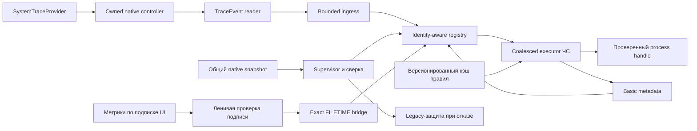

# Проверка реализации ETW для Startup Monitor 2.1.1

Дата: 6 ноября 2026 года. Проверяемая исходная база — commit `efac027` (`v2.1.0`) и локальные исправления для `2.1.1`. Основание требований — [ETW_IMPLEMENTATION_PLAN.md](ETW_IMPLEMENTATION_PLAN.md). Этот отчёт различает реализованное поведение, подтверждённые проверки и длительные измерения, которые нельзя заменить коротким тестом.

## Результат проверки исходной реализации

Коммит `efac027` добавил native-контроллер, consumer, очередь, реестр и заготовленную логику правил, но не завершал событийную защиту. `ProcessRuleEvaluator` не был подключён к автоматическому исполнению, `Healthy` выставлялся до подтверждённой начальной сверки, а часть отказов не удерживала резервный режим. Обнаружены также допуски времени при проверке PID, неполное слияние baseline, потеря информации о владении при неудачном STOP и пропуск подписи после попадания базовых метаданных в кэш.

В версии `2.1.1` рабочая цепочка имеет вид:



## Матрица требований и реализации

| Требование плана | Реализация 2.1.1 | Подтверждение |
| --- | --- | --- |
| Отдельная классическая SystemTraceProvider-сессия, без присвоения `NT Kernel Logger` | `NativeProcessTraceSession`, `SYSTEM_LOGGER_MODE | REAL_TIME`, флаг только Process, собственные имя и nonce GUID | ADR, проверки native layout/constants; реальный Start/Stop собственного зонда |
| Разделить контроллер и consumer | Контроллер использует `StartTraceW`/`ControlTraceW`; `EtwProcessReader` подключается через `ETWTraceEventSource` | Чтение кода; работающий зонд. `TraceEventSession.Stop()` не вызывается |
| Durable ownership до native start; безопасный partial failure и orphan cleanup | Intent lease до `StartTraceW`, atomic write с flush, точные PID/creation time/machine/name/GUID; неуспешный STOP сохраняет владение | Код проверен; успешная реальная очистка своей сессии проверена. Принудительные Win32-отказы каждой отдельной native-операции не эмулировались |
| Исключить thread-affine mutex через асинхронный lifetime | Машинный mutex сериализует создание и durable lease и освобождается на том же потоке; активного владельца защищает lease | Проверка native-контроллера и реальная штатная остановка consumer |
| Callback не выполняет IO/подписи/правила | Копирование собственных полей, bounded ingress, ограниченная диагностика ошибок разбора | `EtwProcessReader`, `LifecycleIngress`; тесты переполнения и parse diagnostics |
| Ограничения очереди по count/bytes и поколения сверки | `LifecycleIngress` резервирует байты симметрично, считает потери, сохраняет новые запросы resync при подтверждении старого поколения | `ProcessLifecycleTests` |
| Реестр отличает PID generation, opaque kernel key и creation FILETIME | `ProcessInstanceId`, отдельные authoritative creation time и timestamp события; повторный kernel key не считается достаточным доказательством | Тесты PID reuse, exact FILETIME и нового Start с прежним kernel key |
| Baseline не дублирует накопленный Start и не воскрешает завершившийся экземпляр | Watermark окончания снимка связывает ожидающий Start с исходной identity; stale Start/Stop/rundown и устаревший baseline проверяются по времени и tombstone | `ProcessLifecycleReconciliationRegressionTests` |
| Неполный/ошибочный snapshot не превращается в пустой live-набор | Общий bounded native reader сообщает ошибку NTSTATUS/границ; перечисление baseline материализуется до изменения реестра | Native snapshot tests и регрессия отказа перечислителя |
| Ограничения live/history/tombstone не скрывают деградацию | Жёсткие пределы; переполнение live выставляет `IsCapacityExceeded`, блокирует Healthy/отключение legacy до полной успешной сверки | Тест заполнения 32769 записей и тест немедленного возврата fallback |
| Ready handshake, начальная сверка и реальное здоровье | `onReady` после открытия consumer/подписок, native QUERY, baseline, liveness reader/reducer до `Healthy` | Supervisor failure tests; реальный зонд подтверждает готовность событиями sentinel-helper |
| Отказ источника — fallback и ограниченные повторы | Degraded, сохранение независимого legacy-прохода, retry 1/2/5/10/30 с, новая эпоха источника | Supervisor factory failure/cancel tests; проверка веток восстановления |
| Отдельная control-проверка при пустой ingress | Supervisor проверяет health/loss/resync независимо от появления нового data event | Структура health loop; тесты generation и переполнения |
| Сверка live-набора не «ремонтирует» утраченную историю | `HistoricalGapCount` не сбрасывается после успешной сверки | Проверка health/reconciliation кода |
| Один native parser для метрик и сверки | `ProcessMetricsTracker.ReadRawProcessEntries` и `CaptureLifecycleSnapshot`, один сериализованный владеющий буфер | `ProcessLifecycleSnapshotTests`: собственные PID/PPID/FILETIME, отмена и disposed; нет активации подписки/обогащения |
| Метрики остаются on-demand; PID reuse не переносит CPU/I/O | История keyed `(PID, StartTimeTicks)`, очистка по полным ключам; subscription ownership сохранён | Существующие метрики/подписки и snapshot-регрессии; полный набор проверяет оркестратор |
| Basic и SignatureChecked — разные стадии | Неизменяемые запросы metadata, очередь не меняет уже опубликованный DTO; Basic cache hit не пропускает Authenticode | `ProcessMetadataCompletionTests` |
| Late metadata не относится к новому PID | `ProcessMetadataUpdate` и `TryUpdateVerifiedMetadata`: только авторитетный exact FILETIME текущего поколения; no-op не создаёт цикл сигналов | Тесты позднего результата, неизвестного rundown и повторной доставки готовой подписи после baseline |
| Общая политика ЧС для legacy и ETW | Оба пути вызывают `ProcessRuleEvaluator`; сохраняются NotifyAndRemove + Path/PathWildcard и host/protected исключения | `ProcessRuleEvaluatorTests`, `ProcessBlacklistEnforcerTests` |
| Кэш правил не зависит от общей revision/рейтингов | `JsonDataStore.BlacklistRevision`, изолированный `GetBlacklistSnapshot`, сигнал после фиксации; executor обновляет policy cache по версии | `BlacklistSnapshotVersionTests` |
| Событийный catch-up до отключения старого прохода | `ProcessBlacklistEnforcer` обрабатывает текущие экземпляры, rule changes и resume; сигнал ёмкостью один означает полный catch-up, а не потерю process payload | Enforcer tests: initial live set, rule mutation, pause/resume, source resync |
| Проверка identity и правил непосредственно перед действием | Native FILETIME, удерживаемый handle, проверка текущей InstanceId, версии правил, pause/health перед Kill; failed Kill повторяется | Enforcer tests с управляемыми целями: смена PID, правил и pause во время открытия; отказ Kill |
| ETW и legacy не выполняют автоматические действия параллельно | Общий execution gate в `RunFallbackSweep`; повторная проверка pause/health внутри gate | Enforcer fallback tests; DI/Pipe интеграция |
| Legacy/Shadow/EtwPreferred и совместимость ручных действий | Legacy не создаёт ETW, Shadow не выполняет event Kill, Preferred отключает legacy только после успешного catch-up; явные ручные действия сохраняют отдельную семантику | Enforcer mode tests и supervisor Legacy test |
| Совместимые команды с усиленной identity | Optional expected FILETIME, capability старого сервиса по умолчанию false, новая UI/service-пара проверяет тот же handle; unknown identity не выдаётся за безопасную | `ProcessInstanceCommandGuardTests`, UI identity tests и полный прогон оркестратора |

## Осознанное ленивое обогащение

Служба не проверяет Authenticode всех процессов постоянно в фоне. Это создало бы ненужную файловую и криптографическую нагрузку при закрытом диспетчере задач.

При необходимости оценки правила событийный executor получает путь и точный FILETIME на удерживаемом process handle и записывает Basic-стадию в registry только для текущей InstanceId. Полная подпись вычисляется существующим bounded worker при запросе метрик. Worker публикует собственный `ProcessMetadataUpdate`; DI bridge принимает его только для уже авторитетного точного FILETIME. Повторный cache hit доставляет готовый результат, если первая проверка успела завершиться раньше baseline. Неизменившийся результат не повышает revision и не запускает новый цикл исполнения ЧС.

Такой поток сохраняет логику path-only правил, полноценное отложенное обогащение и низкую фоновую нагрузку. Он не является синхронным запретом создания процесса: короткий процесс может завершиться раньше реакции executor.

## Проверки и свидетельства

6 ноября 2026 года выполнено:

```powershell
dotnet test tests\StartupMonitor.Tests\StartupMonitor.Tests.csproj -c Release --nologo --no-restore `
  -p:ExcludePublishToSMon=true `
  --filter "FullyQualifiedName~ProcessLifecycle|FullyQualifiedName~ProcessBlacklistEnforcer|FullyQualifiedName~ProcessMetadata|FullyQualifiedName~NativeProcessTraceSession|FullyQualifiedName~ProcessRuleEvaluator|FullyQualifiedName~ProcessInstanceCommandGuard" `
  --logger "trx;LogFileName=etw-closure-final.trx" `
  --results-directory out\release-verification-20261106-2.1.1
```

Результат: **104 passed, 0 failed, 0 skipped**. Shared, Service, UI и Tests собрались без предупреждений и ошибок. Свидетельство: `out/release-verification-20261106-2.1.1/etw-closure-final.trx`.

В старом тесте «duplicate Start» исправлена некорректная предпосылка: повтор доставки теперь сохраняет QPC/OccurredUtc и меняет только sequence приёма. Отдельная регрессия подтверждает новое поколение для нового timestamp при прежнем kernel key; production-логика не получила искусственного допуска времени ради прохождения теста.

Ранее, 5 ноября, реальный зонд получил **8/8 пар Start/Stop**, `IngressDropped=0`, `ParseFailures=0`, native lost counters — ноль. Штатная отмена завершила consumer, последующий `logman query` подтвердил отсутствие собственной сессии; служба была восстановлена в Running. Артефакты: `out/verification-20261105-firewall-etw/etw-probe-8.json`, `.log`, `etw-probe-after-query.log`. Последний native-прогон и фактический запуск релизных бинарников проверяет оркестратор отдельно от этого локального чистого набора.

Dependency audit оркестратора: закреплён TraceEvent `4.0.0`; `out/release-verification-20261106-2.1.1/dependency-audit.json` не содержит известных уязвимых пакетов по использованному NuGet feed. Это результат проверки конкретного дерева зависимостей и базы предупреждений на момент запуска, а не бессрочная гарантия.

### Отказ доступа к защищённым процессам при реальном запуске

При установленной сборке обнаружен отдельный дефект executor ЧС: первичное обращение к `Process.Handle` запрашивало `ALL_ACCESS` ещё до совпадения правила. Маска `*teams*` потенциально совпадает с каталогом любого образа, поэтому фильтр имени обоснованно пропускал процессы к чтению пути. У защищённых процессов Windows возникал `Win32Exception(5)`, повторявшийся каждую секунду и удерживавший legacy fallback. Это ошибка запроса прав и повторов executor, а не доказательство потери событий ETW.

Исправление разделяет чтение и действие. Первичный удерживаемый `SafeProcessHandle` запрашивает только `PROCESS_QUERY_LIMITED_INFORMATION | SYNCHRONIZE`: путь и FILETIME читаются без прав завершения, а нулевой `WaitForSingleObject` точно распознаёт завершение, включая настоящий код выхода 259. `GetProcessTimes` не используется как единственное доказательство выхода: Microsoft документирует неопределённое содержимое exit time работающего процесса. Основание: [права процесса](https://learn.microsoft.com/en-us/windows/win32/procthread/process-security-and-access-rights), [GetProcessTimes](https://learn.microsoft.com/en-us/windows/win32/api/processthreadsapi/nf-processthreadsapi-getprocesstimes), [QueryFullProcessImageNameW](https://learn.microsoft.com/en-us/windows/win32/api/winbase/nf-winbase-queryfullprocessimagenamew).

Только после совпадения политики открывается action handle с `TERMINATE | QUERY_LIMITED_INFORMATION | SYNCHRONIZE`, и точный FILETIME повторно проверяется на том дескрипторе, к которому применяется `TerminateProcess`. Для сохранения завершения дерева один bounded native-снимок перечисляет потомков: учитываются PPID, время создания, удерживаемые handles и exact FILETIME. Ошибка снимка возникает до первого завершения; исчезнувший или заменённый PID ребёнка исключается из действия.

Ожидаемый запрет чтения PPL при отсутствии совпадения с доступными данными оценивается по общей unknown-path политике legacy/ETW. Метаданные остаются `Unknown`; смена метаданных, правил или resume повторяет оценку. Подтверждённое совпадение, которое невозможно проверить или завершить, сохраняет fallback и повторяется с задержкой 1/2/4/8/16/30 секунд. Предупреждение записывается при первом отказе или смене его причины, одинаковые повторы — на Debug. Ошибка Kill не выдаётся за успешное действие и не попадает в постоянный dedup.

Профильный прогон после исправления: **92 passed, 0 failed, 0 skipped**, сборка без предупреждений и ошибок; артефакт `out/release-verification-20261106-2.1.1/etw-enforcer-runtime-fix.trx`. Он включает реальные чтение собственного PID, завершение собственного временного процесса и его потомка, отсутствие действия при ошибке снимка, распознавание выхода 259, пропуск исчезнувшего PID и сохранение постороннего экземпляра при несовпадении FILETIME потомка. Управляемые проверки подтверждают отсутствие повторного открытия/предупреждений для несовпавшего PPL, backoff и восстановление после отказа, немедленную переоценку при смене правил и сохранение `Unknown` при недоступном пути. Финальную проверку установленной службы в `EtwPreferred` и чистоту новых логов оркестратор выполняет отдельно; этот профильный прогон её не подменяет.

## Границы выводов

- Профильные 104 теста не заменяют полный solution test run, проверку установщика, installed-copy hashes и личную проверку свежих Service/UI логов. Эти результаты фиксируются в общем отчёте выпуска.
- Короткий успешный native-сценарий не доказывает отсутствие потерь при любой нагрузке. После потерь live-набор восстанавливается, а исторический gap сохраняется.
- Завершённого 24–48-часового прогона новой версии этот отчёт не заявляет. Его нельзя вывести из ранее запущенного наблюдателя другой сборки или из unit-тестов.
- Сопоставимые CPU/p95/p99, рост ресурсов, аппаратные конфигурации, изменение системного времени и сосуществование с реальными активными WPR/PerfView требуют отдельных измерений. Ограничения хранения ограничивают память, но не являются доказательством нулевых утечек.
- TTL истории/tombstone использует UTC и жёсткие пределы ёмкости. Отдельный внедряемый `TimeProvider` и политика переоценки подписи после изменения файла на диске не включены в этот diff; это не разрешает выдавать старую подпись нового файла за новую проверку.
- Старые PID-only клиенты сохраняют совместимость и не получают гарантии защиты от same-name PID reuse. Гарантия усиленных команд относится к новой паре клиента и службы с явным capability и expected FILETIME.

Завершён рабочий функциональный путь ETW и событийной реакции существующих правил с безопасным fallback. Утверждение о полном прохождении всех нагрузочных и длительных release gates исходного плана допустимо только после соответствующих завершённых измерений.
