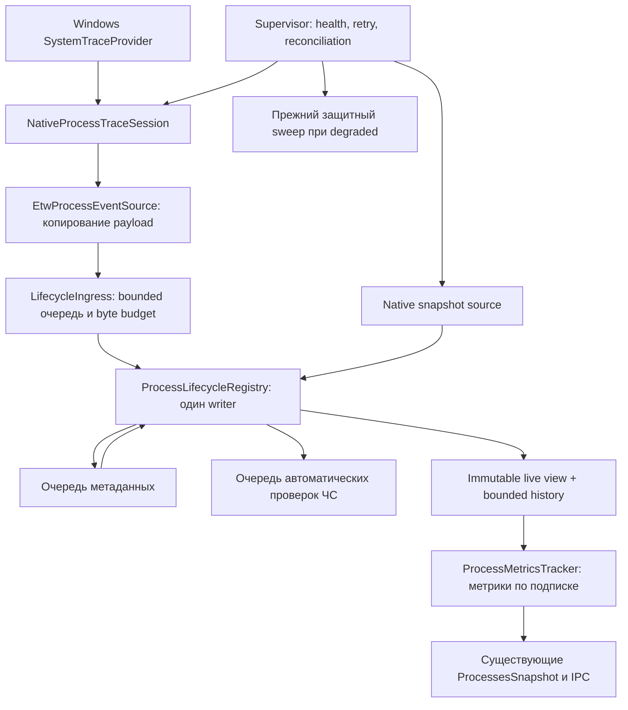

# План внедрения ETW в Startup Monitor: задание для ИИ-разработчика

Дата: **4 ноября 2026 года**. Исходная проверенная версия: **2.0.14**, commit `f3dd7f917772ce2923c56be3d00752d46175d6c6`.

**Статус: проект реализации, а не описание уже работающего ETW.** Документ не разрешает считать будущие компоненты реализованными или тесты пройденными. Требуется внедрить каждый этап, проверить его и сохранить свидетельства. Фрагменты ниже показывают отдельные контракты и алгоритмы; они не заменяют полный native-контроллер, reducer, supervisor и интеграционную приёмку.

## 1. Инструкция исполнителю

1. Прочитать корневой `AGENTS.md`, этот документ и текущие версии целевых файлов. При расхождении исходников с указанными строками ориентироваться на символы и фактическое поведение.
2. Перед каждой правкой дать микро-план: локализация → минимальное изменение → проверка. Не переписывать целиком `PipeServer`, `ProcessMetricsTracker` или UI.
3. Сначала реализовать контролируемый источник событий и чистую модель состояния. Затем подключить реальные ETW-события, метрики, правила и UI.
4. Не оставлять заглушки, фиктивные данные, пустые обработчики исключений и незавершённые production-ветки. Интерфейсы в этом документе — контракты для настоящих реализаций.
5. Новые и изменённые C#-блоки документировать XML-комментариями на русском. Имена типов и членов оставлять английскими.
6. До подтверждения корректности ETW сохранять существующий путь защиты. Для документа и экспериментальной компиляции не менять установленное приложение.
7. Не внедрять одновременно сетевой ETW, CPU sampling, context switches, загрузку DLL, SIEM и новый AI-детектор. Первый выпуск — жизненный цикл процессов и безопасная интеграция существующих правил.
8. Создать отдельную рабочую ветку. Не создавать релиз/тег и не обновлять установщик со старым опубликованным номером. Для функционального ETW-выпуска выбрать новую minor-версию после проверки актуальных тегов и Releases; `2.0.14` повторно не использовать.

## 2. Что существует сейчас

| Область | Реальное поведение | Точки чтения/изменения |
|---|---|---|
| Метрики процессов | Общий `NtQuerySystemInformation(SystemProcessInformation)`, каждые 2000 мс при наличии подписчиков; разовый `CaptureSnapshot()` доступен независимо | `src/StartupMonitor.Service/Services/ProcessMetricsTracker.cs`: `Subscribe`, `Unsubscribe`, `CollectSnapshotCore`, `Dispose` |
| CPU/I/O | Дельты накопленных счётчиков между снимками; история сейчас только по PID | Там же: `_history`, `ProcessMetricHistory`, блок расчёта дельт |
| Метаданные | Кэш `(PID, StartTimeTicks)`, очередь с изменяемым `ProcessInfo`, разрешение пути и CLI-анализ, фоновая проверка подписи | `Services/ProcessMetadataEnricher.cs`: `EnrichOrQueue`, `ProcessEnrichmentLoopAsync`, `PruneDeadProcesses` |
| Автозапуск | Независимые watcher-ы реестра, папок, служб, планировщика, WMI; индекс связи с запущенными процессами | `Services/*Watcher.cs`, `ProcessStartupLinker.UpdateIndex/LinkProcess` |
| Автоматическая проверка ЧС | Первый проход через 5 с; затем каждые 10 с при активных kill-правилах, 5 мин без них. При pause проход пропускается | `Pipe/PipeServer.cs`: `BackgroundCleanupLoop`; `EntryOperations.HasActiveKillRules/KillProcessesByRules` |
| Ручное применение ЧС | Добавление правила и блокировка из диспетчера вызывают `ReapplyBlacklist`; это отдельное явное действие | `PipeServer`: `AddToBlacklist`, `RemoveFromBlacklist`, ветка блокировки процесса, `ReapplyBlacklist` |
| Командный IPC | `StartupMonitor`: `GetProcesses`, `SubscribeProcessMetrics`, `UnsubscribeProcessMetrics` | `Shared/Models/PipeMessage.cs`, `PipeServer.HandleClientAsync`, UI `PipeClient` |
| Push IPC | `SnapshotReady` → `NotificationService` → батч примерно 200 мс → `EventPipeServer` → `StartupMonitorEvents` | `PipeServer` constructor, `NotificationService`, `Pipe/EventPipeServer`, UI `PipeClient.ProcessSnapshotReceived` |
| UI | Снимки объединяются по PID; подписка при открытии вкладки, отписка при деактивации/закрытии | `UI/ViewModels/TaskManagerViewModel.cs`: `_processMap`, `ActivateAsync`, `DeactivateAsync`, `UpdateSnapshot` |
| DI | `ProcessMetricsTracker`, `ProcessMetadataEnricher`, `ProcessStartupLinker` — singleton; `ProcessNetworkTracker` общий для нескольких служб | `src/StartupMonitor.Service/Program.cs` |

**Не путать три разных механизма:** Windows ETW, диагностический .NET EventPipe и наш `EventPipeServer`. Последний — обычный broadcaster именованного канала. Его название не означает, что ETW уже внедрён.

### 2.1. Обнаруженные риски, обязательные к устранению при интеграции

- В `ProcessMetricsTracker` `_history` индексируется только PID. PID может быть повторно использован между двумя снимками; новый процесс не должен наследовать CPU/I/O старого.
- Сейчас `EnrichOrQueue(info, ...)` вызывается до назначения `info.StartTime`. Очередь содержит изменяемый объект, поэтому identity зависит от гонки.
- **Одной перестановки этих двух строк недостаточно.** `EnrichOrQueue` может положить частичные метаданные в кэш, а worker при любом cache hit делает `continue` и пропускает Authenticode. При совпадении ключей после исправления порядка это может стать устойчивой регрессией. Нужен явный статус полноты метаданных и отдельная проверка завершённой подписи.
- UI `_processMap` по PID может сохранять имя, издателя, флаги, дерево и выбор от прежнего процесса.
- `JsonDataStore.Load()` глубоко клонирует конфигурацию. Нельзя вызывать его на каждое ETW-событие. Общая `Revision` меняется также из-за истории/снимков и не является версией чёрного списка.
- Нынешние уведомления и push IPC допускают отбрасывание сообщений. Они не подходят для хранения гарантированной истории lifecycle.

## 3. Цель и границы первого выпуска

Служба постоянно получает события начала/завершения процессов независимо от открытой вкладки UI, поддерживает согласованный реестр экземпляров процессов и запускает существующую автоматическую реакцию на активные правила ЧС через отдельную очередь. CPU/RAM/I/O продолжают измеряться по запросу подписчиков. Начальный снимок и контрольная сверка остаются необходимыми.

Успех означает:

- короткий процесс, полностью завершившийся между двумя UI-снимками, наблюдается в lifecycle-истории в проверенном сценарии;
- процесс с повторно использованным PID получает новую identity;
- потеря событий/переполнение явно отражаются в диагностике и вызывают восстановление согласованности;
- отказ ETW не отключает прежний путь защиты и не завершает SCM-службу из-за необработанного исключения BackgroundService;
- безопасность существующих правил, pause, ручные операции и контракт IPC сохранены;
- потребление ресурсов и задержки измерены, а не выведены из факта использования ETW.

**Не обещать:** 0.00% CPU, гарантированную доставку за <1 мс, отсутствие любых потерь, перехват процесса до исполнения первой инструкции, полную замену всех watcher-ов. ETW сообщает о событии и использует буферы; асинхронная реакция на `ProcessStart` не является синхронным запретом создания процесса. [Механизм ETW](https://learn.microsoft.com/en-us/windows/win32/etw/about-event-tracing), [доставка real-time](https://learn.microsoft.com/en-us/windows/win32/etw/logging-mode-constants).

## 4. Архитектурное решение и зависимость

### 4.1. Разделить Windows-контроллер и .NET consumer

Рекомендуемый production-вариант:

1. `NativeProcessTraceSession` владеет **собственной именованной SystemTraceProvider-сессией** через `StartTraceW`/`ControlTraceW`.
2. `ETWTraceEventSource` из `Microsoft.Diagnostics.Tracing.TraceEvent` читает эту сессию.
3. `KernelTraceEventParser` разбирает классические process-события.

Это осознанное уточнение `docs/ROADMAP.md`: там назван manifest-провайдер `Microsoft-Windows-Kernel-Process`. Он отличается от классического SystemTraceProvider. Нельзя включить `EnableProvider("Microsoft-Windows-Kernel-Process")`, а затем ожидать соответствующие события в `.Kernel.ProcessStart`. Для manifest-варианта нужны свой parser/schema и отдельная проверка payload/keywords. Не смешивать варианты внутри одного адаптера.

Для текущей поддержки Windows 10 1809+ выбрать описанный классический вариант и записать ADR в PR. Если решено строго сохранить manifest-провайдер из roadmap, до дальнейших этапов переписать соответствующий ADR, адаптер и тесты; остальная модель identity/очередей/сверок сохраняется.

### 4.2. Почему не копировать короткий пример TraceEventSession без проверки

Исходники **TraceEvent 4.0.0** содержат важные особенности: `EnableKernelProvider(Process)` добавляет Thread-события; раннее обращение к `Source` может активировать сессию; стандартное создание допускает restart существующей сессии. После неудачного создания cleanup по имени опасен, а `IsActive == false` не доказывает отсутствие частично созданного native-ресурса. Кроме того, `TraceEventSession.Stop()` затрагивает глобальный интервал CPU sampling. Поэтому production-контроллер должен явно владеть native handle и останавливать только собственную сессию, не используя этот lifecycle-helper. [Закреплённый исходник TraceEventSession](https://github.com/microsoft/perfview/blob/v4.0.0/src/TraceEvent/TraceEventSession.cs).

### 4.3. Пакет и совместимость

На дату документа NuGet содержит **4.0.0**; фрагменты consumer проверять именно против неё. Это кандидат, а не разрешение молча обновить все зависимости приложения. До подключения в Service снять и сравнить дерево пакетов: 4.0.0 привносит более новые `System.Text.Json`, `Collections.Immutable`, `Reflection.Metadata`, `Microsoft.Diagnostics.NETCore.Client` и минимум `Logging.Abstractions 8.0.3`. Проверить net8.0, WPF, JSON IPC, self-contained/single-file и лицензии/известные уязвимости доступными средствами.

Если dependency-spike не проходит, выбрать и закрепить совместимую версию, затем повторно проверить API/исходники и перекомпилировать примеры. Не оставлять floating version и не утверждать, что исходники `main` совпадают с выбранным NuGet. [NuGet](https://www.nuget.org/packages/Microsoft.Diagnostics.Tracing.TraceEvent/4.0.0), [индекс версий](https://api.nuget.org/v3-flatcontainer/microsoft.diagnostics.tracing.traceevent/index.json).

## 5. Поток данных и владельцы



| Компонент / будущий файл в `Service/Services/ProcessLifecycle/` | Ответственность |
|---|---|
| `NativeProcessTraceSession.cs` | Создание, владение, native loss stats, остановка, восстановление только своей orphan-сессии |
| `EtwProcessEventSource.cs` | Consumer thread, копирование полей; без диска, хеширования, WMI, правил и IPC в callback |
| `ProcessLifecycleContracts.cs` | Immutable raw-события, внутренние identity, health и snapshot-контракты |
| `LifecycleIngress.cs` | Ограничения по числу и оценочному размеру, отдельный счётчик локальных потерь, resync generation |
| `ProcessLifecycleRegistry.cs` | Один writer, идемпотентные переходы, поколения PID, bounded tombstones/history, immutable чтение |
| `NativeProcessSnapshotSource.cs` | Авторитетный снимок с PID, creation FILETIME и накопленными счётчиками; отмена и явная ошибка снимка |
| `ProcessLifecycleSupervisor.cs` | Hosted lifecycle, baseline, восстановление, backoff, fallback и остановка всех worker-ов |
| `ProcessRuleEvaluator.cs` | Общая проверенная логика matching; различает автоматическую реакцию и явную ручную операцию |

Не дублировать нативный разбор в двух файлах: сначала извлечь существующий reader из `ProcessMetricsTracker` в snapshot source, сохранив один владеющий буфером объект и сериализацию доступа. Снимок для reconciliation может не выполнять network/service-map/enrichment. Использовать один DI-экземпляр registry, source, enricher и общего network tracker; не создавать дополнительные singleton-ы через параллельные `AddHostedService<T>()` и `new T()`.

## 6. Контракты identity и времени

Ни PID, ни `UniqueProcessKey` по отдельности не являются долговечной identity. `UniqueProcessKey` — непрозрачный kernel key, а не FILETIME; значение может отсутствовать и повторно использоваться. Время ETW-события нельзя подставлять вместо авторитетного времени создания процесса. Rundown имеет время перечисления, а не рождения процесса.

Внутренняя identity: `(MonitorEpoch, PID, Generation)`, где generation выдаёт только registry. Авторитетный `CreationFileTimeUtc` хранить отдельно, когда он известен из snapshot/проверенного process handle. `SourceEpoch` меняется при каждом восстановлении ETW; surviving process после сверки может сохранить свою identity. Raw QPC сравнивать только после проверки общего источника часов и внутри одного boot; UTC использовать для отображения. Скорости/TTL/backoff измерять монотонными часами.

### Фрагмент A — контракты (самостоятельный C#-файл)

```csharp
using System;

namespace StartupMonitor.Service.Services.ProcessLifecycle;

/// <summary>Различает реальное рождение, реальное завершение и перечисление существующего процесса.</summary>
public enum LifecycleEventKind { Started, Stopped, Rundown }

/// <summary>Идентифицирует экземпляр процесса внутри одного запуска реестра.</summary>
/// <param name="MonitorEpoch">Эпоха реестра, общая для его worker-ов.</param>
/// <param name="ProcessId">PID процесса; сам по себе не уникален во времени.</param>
/// <param name="Generation">Положительное поколение, назначенное единственным writer.</param>
public readonly record struct ProcessInstanceId(Guid MonitorEpoch, int ProcessId, long Generation);

/// <summary>Передаёт собственную копию полей ETW без ссылки на переиспользуемый TraceEvent.</summary>
/// <param name="SourceEpoch">Эпоха конкретного подключения к ETW.</param>
/// <param name="Sequence">Порядок приёма callback; не доказательство порядка возникновения событий.</param>
/// <param name="Kind">Тип изменения жизненного цикла.</param>
/// <param name="ProcessId">PID из декодированного payload.</param>
/// <param name="ParentProcessId">PID родителя; поколение родителя определяется отдельно.</param>
/// <param name="KernelKey">Непрозрачный ключ ядра; ноль означает отсутствие.</param>
/// <param name="OccurredQpc">Исходная монотонная метка события.</param>
/// <param name="OccurredUtc">Время события в UTC для отображения и истории.</param>
/// <param name="ImageName">Имя образа; полный достоверный путь не гарантирован.</param>
/// <param name="CommandLine">Скопированная командная строка; может быть пустой и содержать секреты.</param>
public sealed record ProcessLifecycleEvent(
    Guid SourceEpoch, long Sequence, LifecycleEventKind Kind,
    int ProcessId, int ParentProcessId, ulong KernelKey,
    long OccurredQpc, DateTime OccurredUtc, string ImageName, string CommandLine);

/// <summary>Содержит ограниченную диагностику ошибки разбора без удержания exception/payload/секретной строки.</summary>
/// <param name="SourceEpoch">Эпоха источника ошибки.</param>
/// <param name="Kind">Вид декодируемого события.</param>
/// <param name="ExceptionType">Имя типа исключения без его Message/Data.</param>
/// <param name="ErrorCode">Числовой HResult для диагностики класса отказа.</param>
public sealed record ParseFailureDiagnostic(Guid SourceEpoch, LifecycleEventKind Kind,
    string ExceptionType, int ErrorCode);

/// <summary>Обозначает проверенное native-владение уже запущенной сессией.</summary>
/// <remarks>Реализация хранит успешный StartTrace handle; чужая сессия никогда не выдаётся через этот контракт.</remarks>
public interface IOwnedProcessTraceSession : IDisposable
{
    /// <summary>Описательное имя собственной сессии для подключения consumer.</summary>
    string Name { get; }

    /// <summary>Идемпотентно останавливает собственный native handle, не меняя глобальные sampling-настройки.</summary>
    void Stop();
}
```

Границы валидировать в реальных конструкторах/adapter: не принимать пустую epoch, PID < 0, generation/sequence <= 0; не превращать ошибочный timestamp в «процесс родился сейчас». PID 0 не показывать как обычное приложение. Ошибки полей учитывать как degraded, не падать всей службой.

## 7. Native-сессия: обязательный алгоритм владения

Применять документированный SystemTraceProvider-режим Windows 8+ с собственным именем, **не захватывать `NT Kernel Logger`**. Параметры: `EVENT_TRACE_SYSTEM_LOGGER_MODE | EVENT_TRACE_REAL_TIME_MODE`, `EnableFlags = EVENT_TRACE_FLAG_PROCESS`, `Wnode.Flags = WNODE_FLAG_TRACED_GUID (0x00020000)`, `Wnode.ClientContext = 1` (QPC), начальный `FlushTimer = 1` секунда, `LogFileNameOffset = 0`. Собственный GUID сессии должен отличаться от `SystemTraceControlGuid`. Структуры/смещения сверить с Windows SDK для win-x64; поля размера выделенной структуры и размера одного ETW-буфера имеют разные единицы. [Настройка SystemTraceProvider](https://learn.microsoft.com/en-us/windows/win32/etw/configuring-and-starting-a-systemtraceprovider-session).

1. Использовать описательное стабильное имя, например `StartupMonitor.ProcessLifecycle`, и один machine-wide owner mutex с корректным ACL для SYSTEM/администраторов. Случайный `SourceEpoch` остаётся внутренним полем, а не способом создавать множество сессий.
2. Сначала проверить прежний lease/существующую сессию. Для нового создания атомарно записать intent-lease `Creating` с новым непредсказуемым SessionGuid, PID/creation time владельца и идентификатором продукта, затем передать этот SessionGuid в `Wnode.Guid`. Подготовить zeroed `EVENT_TRACE_PROPERTIES` с местом для строк, корректными `LoggerNameOffset/Wnode.BufferSize`; не угадывать P/Invoke packing.
3. Вызвать `StartTraceW`. Только `ERROR_SUCCESS` и полученный handle создают owned-token. Не использовать `GetLastWin32Error` вместо возвращённого ULONG status.
4. При `ERROR_ALREADY_EXISTS` не делать безусловный Stop по имени. Проверить lease прошлого владельца, его PID **и время создания**, точный SessionGuid из native QUERY, параметры сессии и отсутствие живого владельца. Только подтверждённую orphan-сессию нашего компонента можно остановить. Неоднозначность → degraded + прежняя защита + диагностическая ошибка. Не перезаписывать прежний lease новым intent до завершения этой проверки.
5. Lease хранить атомарно в защищённом ProgramData-каталоге; после успешного StartTrace перевести `Creating` в `Active`. Intent перед созданием закрывает crash-окно до записи `Active`: native GUID должен совпасть именно с nonce прежнего intent, а не только с общим GUID продукта. Один префикс имени или известный product GUID не доказывает владения. Отсутствие подтверждённого native-ресурса после неуспешного create разрешает удалить только собственный intent.
6. Любой отказ после успешного StartTrace освобождает **свой полученный handle** в `finally`. Отказ до успешного создания не запускает cleanup чужой сессии.
7. Остановка: `ControlTraceW(ownedHandle, null, properties, EVENT_TRACE_CONTROL_STOP)`; обрабатывать фактический status и повторную остановку. Не применять массовый Stop ко всем ETW-сессиям и не изменять лимиты ETW/реестр системы.
8. QUERY/STOP используют корректно инициализированные properties buffers и сериализацию native-вызовов. Не освобождать буфер одновременно с запросом/остановкой. Отдельный query-buffer предпочтительнее изменения общего start-buffer.
9. Consumer `Process()` работает на выделенном worker, который supervisor обязательно наблюдает и ожидает. Shutdown: запретить новую работу → остановить native session/закрыть consumer → дождаться reader → завершить ingress → отменить/drain worker-ы по выбранной политике → освободить native память/mutex/lease.
10. Тайм-аут остановки — отдельная ошибка. Не начинать вторую сессию, пока прежний reader/владелец не подтверждены завершёнными. Ошибка ETW не должна через необработанный `BackgroundService` выключать работающую защиту.

Статусы STOP не сводить к одному `status != 0`: `ERROR_MORE_DATA` может быть возвращён уже после остановки сессии; `ERROR_ACTIVE_CONNECTIONS` требует завершения/подтверждения остановки; `ERROR_WMI_INSTANCE_NOT_FOUND` означает отсутствие указанного ресурса. Сверить значения с целевым SDK и записать unit/native тесты. Не повторять STOP вслепую по устаревшему handle. Owned-controller хранит состояние подтверждённой остановки и последнюю ошибку; callback-лог и `OperationCanceledException` consumer не означают, что native-сессия исчезла. Owner выполняет финальный cleanup/QUERY и сохраняет lease при неподтверждённом Stop; такой shutdown нельзя объявить чистым `Stopped`.

Проверить lifecycle и разрешения на Windows 10 1809 и Windows 11. Если минимально поддерживаемая ОС фактически иная, сначала согласовать это с README/installer и тестами. UI не должен получать административные права ради ETW: ресурс принадлежит службе. [StartTraceW](https://learn.microsoft.com/en-us/windows/win32/api/evntrace/nf-evntrace-starttracew), [ControlTraceW](https://learn.microsoft.com/en-us/windows/win32/api/evntrace/nf-evntrace-controltracew).

## 8. Очередь, потери и generation сверки

Callback не ждёт свободного места: `FullMode.Wait` + `TryWrite`. `DropOldest/DropWrite` без отдельного учёта запрещены: успешный `TryWrite` в dropping-режиме не доказывает сохранение каждого события.

Начальные ориентиры для эксперимента: 4096 сообщений, бюджет удерживаемых payload около 8 MiB, ETW-буферы 4–16 MiB. Это **настройки для проверки**, а не гарантированный размер процесса. Нужны ограничения строк, history/tombstones, metadata/rule очередей и всех вспомогательных словарей; лимит количества элементов один не ограничивает объём длинных командных строк.

Счётчики разделить: native `EventsLost`, `RealTimeBuffersLost`, локальные rejected/overflow, parse failures. Рост loss-counter переводит качество в degraded. Штатные history retention/evictions считать отдельно: это сдвиг объявленного окна доступной истории, а не повод бесконечно переснимать live-набор. Сверка исправляет текущий live-набор, но не восстанавливает пропущенную историю коротких процессов.

### Фрагмент B — bounded ingress и запросы сверки

```csharp
using System;
using System.Threading;
using System.Threading.Channels;
using System.Threading.Tasks;

namespace StartupMonitor.Service.Services.ProcessLifecycle;

/// <summary>Ограничивает приём событий и сохраняет запросы сверки, поступившие во время предыдущей сверки.</summary>
public sealed class LifecycleIngress
{
    private readonly Channel<QueuedEvent> _channel;
    private readonly long _byteBudget;
    private long _retainedBytes;
    private long _dropped;
    private long _requested;
    private long _completed;
    private long _parseFailures;
    private ParseFailureDiagnostic? _lastParseFailure;
    private int _closed;

    /// <summary>Хранит оценочную стоимость вместе с событием для симметричного освобождения бюджета.</summary>
    private readonly record struct QueuedEvent(ProcessLifecycleEvent Event, long Cost);

    /// <summary>Создаёт очередь с одним reader и явными ограничениями удерживаемых данных.</summary>
    /// <param name="capacity">Максимальное число ожидающих событий.</param>
    /// <param name="byteBudget">Оценочный бюджет строк и служебных данных, не размер всего managed heap.</param>
    public LifecycleIngress(int capacity = 4096, long byteBudget = 8 * 1024 * 1024)
    {
        if (capacity <= 0) throw new ArgumentOutOfRangeException(nameof(capacity));
        if (byteBudget < 256) throw new ArgumentOutOfRangeException(nameof(byteBudget));
        _byteBudget = byteBudget;
        _channel = Channel.CreateBounded<QueuedEvent>(new BoundedChannelOptions(capacity)
        {
            SingleReader = true, SingleWriter = false, FullMode = BoundedChannelFullMode.Wait,
            AllowSynchronousContinuations = false
        });
    }

    /// <summary>Возвращает число отказов приёма во время работы; завершение источника учитывается отдельно.</summary>
    public long Dropped => Interlocked.Read(ref _dropped);

    /// <summary>Возвращает оценку зарезервированных и ожидающих payload-байтов.</summary>
    public long RetainedBytes => Interlocked.Read(ref _retainedBytes);

    /// <summary>Возвращает число ошибок разбора без синхронной записи журнала из callback.</summary>
    public long ParseFailures => Interlocked.Read(ref _parseFailures);

    /// <summary>Сохраняет одну coalesced-диагностику; supervisor журналирует её вне callback с ограничением частоты.</summary>
    /// <param name="exception">Ошибка разбора; сам объект и его Message/Data не сохраняются.</param>
    /// <param name="kind">Вид события.</param>
    /// <param name="sourceEpoch">Эпоха источника.</param>
    public void ReportParseFailure(Exception exception, LifecycleEventKind kind, Guid sourceEpoch)
    {
        ArgumentNullException.ThrowIfNull(exception);
        Interlocked.Increment(ref _parseFailures);
        Interlocked.Exchange(ref _lastParseFailure, new ParseFailureDiagnostic(sourceEpoch, kind,
            exception.GetType().FullName ?? exception.GetType().Name, exception.HResult));
        RequestReconciliation();
    }

    /// <summary>Забирает последнюю coalesced-диагностику для ограниченного журналирования вне callback.</summary>
    /// <returns>Диагностика либо null при отсутствии новых ошибок.</returns>
    public ParseFailureDiagnostic? TakeParseFailureDiagnostic() =>
        Interlocked.Exchange(ref _lastParseFailure, null);

    /// <summary>Возвращает generation, которую должна покрыть следующая успешная сверка.</summary>
    public long RequestedReconciliation => Interlocked.Read(ref _requested);

    /// <summary>Показывает, остался ли запрос после последнего успешного commit сверки.</summary>
    public bool NeedsReconciliation => RequestedReconciliation > Interlocked.Read(ref _completed);

    /// <summary>Запрашивает восстановление согласованности без блокировки callback.</summary>
    /// <returns>Новая generation запроса.</returns>
    public long RequestReconciliation() => Interlocked.Increment(ref _requested);

    /// <summary>Подтверждает только захваченную generation; вызывать единственным writer после успешного merge.</summary>
    /// <param name="generation">Значение, захваченное до начала соответствующего снимка.</param>
    public void AcknowledgeReconciliation(long generation)
    {
        if (generation < 0 || generation > RequestedReconciliation)
            throw new ArgumentOutOfRangeException(nameof(generation));
        if (generation > Interlocked.Read(ref _completed))
            Interlocked.Exchange(ref _completed, generation);
    }

    /// <summary>Пытается принять собственную копию события; никогда не ожидает освобождения очереди.</summary>
    /// <param name="value">Проверенное immutable-событие текущего источника.</param>
    /// <returns>Истина только при сохранении события в очереди.</returns>
    public bool TryPublish(ProcessLifecycleEvent value)
    {
        ArgumentNullException.ThrowIfNull(value);
        ArgumentNullException.ThrowIfNull(value.ImageName);
        ArgumentNullException.ThrowIfNull(value.CommandLine);
        if (Volatile.Read(ref _closed) != 0) return false;
        var cost = 128L + 2L * (value.ImageName.Length + (long)value.CommandLine.Length);
        while (true)
        {
            var retained = Interlocked.Read(ref _retainedBytes);
            if (cost > _byteBudget - retained) return Reject();
            if (Interlocked.CompareExchange(ref _retainedBytes, retained + cost, retained) == retained)
                break;
        }
        if (_channel.Writer.TryWrite(new QueuedEvent(value, cost))) return true;
        Interlocked.Add(ref _retainedBytes, -cost);
        return Volatile.Read(ref _closed) == 0 && Reject();
    }

    /// <summary>Ожидает данные без периодического опроса пустой очереди.</summary>
    /// <param name="ct">Токен остановки worker.</param>
    /// <returns>Истина, если reader может продолжить чтение.</returns>
    public ValueTask<bool> WaitToReadAsync(CancellationToken ct) => _channel.Reader.WaitToReadAsync(ct);

    /// <summary>Извлекает событие и освобождает его очередь-бюджет; обработка выполняется вне очереди.</summary>
    /// <param name="value">Принятое событие либо null при отсутствии данных.</param>
    /// <returns>Истина при успешном извлечении.</returns>
    public bool TryRead(out ProcessLifecycleEvent? value)
    {
        if (!_channel.Reader.TryRead(out var queued)) { value = null; return false; }
        Interlocked.Add(ref _retainedBytes, -queued.Cost);
        value = queued.Event;
        return true;
    }

    /// <summary>Закрывает приём идемпотентно; owner затем явно drain-ит либо отбрасывает остаток с учётом потерь.</summary>
    public void Complete()
    {
        Interlocked.Exchange(ref _closed, 1);
        _channel.Writer.TryComplete();
    }

    /// <summary>Учитывает потерю и запрашивает сверку без логирования чувствительного payload.</summary>
    /// <returns>Ложь как результат непринятого события.</returns>
    private bool Reject()
    {
        Interlocked.Increment(ref _dropped);
        RequestReconciliation();
        return false;
    }
}
```

Это ingress для raw lifecycle, а не общая очередь любых действий. Baseline/health/control сообщения должны иметь отдельный гарантированно обслуживаемый управляющий путь и bounded single-flight снимок. **Сам счётчик `RequestReconciliation` никого не пробуждает.** Supervisor обязан проверять его независимо от data reader: coalesced control wake либо собственный отменяемый health tick максимум через 5 с, включая полностью пустую ingress. Первый oversized event может быть отклонён при пустой очереди; восстановление должно начаться без следующего принятого события. Не оставлять reducer навсегда на одном `WaitToReadAsync`, если нужен control commit. При ожидании нескольких каналов хранить/отменять pending waits, не накапливать проигравшие задачи `WhenAny`.

Нельзя ставить результат восстановления в ту же заполненную очередь и ждать, что он обязательно попадёт к reducer. В production дополнить high-watermark и диагностикой причин отказа. Parse-failure callback только обновляет bounded-диагностику и generation; supervisor вне callback читает её и журналирует тип/код/epoch/число ошибок с ограничением частоты. После извлечения события владение его памятью переходит worker; нельзя раздать ссылки неограниченному числу задач.

## 9. Consumer: копирование и завершение

`ProcessDCStart` — перечисление существующего процесса. `ProcessDCStop` — завершение rundown, **не реальный выход процесса**. Не подписывать общий `ProcessEndGroup` как безусловное удаление из live registry. `ImageFileName` может быть лишь именем; для path-правила проверяется достоверный путь текущего экземпляра. `TraceEvent` переиспользуется: в очередь передаются копии скаляров/строк. [Типы process payload](https://github.com/microsoft/perfview/blob/v4.0.0/src/TraceEvent/Parsers/KernelTraceEventParser.cs).

### Фрагмент C — reader уже успешно созданной owned-сессии

```csharp
using System;
using System.IO;
using System.Threading;
using Microsoft.Diagnostics.Tracing;
using Microsoft.Diagnostics.Tracing.Parsers.Kernel;
using Microsoft.Extensions.Logging;

namespace StartupMonitor.Service.Services.ProcessLifecycle;

/// <summary>Читает собственную запущенную native-сессию; создание и доказательство владения выполняет controller.</summary>
public static class EtwProcessReader
{
    /// <summary>Блокирующий reader для отдельного наблюдаемого worker, никогда не для UI/Host.StartAsync.</summary>
    /// <param name="session">Успешно созданная и активированная собственная native-сессия.</param>
    /// <param name="ingress">Ограниченный приёмник копий событий.</param>
    /// <param name="sourceEpoch">Новая эпоха для этого подключения consumer.</param>
    /// <param name="logger">Журнал без командных строк и полного payload.</param>
    /// <param name="ct">Токен остановки, отменяемый supervisor вне ETW callback.</param>
    public static void Run(IOwnedProcessTraceSession session, LifecycleIngress ingress,
        Guid sourceEpoch, ILogger logger, CancellationToken ct)
    {
        ArgumentNullException.ThrowIfNull(session);
        ArgumentNullException.ThrowIfNull(ingress);
        ArgumentNullException.ThrowIfNull(logger);
        ArgumentException.ThrowIfNullOrWhiteSpace(session.Name);
        if (sourceEpoch == Guid.Empty) throw new ArgumentException("Эпоха источника отсутствует.", nameof(sourceEpoch));
        ct.ThrowIfCancellationRequested();
        using var source = new ETWTraceEventSource(session.Name, TraceEventSourceType.Session);
        long sequence = 0;

        /// <summary>Копирует поля внутри callback; ошибки передаёт через bounded-диагностику без дискового logger.</summary>
        /// <param name="data">Переиспользуемый payload, действительный только в текущем callback.</param>
        /// <param name="kind">Вид изменения жизненного цикла.</param>
        void Publish(ProcessTraceData data, LifecycleEventKind kind)
        {
            if (ct.IsCancellationRequested) return;
            try
            {
                if (data.ProcessID < 0)
                    throw new InvalidDataException("ETW payload содержит отрицательный PID.");
                // Сырой QPC нужен только для проверяемого сопоставления native-снимка; API помечен Discouraged.
#pragma warning disable CS0618
                var eventQpc = data.TimeStampQPC;
#pragma warning restore CS0618
                var copied = new ProcessLifecycleEvent(sourceEpoch, Interlocked.Increment(ref sequence), kind,
                    data.ProcessID, data.ParentID, data.UniqueProcessKey, eventQpc,
                    data.TimeStamp.ToUniversalTime(), data.ImageFileName ?? string.Empty,
                    data.CommandLine ?? string.Empty);
                ingress.TryPublish(copied);
            }
            catch (Exception ex)
            {
                ingress.ReportParseFailure(ex, kind, sourceEpoch);
            }
        }

        Action<ProcessTraceData> onStart = data => Publish(data, LifecycleEventKind.Started);
        Action<ProcessTraceData> onStop = data => Publish(data, LifecycleEventKind.Stopped);
        Action<ProcessTraceData> onRundown = data => Publish(data, LifecycleEventKind.Rundown);
        source.Kernel.ProcessStart += onStart;
        source.Kernel.ProcessStop += onStop;
        source.Kernel.ProcessDCStart += onRundown;

        // Остановка собственной native-сессии разблокирует ожидание; один StopProcessing() этого не гарантирует.
        using var registration = ct.Register(() =>
        {
            try { session.Stop(); }
            catch (Exception ex) { logger.LogError(ex, "Не удалось остановить собственную ETW-сессию {Session}", session.Name); }
            finally
            {
                try { source.Dispose(); }
                catch (Exception ex) { logger.LogError(ex, "Не удалось закрыть ETW consumer {Session}", session.Name); }
            }
        });
        try
        {
            source.Process();
            ct.ThrowIfCancellationRequested();
            throw new IOException("ETW consumer завершился без запроса остановки; требуется восстановление.");
        }
        catch (Exception ex) when (ct.IsCancellationRequested)
        {
            logger.LogDebug(ex, "ETW consumer остановлен по запросу");
            throw new OperationCanceledException("Чтение ETW отменено.", ex, ct);
        }
        finally
        {
            source.Kernel.ProcessStart -= onStart;
            source.Kernel.ProcessStop -= onStop;
            source.Kernel.ProcessDCStart -= onRundown;
        }
    }
}
```

Owner вызывает этот метод на dedicated worker и освобождает `IOwnedProcessTraceSession` в своём `finally`. Отмена callback не заменяет наблюдение задачи и shutdown-timeout. Stop/Dispose ошибки сохраняет controller и проверяет supervisor после reader: обычный OCE не скрывает неудачную native-остановку. До перехода в healthy дополнить handshake: consumer открыт и обработчики зарегистрированы, источник активен, baseline слит, выполнен успешный native loss QUERY до/после bootstrap. Отсутствие requested resync до первого QUERY не означает отсутствия потерь. Факт создания `Task` не означает Ready. Реальный native shutdown и поведение concurrent Dispose требуют Windows integration-проверки, компиляция их не доказывает.

## 10. Реестр, baseline и reconciliation

### 10.1. Один writer и две проекции

- Live registry содержит только активные экземпляры; историю завершившихся хранить отдельно с TTL, count/byte limits и quality markers. Пример стартовых лимитов: live-cache максимум 32768, history 10000 событий/15 мин/16 MiB, tombstones 60 с/32768. Штатная очистка history по объявленному retention сдвигает `RetainedFromUtc` и увеличивает eviction-counter; она не переводит исправный source в degraded. Потеря необходимого live/tombstone состояния из-за аварийного превышения ёмкости — отдельная причина degraded и сверки. Не обещать полные 15 минут при достижении count/byte limits раньше этого срока.
- Для исторической записи достаточно identity, PID/PPID, времён/имени/причины завершения/качества. Полные командные строки не сохранять на диск по умолчанию; политика retention и права должны быть явными.
- Read-model публикуется immutable-ссылкой/копией. Не отдавать внутренний изменяемый `ProcessInfo` в очередь, UI и несколько reader-ов одновременно.
- На Stop нельзя автоматически удалять новый процесс только по совпадению PID. Учитывать поколение, source epoch, kernel key и порядок событий. Старые metadata/rule результаты не применяются к новому поколению.
- При неоднозначности identity не выполнять разрушительную реакцию; запросить авторитетную сверку, сохранить диагностируемую неопределённость и прежний fallback.

### 10.2. Начальная синхронизация — алгоритм

1. Включить fallback-защиту; состояние `Starting`.
2. Создать source epoch, запустить native session и consumer; начать приём событий до снимка.
3. Захватить reconciliation generation `g`, snapshot-begin monotonic timestamp и ревизию изменений live registry. Принять события, пока snapshot source выполняет единственный bounded снимок.
4. Передать успешный результат через управляющий путь одному writer вместе с begin/end и epoch. Ошибка или частичный/невалидный снимок не превращается в пустой список.
5. Слить положительные записи baseline с принятыми событиями. Совпавший экземпляр не создаётся дважды. Процесс, завершившийся во время снимка, не воскрешается. Новый Start после начала снимка не удаляется из-за отсутствия в baseline.
6. Отрицательные выводы снимка допустимы только для записей, не изменившихся с snapshot-begin и не противоречащих более свежим событиям. При позднем/неоднозначном событии не угадывать поколение: пометить uncertain и повторить сверку.
7. Учесть tombstones Stop, включая Start+Stop целиком внутри снимка. Отсутствие процесса в live-cache не означает отсутствие его lifecycle-истории.
8. После successful commit подтвердить **только `g`**. Если во время снимка пришла новая loss-generation, `NeedsReconciliation` остаётся true.
9. Healthy разрешается только при активном reader, успешном baseline, согласованной эпохе, успешной bootstrap-проверке native loss counters и отсутствии неподтверждённых loss requests. Если baseline исправил live-набор после bootstrap loss, исторический gap всё равно сохраняется. Gracefully drain принятую работу до объявления baseline готовым; не ждать бесконечной тишины всех процессов системы.

Готовность lifecycle и готовность защиты — разные флаги. После baseline/recovery/reconciliation поставить в rule catch-up все применимые live-instance, в том числе найденные только через rundown/снимок. Это не новое событие рождения. Legacy sweep выключается только при готовом security path и подтверждённой coverage актуального live-набора/версии правил.

Native snapshot не считать атомарным глобальным барьером. Timestamp callback и номер приёма не доказывают глобального порядка на всех CPU. Описать reducer переходами и покрыть гонки управляемым источником до подключения реальной машины.

### 10.3. Правила переходов reducer

| Вход | Требуемый результат |
|---|---|
| Новый достоверный Start | Назначить generation, создать live-запись, записать lifecycle, поставить безопасную работу по метаданным/правилам |
| Дубликат того же Start | Идемпотентный merge без повторного анализа/дублирования истории |
| Rundown/положительная baseline-запись | Подтвердить существование; не выдавать событие как новое рождение |
| Stop известного экземпляра | Удалить только это поколение, оставить bounded history/tombstone, инвалидировать pending работу |
| Stop неизвестного/старого поколения | Сохранить диагностический факт; не удалять нового владельца PID |
| Переиспользованный PID | Новая generation, очищенные метрики/связи/подпись, никакого переноса старого UI-состояния |
| Потеря или сомнительная identity | Degraded, coalesced reconciliation, прежняя защита |
| Metadata result | Применить только при совпадении instance id и актуальной версии запроса |
| Смена SourceEpoch | Старые callback не меняют новую эпоху; surviving instance сопоставляется по авторитетному creation time |

### 10.4. Health и восстановление

Состояния: `Starting → Synchronizing → Healthy`; любой native/app loss, parse failure или завершение reader → `Degraded`; повторное соединение → `Synchronizing`; shutdown → `Stopping → Stopped`.

- Single-flight baseline/reconciliation. Очередь запросов сверки не накапливает тысячи одинаковых снимков.
- Начальные настройки: health-query раз в 5 с, контрольный live-only reconcile раз в 60 с, retry с backoff 1/2/5/10/30 с с верхним пределом; пересмотреть после измерений. Использовать `TimeProvider`, отменяемые ожидания и монотонное время.
- Счётчики native-потерь накопительные в рамках сессии: сравнивать прирост, учитывать reset при новой epoch и переполнение unsigned счётчика. После восстановления нельзя сбрасывать долговременный счётчик исторических gaps в ноль.
- Не создавать snapshot/reader task на каждом health tick. Не ждать синхронно ETW из UI, IPC-reader или callback.
- Три отдельных факта качества: доступен текущий live-набор; пригодны ли метрики; полна ли история за выбранный период. Reconciliation может восстановить первый факт при сохранённом gap в третьем.

## 11. Метрики и метаданные

### 11.1. Сохранить on-demand sampling

Оставить существующие публичные `Subscribe/Unsubscribe/CaptureSnapshot/SnapshotReady/GetProcessSockets`. Lifecycle работает постоянно; дорогие CPU/RAM/network/service-map снимки по-прежнему запускаются только при подписчиках или явном запросе. Не добавлять второе перечисление всех процессов в каждом ETW callback.

Сначала безопасно сохранить текущий single-call native snapshot для показателей. Не заявлять «полностью Zero-Polling», пока CPU/RAM ещё семплируются. Ускорение lifecycle не гарантирует ускорение метрик и не устраняет независимые COM/firewall пики.

Ключ metric history — `(PID, авторитетный creation FILETIME)` либо подтверждённый instance id. Не создавать историю по `(PID, DateTime.MinValue)` для неизвестного экземпляра. Первый отсчёт нового поколения не рассчитывает чужую дельту. Сохранять текущую нормализацию CPU на число логических процессоров.

### Фрагмент D — безопасный расчёт дельты

```csharp
using System;

namespace StartupMonitor.Service.Services.ProcessLifecycle;

/// <summary>Содержит нормированные показатели одного подтверждённого экземпляра.</summary>
/// <param name="CpuPercent">Доля общей мощности логических процессоров от 0 до 100.</param>
/// <param name="IoBytesPerSecond">Суммарный I/O за секунду; не выдавать его за отдельные чтение и запись.</param>
public readonly record struct ProcessMetricDelta(double CpuPercent, long IoBytesPerSecond);

/// <summary>Вычисляет показатели только для одной identity и положительного монотонного интервала.</summary>
public static class ProcessMetricMath
{
    /// <summary>Отклоняет первый/сброшенный отсчёт; предыдущую identity проверяет вызывающий sampler.</summary>
    /// <param name="previousCpuTicks">Предыдущее накопленное CPU-время в TimeSpan ticks.</param>
    /// <param name="currentCpuTicks">Текущее накопленное CPU-время в TimeSpan ticks.</param>
    /// <param name="previousIoBytes">Предыдущее накопленное число I/O-байтов.</param>
    /// <param name="currentIoBytes">Текущее накопленное число I/O-байтов.</param>
    /// <param name="elapsed">Монотонный интервал между отсчётами.</param>
    /// <param name="processorCount">Положительное число логических процессоров.</param>
    /// <returns>Дельта либо null при невалидном интервале/сброшенных счётчиках.</returns>
    public static ProcessMetricDelta? Calculate(long previousCpuTicks, long currentCpuTicks,
        long previousIoBytes, long currentIoBytes, TimeSpan elapsed, int processorCount)
    {
        if (processorCount <= 0) throw new ArgumentOutOfRangeException(nameof(processorCount));
        if (elapsed <= TimeSpan.Zero || previousCpuTicks < 0 || currentCpuTicks < previousCpuTicks ||
            previousIoBytes < 0 || currentIoBytes < previousIoBytes) return null;
        var cpu = Math.Clamp((currentCpuTicks - previousCpuTicks) / (double)elapsed.Ticks /
            processorCount * 100.0, 0.0, 100.0);
        var rate = (currentIoBytes - previousIoBytes) / elapsed.TotalSeconds;
        var io = rate >= long.MaxValue ? long.MaxValue : (long)rate;
        return new ProcessMetricDelta(cpu, io);
    }
}
```

Не менять в этом выпуске единицы/смысл уже существующего JSON I/O поля без отдельного решения совместимости. В нынешнем tracker суммарная дельта I/O присваивается read-полю; исправление этой семантики — отдельный согласованный diff с тестами, а не побочный эффект ETW.

### 11.2. Полнота метаданных и защита от позднего результата

1. Установить `StartTime` и identity **до** постановки работы.
2. Вместо mutable `ProcessInfo` передавать immutable `MetadataRequest(InstanceId, CreationTime, PathHint, RequestVersion)`; результат возвращать registry, не изменять произвольный DTO из worker.
3. Разделить стадии как минимум `Unknown / Basic / SignatureChecked`. Cache hit `Basic` не отменяет ожидающую проверку подписи. `SignatureChecked` означает выполненную проверку, а не обязательно доверенную подпись: хранить фактический статус.
4. Дедуплицировать in-flight работу по instance/version, ограничить очередь и retries. Защищённый/завершившийся процесс даёт объяснимое unknown/denied, а не падение consumer.
5. Проверить реальный creation time живого PID до чтения через process handle. Если PID уже другой, не применять результат. Для проверки файла добавить file identity/mtime/размер и контролируемое обновление при замене файла по тому же пути.
6. По завершении процесса late result не возвращает его в live registry; допустима только явно выбранная bounded историческая проекция.
7. Сохранять `ProcessStartupLinker.UpdateIndex` и переобогащать связь после появления пути/метаданных; не переносить origin старого поколения PID.

## 12. Подключение чёрного списка без изменения политики

Это отдельный этап после доказанной корректности lifecycle. Сначала shadow-режим: события сопоставляются с правилами и логируют обезличенные решения/счётчики, но реальное выполнение остаётся прежнему пути. Не выполнять действие дважды во время shadow.

### 12.1. Неприкосновенные условия matching

- Автоматическое завершение касается **только** `BlacklistAction.NotifyAndRemove` вместе с `BlacklistMatchType.Path/PathWildcard`.
- Сохранить `EntryOperations.IsProtectedProcessName` и `SystemProtectionHelper.IsHostProcess` по имени/имени с `.exe`, затем по разрешённому реальному пути. Не убирать существующие исключения для `cmd/powershell/pwsh/mshta/cscript/wscript` под предлогом улучшения EDR.
- Сохранить `BlacklistManager.MatchesFilePath`, case-insensitive сравнение и timeout wildcard regex.
- Если достоверный путь неизвестен, разрешён только существующий filename-fallback для значения правила **без `/`, `\`, `:`**. Имя из ETW не считать полным путём и не расширять path-mask matching.
- Не добавлять автоматический kill по Publisher/SHA256/CLI-эвристике. Не смешивать `NotifyOnly` с kill.
- Сохранить принятую семантику первого совпадения и `Kill(entireProcessTree: true)`; изменение политики дерева — отдельная задача.

### 12.2. Версии правил и выполнение

1. Извлечь общий matcher из существующего метода без изменения поведения; fallback и ETW используют одну логику.
2. Создать immutable snapshot правил с **отдельной blacklist generation**, а не `JsonDataStore.Revision`. Нужны точки обновления всех путей изменения ЧС, включая `AddToBlacklist`, `RemoveFromBlacklist`, блокировку из диспетчера и импорт/внешнее редактирование, если оно поддерживается.
3. Work item содержит instance id, rule id и rule generation. Перед выполнением повторно проверить существование/действие актуального правила и identity живого процесса. Отмена/изменение правила отменяет устаревшую pending-реакцию.
4. Для автоматической ETW-реакции проверять `_coordinator.IsPaused` **в момент исполнения**. Сохранить отдельно нынешнюю семантику явного ручного `ReapplyBlacklist`: общий helper нельзя бездумно сделать всегда pause-зависимым.
5. Сопоставить PID/creation time на том же handle, который будет использован для действия; не проверять один `Process`, а затем повторно открывать PID для kill. Если identity не доказана, отказаться от разрушительного действия и запросить сверку.
6. Даже уже проверенное правило не исполняется внутри ETW callback. Ограниченная worker-очередь, идемпотентность `(instance, rule generation)` и контекстные логи обязательны. Успех/процесс уже завершён/правило более не применимо отличать от retryable failure: не помечать неудачный Kill навсегда обработанным. Сохранить возможность повторной попытки с bounded backoff либо через legacy sweep, который прежде повторял проверку каждые 10 с.
7. При ETW Starting/Degraded/Disabled оставить legacy sweep с прежней частотой 10 с при активных правилах. Lifecycle Healthy сам по себе недостаточен: выключать sweep только после готовности executor и rule catch-up всего актуального live-набора/версии правил. На отказ/переполнение rule queue или падение rule worker включать security fallback независимо от здоровья ingress. Переходы выполняются атомарно без интервала с обоими выключенными путями.
8. Пятиминутную очистку startup-записей из `BackgroundCleanupLoop` сохранить. Нельзя удалить весь цикл вместе с process sweep.
9. При появлении нового правила переоценить уже работающие процессы по текущему snapshot; ожидание только будущих Start недостаточно.
10. Обязательный rule catch-up также запускать после initial baseline, восстановления/сверки и перехода coordinator `paused → running`. Процесс, начавшийся во время pause, не получает второй Start при resume; отсутствие catch-up оставит его без проверки при выключенном sweep.
11. Для `entireProcessTree` проверить использование тех же подтверждённых process handles в целевой .NET/runtime. Не заменять дерево одиночным `TerminateProcess` незаметно; не переносить проверку identity до позднего повторного открытия PID. Реальные проверки дерева проводить только на собственном helper parent/child.

## 13. IPC и UI

- Оставить имена сообщений `GetProcesses`, `SubscribeProcessMetrics`, `UnsubscribeProcessMetrics`, `ProcessesSnapshot`, DTO `SystemPerformanceSnapshot/ProcessInfo` и существующие JSON aliases.
- Сохранять одну metrics lease на command-session: дубликат Subscribe не увеличивает счётчик, чужая Unsubscribe не снимает чужую подписку, disconnect освобождает lease.
- Lifecycle не зависит от подписчиков метрик; сворачивание UI не останавливает ETW.
- Не отправлять каждый raw Start/Stop в существующую notification очередь. Новая bounded lifecycle-история хранится в Service; live UI получает coalesced snapshots. Исторический UI и новый надёжный history IPC — отдельная будущая функция, а не незаявленная гарантия нынешнего канала.
- В `TaskManagerViewModel.UpdateSnapshot` заменять старый объект/сбрасывать признаки при смене подтверждённого `StartTime` того же PID. При неизвестном creation time использовать консервативную замену; не выдавать номер generation в поле времени.
- Проверить сортировку, parent tree, фильтры, выбранный процесс, pause/suspend flags, startup origin, RU/EN/Dark/Light после PID reuse и reconnect. Кнопки действий должны адресовать актуальный экземпляр; старый selection не должен завершить нового владельца PID.
- **Boot Impact:** текущий badge выводится из `EntryLocation`, а не измеренной нагрузки загрузки. Сбор `ProcessStart/Stop` не превращает его автоматически в измеренный Boot Impact; CPU/disk boot-анализ требует отдельного проекта/методики.

### 13.1. Совместимое усиление команд действий

Нынешние `KillProcessAsync(pid, processName)`, Suspend/Resume и связанные server handlers получают PID/имя. Замена UI-строки не устраняет гонку уже отправленной команды: PID и имя могут совпасть у нового процесса. Чтобы обещать защиту для новой пары UI/Service, необходимо **аддитивное расширение**, а не замораживание старого payload:

1. Сохранить имена команд/существующие поля и DTO снимков; добавить optional `ExpectedCreationFileTimeUtc` в payload Kill/Suspend/Resume и process-specific Block. Единицы — Win32 FILETIME UTC, не `DateTime.Ticks` и не timestamp ETW-события.
2. Добавить optional capability в `GetServiceInfo`: `SupportsProcessInstanceCommands`, отсутствующее поле старого сервиса означает false. Обновлённый UI с поддерживающим сервисом захватывает immutable expected identity при формировании команды; при неизвестном/невалидном creation time не предлагает действие как безопасно адресованное конкретному экземпляру.
3. Новый сервер при наличии expected token открывает handle, сверяет creation time на нём и выполняет действие на той же identity. Несовпадение даёт обычный ошибочный ответ с диагностируемой причиной `ProcessInstanceChanged`, без действия над новым PID. Сохранить protected/host guard и остальные условия команды.
4. Для старых клиентов без токена сохранить прежнюю совместимую ручную семантику и явно ограничить гарантию: их PID-only команды остаются legacy и не считаются защищёнными от same-name PID reuse. Автоматический ETW executor никогда не пользуется этим legacy послаблением. Новая штатная пара UI/Service обязана отправлять token; downgrade capability не скрывать.
5. Для process-specific Block проверить identity до связанных действий/неожиданного создания правила; отдельно отличать явную блокировку выбранного файлового пути от устаревшего действия над экземпляром процесса.
6. Добавить JSON compatibility/capability тесты, включая отсутствие поля, сохранение старых команд и задержанную команду A → новый B с тем же PID/именем → отказ без kill/suspend/resume B.

## 14. Этапы и проверяемые результаты

| Этап | Изменения | Условие завершения |
|---|---|---|
| 0. Baseline и ADR | Снять git status/версии/тесты; описать provider/controller, собрать dependency tree и резервный режим | Проверенная исходная сборка; ADR с точной версией пакета и поддерживаемыми ОС |
| 1. Изолированный Windows spike | Owned native create/query/stop + TraceEvent reader + безвредный helper | Пойманы свои Start/Stop; нет чужих Stop/изменения sampling; release всех native-ресурсов |
| 2. Чистая модель | Контракты, ingress, reducer, поколения, tombstones/history, mockable snapshot source | Детерминированные тесты гонок/identity/лимитов проходят без ETW/elevation |
| 3. Supervisor | Ready handshake, baseline, loss recovery, retry/backoff, shutdown, health | Отказ источника не падает SCM; reset/loss не теряются; нет второй активной сессии |
| 4. Метрики/metadata | Извлечение native reader; identity-aware history; staged metadata; общий network tracker | CPU/RAM/I/O и подписи корректны; off-demand таймер выключается; нет stale результатов |
| 5. IPC/UI | Сохранение DTO/subscription ownership; корректная замена переиспользованного PID | Старые transport/UI тесты проходят, два клиента изолированы, restore/tray/reconnect рабочие |
| 6. ЧС shadow | Общий matcher, versioned rule cache, сравнение решений с legacy sweep | Детерминированная policy parity; нет двойных действий/изменения исключений |
| 7. ЧС active | Identity-checked executor, pause/manual split, атомарный fallback | Все safety-тесты и безвредный isolated integration пройдены |
| 8. Нагрузка и выпуск | Одинаковые контрольные прогоны, длительное наблюдение, документация, build/install/logs | Все release gates ниже подтверждены; новая версия и артефакты согласованы |

Первый production PR не должен одновременно включать неготовую автозащиту и удалять fallback. Допустимо разделить этапы на несколько PR; каждый merge содержит полностью работающую проверенную функциональность и явное состояние feature flag. Не держать в production две разные копии rule matcher.

## 15. Автоматические тесты

Существующий стек: xUnit 2.8.1, `net8.0-windows10.0.17763`, `InternalsVisibleTo` для тестов. Чистые тесты используют управляемый `IProcessEventSource`, fake snapshot source и `TimeProvider`, а не реальную сессию администратора. Не доказывать гонки через `Thread.Sleep`: применять barriers/TCS/manual clock; `WaitAsync` — только предел зависания.

Будущие файлы: `ProcessLifecycleRegistryTests.cs`, `LifecycleIngressTests.cs`, `EtwProcessEventSourceTests.cs`, `NativeProcessTraceSessionTests.cs`, `ProcessLifecycleSupervisorTests.cs`, `ProcessMetricsTrackerTests.cs`, `ProcessRuleEvaluatorTests.cs`, дополнительные metadata/UI regression tests.

| Сценарий | Обязательное наблюдаемое поведение |
|---|---|
| Процесс существовал до службы | Baseline создаёт одну активную identity |
| Start одновременно с baseline | Нет дубликата и двойного анализа |
| Stop во время baseline | Старый snapshot не воскрешает процесс |
| Start+Stop целиком во время снимка | В live отсутствует; в bounded history оба факта |
| Новый PID generation, старый Stop позже | Новый экземпляр остаётся активен |
| Одинаковый kernel key повторно | Не считается достаточным доказательством того же процесса |
| Дубликаты, неизвестный Stop, старый SourceEpoch | Идемпотентность; нет удаления чужого поколения |
| Parse failure/AccessDenied/пустой путь | Не падает consumer; качество и неизвестные поля отражены |
| Native lost counter вырос/сбросился/переполнился | Правильная delta и degraded; исторический gap сохранён |
| Переполнены count/byte budgets | Callback не блокируется; loss учитывается; resync запрошен |
| Пустая ingress, первый oversized event/native loss | Control/supervisor запускает resync без нового принятого data event |
| Burst parse failures | Bounded diagnostics; callback не пишет файл/не усиливает синхронное логирование |
| History retention истёк штатно | Окно истории сдвинуто; нет бесконечного live resync/degraded |
| Новая потеря во время сверки | Commit старой generation не очищает новый запрос |
| Snapshot throws/невалиден | Нет fake-empty и массового удаления |
| Reader неожиданно завершился | Наблюдаемая ошибка, fallback, bounded retry, новый baseline |
| Cancel до старта/во время baseline/Process/backoff | Своевременное завершение и release своей сессии |
| Коллизия имени/частичный native start fail | Не остановлена чужая сессия; свой handle освобождён |
| WPR/PerfView активен до/после stop | Чужие сессии и sampling interval сохранены |
| Late metadata после Stop/PID reuse | Не воскрешает live-запись и не меняет нового владельца PID |
| Basic cache hit после исправления StartTime | Authenticode всё равно выполняется один раз до завершённой стадии |
| Первый интервал/сброс counters/скачок UTC | Нет чужих дельт, отрицательных скоростей, NaN/Infinity |
| Правило удалено/изменено, пока работа в очереди | Устаревшее действие не исполняется |
| Pause после приёма Start | Автоматическая реакция не выполняется; ручная семантика сохранена |
| Запрещённый процесс существовал до baseline | Catch-up проверяет его до выключения legacy sweep |
| Start во время pause, затем resume | Catch-up проверяет живой экземпляр без ожидания второго Start |
| Lifecycle принят, rule queue отклонила работу | Security degraded, fallback и catch-up; процесс не считается проверенным |
| Первый Kill временно не удался | Поздняя повторная попытка возможна, идемпотентность её не подавляет |
| Имя образа без полного пути | Path-mask не применяется как будто путь достоверен |
| Системный/host процесс, NotifyOnly, другие MatchType | Существующие исключения и политика полностью сохранены |
| Два IPC-клиента/дубликаты/disconnect | Метрики lease-изолированы; lifecycle продолжает работать |
| UI tab/tray/restore/reconnect/PID reuse | Корректные строки/selection/команды без лишних подписок |
| Задержанная token-команда A, новый B с тем же PID/именем | B не затронут; сервер вернул ProcessInstanceChanged |
| Длительный burst и мутация выданного DTO | Ограничена память; внутренний registry не меняется внешним reader |

Обязательно сохранить `IpcTransportRegressionTests.MetricsSubscriptions_AreIdempotentIsolatedAndReleasedOnDisconnect`, `ProcessNetworkTrackerTests`, `ProcessStartupLinkerTests`, `ProcessTreeTests`, `TaskManagerViewModelTests`, `BlacklistManagerTests`, `SystemProtectionTests`, существующие `EntryOperations*Tests`. Многие прежние kill-тесты проверяют только отсутствие исключения — этого недостаточно для новой policy parity.

### Фрагмент E — примеры чистых xUnit-тестов для фрагментов A/B/D

```csharp
using System;
using StartupMonitor.Service.Services.ProcessLifecycle;
using Xunit;

namespace StartupMonitor.Tests.Services;

/// <summary>Проверяет перегрузку ingress, поколения сверки и физический смысл дельт без настоящего ETW.</summary>
public sealed class EtwPlanExamplesTests
{
    /// <summary>Переполнение не блокирует producer и не скрывается за успешной записью.</summary>
    [Fact]
    public void FullIngress_RejectsAndRequestsRecovery()
    {
        var ingress = new LifecycleIngress(capacity: 1, byteBudget: 1024);
        var item = new ProcessLifecycleEvent(Guid.NewGuid(), 1, LifecycleEventKind.Started,
            42, 4, 0, 100, DateTime.UnixEpoch, "helper.exe", "helper.exe");
        Assert.True(ingress.TryPublish(item));
        Assert.False(ingress.TryPublish(item with { Sequence = 2 }));
        Assert.Equal(1L, ingress.Dropped);
        Assert.True(ingress.NeedsReconciliation);
        Assert.True(ingress.TryRead(out var actual));
        Assert.Equal(item, actual);
        Assert.Equal(0L, ingress.RetainedBytes);
    }

    /// <summary>Длинный payload не обходит отдельный лимит удерживаемых байтов.</summary>
    [Fact]
    public void OversizedPayload_IsRejectedEvenWhenCountHasRoom()
    {
        var ingress = new LifecycleIngress(capacity: 10, byteBudget: 256);
        var item = new ProcessLifecycleEvent(Guid.NewGuid(), 1, LifecycleEventKind.Started,
            42, 4, 0, 100, DateTime.UnixEpoch, "helper.exe", new string('x', 1000));
        Assert.False(ingress.TryPublish(item));
        Assert.Equal(0L, ingress.RetainedBytes);
        Assert.Equal(1L, ingress.Dropped);
    }

    /// <summary>Подтверждение старого снимка не стирает потерю, случившуюся во время его получения.</summary>
    [Fact]
    public void ReconciliationCommit_PreservesNewRequest()
    {
        var ingress = new LifecycleIngress();
        var captured = ingress.RequestReconciliation();
        var later = ingress.RequestReconciliation();
        ingress.AcknowledgeReconciliation(captured);
        Assert.True(ingress.NeedsReconciliation);
        ingress.AcknowledgeReconciliation(later);
        Assert.False(ingress.NeedsReconciliation);
    }

    /// <summary>Одно CPU-ядро за секунду на восьмиядерной машине даёт 12,5% общей мощности.</summary>
    [Fact]
    public void Metrics_AreNormalizedAndRejectCounterReset()
    {
        var delta = ProcessMetricMath.Calculate(0, TimeSpan.TicksPerSecond, 0, 1024,
            TimeSpan.FromSeconds(1), 8);
        Assert.True(delta.HasValue);
        Assert.Equal(12.5, delta.GetValueOrDefault().CpuPercent, 6);
        Assert.Equal(1024L, delta.GetValueOrDefault().IoBytesPerSecond);
        Assert.Null(ProcessMetricMath.Calculate(100, 10, 0, 1, TimeSpan.FromSeconds(1), 8));
        Assert.Null(ProcessMetricMath.Calculate(0, 10, 0, 1, TimeSpan.Zero, 8));
    }

    /// <summary>Ошибка callback сохраняется ограниченно, без Message/Data, для последующей диагностики supervisor.</summary>
    [Fact]
    public void ParseFailure_CoalescesWithoutRetainingSensitivePayload()
    {
        var ingress = new LifecycleIngress();
        var epoch = Guid.NewGuid();
        ingress.ReportParseFailure(new ArgumentException("secret-command-line"), LifecycleEventKind.Started, epoch);
        ingress.ReportParseFailure(new InvalidOperationException("secret-command-line"), LifecycleEventKind.Stopped, epoch);
        var diagnostic = ingress.TakeParseFailureDiagnostic();
        Assert.NotNull(diagnostic);
        Assert.Equal(epoch, diagnostic.SourceEpoch);
        Assert.Equal(typeof(InvalidOperationException).FullName, diagnostic.ExceptionType);
        Assert.DoesNotContain("secret-command-line", diagnostic.ToString());
        Assert.Null(ingress.TakeParseFailureDiagnostic());
        Assert.Equal(2L, ingress.ParseFailures);
        Assert.True(ingress.NeedsReconciliation);
    }
}
```

Эти пять тестов подтверждают только показанные примитивы. Они не заменяют матрицу reducer/native/metadata/rules и реальный Windows-прогон.

## 16. Настоящий Windows integration harness

Создать tracked инструмент `tools/EtwProcessProbe/` и tracked сценарий `scripts/test-etw-integration.ps1`; не полагаться на ignored `out/` с текущего компьютера. Команда должна явно требовать elevation, проверять Ready и завершаться ошибкой при невыполненной критической проверке. Обычные unit-тесты не должны неявно запускать привилегированный ETW или менять чужие процессы.

- Helper печатает собственный PID/authoritative creation time и штатно завершается. Безвредные сценарии: процесс живёт <2000 мс, parent→child, несколько последовательно/параллельно запущенных helper-ов.
- Проверять конкретные зарегистрированные helper identities; внешние процессы компьютера не входят в ожидаемый набор.
- До нагрузки сделать baseline и дождаться Ready. После запуска дождаться фактической обработки ETW-буферов, а не фиксированного `Sleep(50)`.
- Запускать ограниченные ступени нагрузки, например 10/100/500 helper-процессов с ограниченной параллельностью. Не устраивать бесконтрольный process storm на рабочей машине.
- Проверить штатный stop, аварийное завершение своего процесса/восстановление orphan, повторный старт службы, занятое чужое имя, истощение доступной сессии через управляемый adapter, отказ доступа.
- Проверять совпадение Start/Stop для известных helper-ов, отсутствие их «призраков» в live registry, стабильность identity, явные gaps при намеренном переполнении.
- Снять перечень ETW-сессий и параметры профилирования до/после; WPR/PerfView не остановлены и не переконфигурированы. Не требовать выключить другие диагностические программы ради зелёного результата.
- ЧС integration использовать только на собственном isolated helper и тестовом правиле с точным путём. Приборный executor/fake нужен в unit-тестах; настоящие kill-операции не должны затрагивать пользовательские приложения.
- После завершения отсутствуют собственная сессия/reader/worker/потерянный mutex, кроме явно работающей production-службы.

Для latency измерять отдельно: event timestamp → callback, callback → registry, registry → rules worker, registry → IPC/UI. Сохранить p50/p95/p99/max, конфигурацию flush/buffers, нагрузку, loss counters. Результат одного этапа нельзя выдавать за end-to-end задержку; late callback может содержать точную раннюю метку.

## 17. Сборка и проверки по этапам

После добавления закреплённой зависимости восстановить пакеты и записать resolved versions. Для чистых примеров/адаптеров использовать отдельный scratch-проект в `out/`; его компиляция не запускает настоящую ETW-сессию и не развёртывает приложение.

```powershell
dotnet build StartupMonitor.sln -c Release -m:1 -p:ExcludePublishToSMon=true --nologo

dotnet test tests/StartupMonitor.Tests/StartupMonitor.Tests.csproj `
  -c Release -m:1 -p:ExcludePublishToSMon=true `
  --filter "FullyQualifiedName~ProcessLifecycle|FullyQualifiedName~LifecycleIngress|FullyQualifiedName~EtwProcess|FullyQualifiedName~NativeProcessTrace|FullyQualifiedName~ProcessRuleEvaluator|FullyQualifiedName~ProcessMetrics|FullyQualifiedName~IpcTransportRegressionTests|FullyQualifiedName~ProcessNetworkTrackerTests|FullyQualifiedName~TaskManagerViewModelTests|FullyQualifiedName~ProcessTreeTests|FullyQualifiedName~ProcessStartupLinkerTests|FullyQualifiedName~BlacklistManagerTests|FullyQualifiedName~SystemProtectionTests|FullyQualifiedName~EntryOperations"

dotnet test StartupMonitor.sln -c Release -m:1 -p:ExcludePublishToSMon=true `
  --logger "trx;LogFileName=etw-release.trx" --results-directory out/verification-etw --nologo

Invoke-Pester -Path tests/Deployment.Tests.ps1
```

Сравнивать итоговое число со всеми существующими **и новыми** тестами, а не навсегда фиксировать 1426. Проверить, что filter действительно нашёл целевые тесты. Все критические integration-пути выполнить явно; отсутствие elevation не считать успешно пройденным тестом.

`scripts/publish.ps1` не является compile-only: он также выполняет развёртывание. Запускать его только на этапе фактического обновления. Обычные build/test не должны останавливать установленную службу.

## 18. Измерения производительности и критерии выпуска

Сравнить baseline и ETW на одной машине, одинаковых фазах и интервалах: открытый диспетчер, трей, без UI, активные/отсутствующие kill-правила, управляемый burst. Warmup, остановки/смены PID, действия GUI и deploy gaps отделять от steady-участков. Проверять фактическое состояние окна, а не только название фазы.

Собирать:

- CPU Service/UI: среднее, p95/p99/max с длительностью интервала и нормализацией;
- private bytes/working set/handles/threads, фактические native ETW buffers;
- accepted/parsed/lost/rejected events, queue high-watermark/retained bytes;
- live/history/tombstone/metadata-cache sizes, retries/reconciliation count и duration;
- IPC latency/timeouts и end-to-end latency для helper-сценария;
- все переходы health, с указанием epoch/причины без секретного payload.

Цели roadmap 2–5% CPU и 0.0–0.5% в трее остаются измеряемыми целями для оговорённой конфигурации. У исходной 2.0.14 были зафиксированы пики около 12%; ETW не разрешает объявить их устранёнными без повторных данных. Определить допустимую регрессию до опыта: пример инженерного gate — steady mean CPU не хуже baseline более чем на 0.5 процентного пункта, нет новых устойчивых IPC-отказов и безграничного роста ресурсов. Это начальный критерий сравнения, а не доказательство достижения всех целей продукта.

Длительность: короткие функциональные прогоны, отдельный сопоставимый прогон каждого steady-режима, затем 24–48 часов наблюдения. Указать фактическое начало/конец/сбои/перезапуски; незавершённый прогон не объявлять успешным. Нулевые потери можно утверждать только для конкретного измеренного сценария. Reconciliation после induced loss должен восстановить live-набор без ложного заявления о полной истории.

### Release gates

- [ ] ADR provider/controller и dependency audit завершены; native ownership доказан тестами.
- [ ] Все existing/new unit-тесты проходят, критические integration-сценарии выполнены.
- [ ] ЧС policy parity и identity-check перед действием подтверждены; fallback работает.
- [ ] Pause/manual semantics, rule invalidation, PID reuse и metadata completeness проверены.
- [ ] Метрики по подписке, IPC leases, старый DTO и UI-состояния сохранены.
- [ ] WPR/PerfView, чужие сессии и глобальный CPU sampling не затронуты.
- [ ] Resource/latency/loss отчёты содержат реальные данные, ограничения и завершённый длительный прогон.
- [ ] Выбрана новая уникальная возрастающая версия; props/installer/tag/release согласованы.
- [ ] Собраны Service/UI; напрямую запущены переносимая служба и UI; просмотрены свежие журналы.
- [ ] Установленная копия обновлена явной процедурой; SHA-256/версии обоих EXE и SCM path совпадают.
- [ ] GUI запущен канонично через scheduler (`scripts/deploy-installed.ps1 -SourceDirectory <готовая_сборка> -LaunchUI`), подтверждены HWND и содержимое.
- [ ] Installer проверен настоящим обновлением; подпись/пределы доверия описаны честно.
- [ ] README/ROADMAP/release notes/WWW обновлены только по подтверждённым результатам.

Не копировать `<готовая_сборка>` буквально: указать проверенный staging-каталог. Не просить пользователя проверять старые бинарники из Program Files после новой сборки.

## 19. Откат и feature flags

Предусмотреть локальную конфигурацию `ProcessLifecycleMode` со значениями `Legacy / Shadow / EtwPreferred`; новые поля конфигурации имеют безопасный default и совместимую загрузку. В первом этапе default — Legacy, после приёмки — явно выбранный режим выпуска. При runtime-failure `EtwPreferred` автоматически включает старую защиту и сообщает degraded, не утверждая, что история полна.

Откат режима не меняет правила ЧС, настройки firewall, пользовательские данные и версии установленных DLL по отдельности. При бинарном rollback использовать существующий транзакционный deployment всей согласованной пары Service/UI. Если один source завис и не остановлен, запретить создание ещё одного: это ошибка, требующая диагностики, а не рекурсивный retry.

Сохранить достаточную информацию для будущей настройки, но не делать временные конфигурационные ветки вечными: после стабильного выпуска отдельным решением пересмотреть default и необходимость legacy metrics discovery. Защитный fallback должен оставаться работающим, пока нет равноценного подтверждённого восстановления.

## 20. Что ИИ должен передать по завершении

1. Список конкретных файлов/методов и архитектурных решений, включая отклонение от named manifest provider в старом roadmap.
2. Сводку совместимости DTO/настроек, политики правил и UI, dependency tree и выбранную версию TraceEvent.
3. Команды и результаты build/tests/integration; ссылки на TRX, raw JSON/CSV и свежие логи.
4. Сравнительные таблицы CPU/memory/handles/latency/losses с длительностями и hardware/software условиями.
5. Проверенный сценарий failure/recovery/rollback и известные ограничения; без утверждений об отсутствии всех утечек по короткому запуску.
6. Для релиза — новую версию, SHA-256 артефактов, путь установленной службы, подтверждение реального UI/Service запуска и ссылку на опубликованный выпуск.

### Готовая вводная задача для следующего ИИ

> Прочитай `AGENTS.md` и `docs/ETW_IMPLEMENTATION_PLAN.md`. Реализуй ETW lifecycle по этапам, начиная с ADR/dependency audit и изолированного owned-session spike. Сохрани работающую legacy-защиту до успешной интеграционной приёмки. Не меняй семантику правил, pause/manual операций и IPC. Устрани описанные риски PID reuse и metadata completeness с тестами. Сначала представь микро-план ближайшего этапа, затем делай минимальные изменения и проверяй их. Не объявляй ETW внедрённым по одной успешной подписке, не публикуй старую версию и не выдавай плановые показатели за измеренные.

## 21. Первичные источники для повторной проверки API

- [Microsoft: About Event Tracing](https://learn.microsoft.com/en-us/windows/win32/etw/about-event-tracing).
- [Microsoft: SystemTraceProvider session](https://learn.microsoft.com/en-us/windows/win32/etw/configuring-and-starting-a-systemtraceprovider-session).
- [Microsoft: StartTraceW](https://learn.microsoft.com/en-us/windows/win32/api/evntrace/nf-evntrace-starttracew).
- [Microsoft: ControlTraceW](https://learn.microsoft.com/en-us/windows/win32/api/evntrace/nf-evntrace-controltracew).
- [Microsoft: EVENT_TRACE_PROPERTIES](https://learn.microsoft.com/en-us/windows/win32/api/evntrace/ns-evntrace-event_trace_properties).
- [Microsoft: Logging Mode Constants](https://learn.microsoft.com/en-us/windows/win32/etw/logging-mode-constants).
- [Microsoft: Consuming Events](https://learn.microsoft.com/en-us/windows/win32/etw/consuming-events).
- [TraceEvent 4.0.0: session/controller implementation](https://github.com/microsoft/perfview/blob/v4.0.0/src/TraceEvent/TraceEventSession.cs).
- [TraceEvent 4.0.0: process parser](https://github.com/microsoft/perfview/blob/v4.0.0/src/TraceEvent/Parsers/KernelTraceEventParser.cs).
- [TraceEvent 4.0.0: core timestamp/lifetime API](https://github.com/microsoft/perfview/blob/v4.0.0/src/TraceEvent/TraceEvent.cs).
- [TraceEvent programmer guide](https://github.com/microsoft/perfview/blob/main/documentation/TraceEvent/TraceEventProgrammersGuide.md) — примеры сверять с закреплённой версией, не копировать порядок запуска вслепую.

## 22. Проверка самого документа и воспроизведение примеров

При подготовке документа пять C#-блоков извлечены в отдельные файлы, скомпилированы на **.NET SDK 8.0.423 / net8.0**, `TraceEvent 4.0.0`, `Logging.Abstractions 8.0.3`; **5 xUnit-тестов пройдены, 0 ошибок, 0 пропусков**. Это проверка фрагментов, не запуск native ETW и не внедрение в приложение. `TimeStampQPC` помечен библиотекой как Discouraged; его точечное использование с локальным CS0618 suppression объяснено в коде и требует проверки общей шкалы времени. Остальные предупреждения фрагментов не подавлять без обоснования; CA1416 в scratch-проекте соответствует Windows-only назначению Service.

Локальное свидетельство подготовки: `out/etw-plan-snippet-check/results/etw-plan-snippets.trx` (ignored, не обязательный файл на машине следующего ИИ). Для повторения из корня репозитория можно извлечь примеры заново:

```powershell
$workspace = (Get-Location).Path
$checkDirectory = Join-Path $workspace 'out/etw-plan-snippet-check'
New-Item -ItemType Directory -Path $checkDirectory -Force | Out-Null
$planText = [IO.File]::ReadAllText((Join-Path $workspace 'docs/ETW_IMPLEMENTATION_PLAN.md'), [Text.Encoding]::UTF8)
$blocks = [regex]::Matches($planText, '(?ms)^```csharp\r?\n(.*?)^```\s*$')
if ($blocks.Count -ne 5) { throw 'Ожидались пять самостоятельных C#-блоков.' }
for ($index = 0; $index -lt $blocks.Count; $index++) {
    $target = Join-Path $checkDirectory ('Snippet{0:D2}.cs' -f ($index + 1))
    [IO.File]::WriteAllText($target, $blocks[$index].Groups[1].Value, [Text.UTF8Encoding]::new($false))
}
$projectText = @'
<Project Sdk="Microsoft.NET.Sdk">
  <PropertyGroup>
    <TargetFramework>net8.0</TargetFramework>
    <ImplicitUsings>enable</ImplicitUsings>
    <Nullable>enable</Nullable>
    <IsTestProject>true</IsTestProject>
    <EnableDefaultCompileItems>false</EnableDefaultCompileItems>
    <NoWarn>CA1416</NoWarn>
  </PropertyGroup>
  <ItemGroup>
    <Compile Include="Snippet*.cs" />
    <PackageReference Include="Microsoft.Diagnostics.Tracing.TraceEvent" Version="4.0.0" />
    <PackageReference Include="Microsoft.Extensions.Logging.Abstractions" Version="8.0.3" />
    <PackageReference Include="Microsoft.NET.Test.Sdk" Version="17.10.0" />
    <PackageReference Include="xunit" Version="2.8.1" />
    <PackageReference Include="xunit.runner.visualstudio" Version="2.8.1" />
  </ItemGroup>
</Project>
'@
$projectPath = Join-Path $checkDirectory 'EtwPlanSnippetCheck.csproj'
[IO.File]::WriteAllText($projectPath, $projectText, [Text.UTF8Encoding]::new($false))
dotnet test $projectPath -c Release --nologo
if ($LASTEXITCODE -ne 0) { throw 'Компиляция/тесты примеров плана не прошли.' }
```
