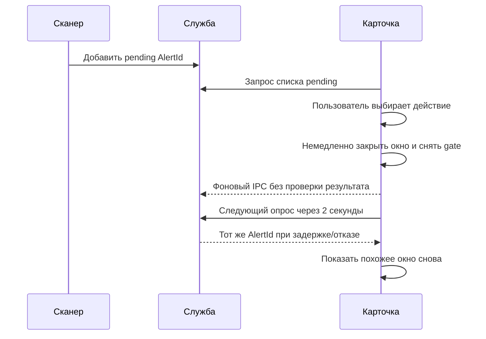
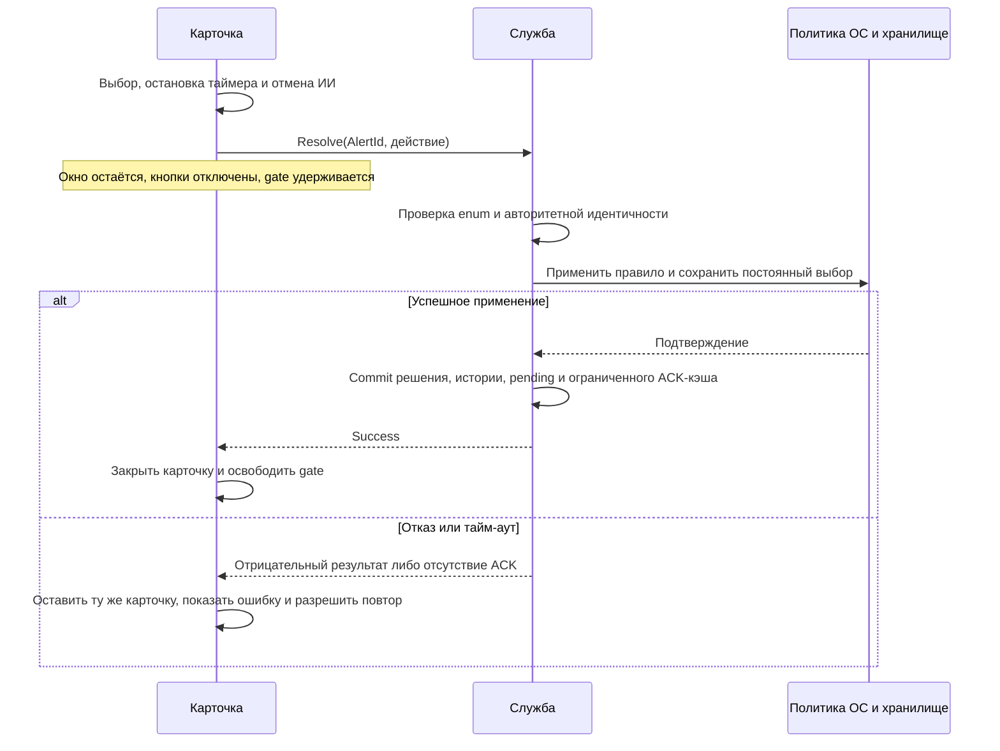

# Аудит сетевого диалога и применения решений

Дата итоговой проверки: 6 ноября 2026 года. Исходная база: `efac027` (`v2.1.0`), проверяемая версия — `2.1.1`.

## Подтверждённые причины

1. `NetworkConnectionAlertWindow.ResolveAndClose` раньше закрывал карточку до ответа IPC. Результат `ResolveNetworkAlertAsync` игнорировался. `MainViewModel` освобождал запрет показа следующего окна при `Closed` и через две секунды мог получить тот же `AlertId` из службы.
2. Служба удаляла ожидающий алерт и меняла историю/решения до записи правила. `ApplyRule` подавлял исключение после записи в лог и игнорировал `FirewallOperationResult.Success`. Отрицательный результат Windows Firewall превращался в ложное подтверждение.
3. Сканирование и применение решения не имели общей транзакционной границы: скан мог поставить новое уведомление одновременно с очисткой старых.
4. Сопоставление по имени распространяло решение на другой исполняемый файл с тем же именем. Имена автоматических COM-правил также строились только по имени файла.
5. `AllowPort` раньше бессрочно подавлял всю программу и соседние уведомления по другим портам. Дополнительно скан проверял разрешённый удалённый порт как локальный, что расширяло область решения.
6. `AllowSession` и `BlockSession` изменяли только словарь подавления уведомлений. Реальная временная политика ОС отсутствовала. Матрица доступа для сессионного выбора создавала постоянные COM-правила, затем обращалась к `ResolveAlert` с пустым идентификатором, который служба отклоняла.
7. Автономный ИИ также фиксировал разрешение/блокировку до реального применения политики, а поздний ответ мог перезаписать более новое ручное решение.
8. После перехода из блокировки в разрешение собственное противоположное правило могло оставаться в Windows Firewall. Очистка теперь ограничена управляемыми правилами того же полного пути; чужие правила и одноимённые приложения в других каталогах сохраняются.

## Поток до исправления

## Поток после исправления

## Действия и области применения

| Действие | Реальная политика | Подавление уведомлений | Срок |
| --- | --- | --- | --- |
| Белый список | Разрешающее COM-правило приложения и запись списка | Точный полный путь | Постоянно |
| Чёрный список | Блокирующее COM-правило приложения и запись списка | Точный полный путь | Постоянно |
| Разрешить на сеанс | Динамический WFP soft permit для ALE app-id, исходящие IPv4 и IPv6 | Точный полный путь | До остановки службы, перезагрузки или максимум 8 часов |
| Заблокировать на сеанс | Динамический WFP block для того же app-id, исходящие IPv4 и IPv6 | Точный полный путь | До остановки службы, перезагрузки или максимум 8 часов |
| Разрешить порт | Постоянное разрешающее исходящее TCP-правило с `RemotePorts=N` и запись разрешённого порта | Только этот удалённый порт, для всех приложений | Постоянно |
| Крестик / системное закрытие / истечение таймера | То же подтверждаемое `BlockSession` | Как у сессионной блокировки | Как у сессионной блокировки |
| Legacy `AllowAlways` / `BlockAlways` | Постоянное COM-правило точного приложения | Точный путь | Постоянно |
| Legacy `CreateRule` без описания правила | Отклоняется: этот запрос не подтверждает создание подробного правила | Не меняется | — |

Нажатие во время незавершённого запроса не отправляет второе решение. Потерянный успешный IPC-ответ допускает повтор: ограниченный журнал последних 1000 идентификаторов возвращает подтверждение того же действия без повторного применения. Другое действие для уже подтверждённого идентификатора не выдаёт ложный успех.

Ожидающие уведомления группируются по области успешно применённого решения. Для приложения это полный путь, для порта — `RemotePort`. Не относящиеся к решению программы и порты сохраняются.

## Временные правила и ограничения платформы

`SessionFirewallPolicy` открывает WFP только по явному решению. Для приложения создаётся собственная динамическая сессия, отдельный sublayer и два фильтра `ALE_AUTH_CONNECT_V4/V6` с единственным точным `FWPM_CONDITION_ALE_APP_ID`. Sublayer и обе IP-семьи добавляются одной транзакцией. Отказ откатывает новую сессию; прежняя политика заменяется только после успешного commit.

Флаг `FWPM_SESSION_FLAG_DYNAMIC` передаёт очистку BFE: фильтры не сохраняются в реестр и удаляются при закрытии владельца, включая аварийное завершение службы. Таймер экспирации действует также при отключённом детекторе. Количество активных приложений ограничено 1000.

Soft permit намеренно сохраняет приоритет внешних блокировок. Он не обходит явный запрет Windows Firewall, сторонний WFP firewall или IPsec. В режиме белого списка исходящего трафика и Killswitch временное разрешение не может снять системный запрет. Поэтому служба отклоняет его, а карточка отключает кнопку и показывает локализованное объяснение. Проверка повторяется на сервере при применении: UI-снимок не является полномочием.

Если полный путь приложения недоступен, действия над приложением недоступны; пользователь видит причину. Разрешение показанного удалённого TCP-порта остаётся отдельным действием с собственной областью. Постоянное разрешение порта также подчиняется блокирующим правилам Windows.

Матрица доступа и автономный ИИ обращаются к тому же владельцу временной политики. `TimedTtl` принимает 1–480 минут, обычный сеанс сохраняет прежний предельный срок восемь часов. Изменение постоянных правил матрицы является отдельной операцией; временное разрешение не удаляет постоянный чёрный список.

## Границы подтверждения и проверки

ACK означает успешную установку собственной политики и сохранение требуемого постоянного выбора. Он не означает, что удалённый сервер доступен или что сторонние средства защиты разрешили трафик. Для постоянных COM-правил и настроек нет общей транзакции Windows+JSON: при отказе сохранения окно остаётся открытым, ошибка диагностируется, повтор установки идемпотентен.

Тесты используют внедряемый `ISessionFirewallPolicy` и явный адаптер применения COM-правил; unit-тесты не меняют сетевую политику машины. Настоящие WPF-тесты удерживают ACK через управляемую задачу и проверяют окно, кнопки, повтор выбора и таймер. Проверка нативной WFP-политики выполняется отдельно на собственном изолированном helper-процессе.

Профильный прогон 6 ноября подтвердил 22 из 22 проверок без падений и пропусков: реальные WPF ACK-сценарии, восстановление визуального дерева после native Restore и новый жизненный цикл закрытия главного окна. TRX: `out/verification-20261106/gui-tests/gui-tray-ack.trx`. Это профильный результат; полный прогон решения фиксируется отдельно в отчёте выпуска.

Структуры native ABI дополнительно проверены независимой компиляцией C++ с Windows SDK 10.0.26100.0 x64: `FWPM_SESSION0=72`, `FWPM_SUBLAYER0=72`, `FWP_VALUE0=16`, `FWPM_FILTER_CONDITION0=40`, `FWPM_ACTION0=20`, `FWPM_FILTER0=200`; проверены также пять смещений полей фильтра. Исходник локального доказательства: `out/wfp-layout-check.cpp`.

Нативная функциональная проверка `out/verification-20261105-firewall-etw/wfp-probe/` завершилась с кодом 0. Правила применялись исключительно к собственному `WfpPolicyProbe.exe`, подключения выполнялись к собственным `127.0.0.1` и `[::1]` на эфемерных портах. Подтверждены baseline-соединения, `AccessDenied` обеих IP-семей после block, восстановление после Remove/Dispose/экспирации, замена block на allow в поддерживаемом режиме и автоматическая очистка BFE после принудительного завершения собственного дочернего владельца. Машинный отчёт: `wfp-probe-results.json` в каталоге проверки. Политики и приложения пользователя эта проверка не изменяет.

Повтор 6 ноября выполнен на актуальной `StartupMonitor.Service.dll` версии `2.1.1.0`: все девять проверок прошли, код процесса 0, оставшихся helper-процессов нет. Скопированная в зонд DLL совпадает с исходной по SHA-256 (`348BFBE0EFA3C5CEB51304156B6A32F2EF7AE60B79505B8A3E86DC2F02690970`). Отчёт и метаданные: `out/release-verification-20261106-2.1.1/wfp-native/wfp-probe-results.json` и `metadata.json`; `stderr.log` пуст. Проверка подтверждает реальное применение WFP, снятие правил по точному TTL и очистку BFE после аварийного завершения собственного владельца.

## Крестик главного окна и трей

В `MainWindow.xaml` возвращён стандартный `TitleBar.ShowClose=True`. Новый `WindowCloseToTrayBehavior` отменяет обычное закрытие и вызывает WPF `Hide`, сохраняя процесс UI, его содержимое, состояние Normal/Maximized и работу трея. Фоновая служба при этом продолжает работу. Существующий пункт «Выход» вызывает `Application.Shutdown`; WPF завершает приложение независимо от отмены обычного `Closing`.

Интерактивная проверка `scripts/launch-ui-interactive.ps1 -CloseAfterLaunch` теперь различает эти действия: native Close обязан скрыть окно при живом PID; native Restore обязан вернуть видимое WPF-содержимое; затем существующий пункт «Выход» завершает UI. Пункт выхода преобразован в настоящую кнопку WPF с прежним навигационным оформлением и поддержкой клавиатуры. Проверка вызывает стандартный UI Automation `InvokePattern` этой кнопки, который выполняет тот же `Click`, что мышь или клавиатура, без перемещения пользовательского курсора. Фактический интерактивный результат сохраняется в JSON развёртывания.

## Первичные источники

- [FWPM_SESSION0: динамическая очистка](https://learn.microsoft.com/en-us/windows/win32/api/fwpmtypes/ns-fwpmtypes-fwpm_session0)
- [FWPM_FILTER0: структура, условия и action flags](https://learn.microsoft.com/en-us/windows/win32/api/fwpmtypes/ns-fwpmtypes-fwpm_filter0)
- [Арбитраж WFP: soft permit и приоритет блокировок](https://learn.microsoft.com/en-us/windows/win32/fwp/filter-arbitration)
- [ALE: фильтрация по нормализованной идентичности приложения](https://learn.microsoft.com/en-us/windows/win32/fwp/application-layer-enforcement--ale-)
- [Идентификаторы условий, включая ALE app-id](https://learn.microsoft.com/en-us/windows/win32/fwp/filtering-condition-identifiers-)
