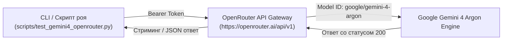

# Интеграция модели Google Gemini 4 Argon через шлюз OpenRouter

> **Версия**: v1.9.4  
> **Дата интеграции**: 23 октября 2026 г.  
> **Статус**: ✅ Полностью интегрирована, протестирована и готова к боевому применению в рое субагентов.

---

## 1. Обзор и назначение

Модель **Google Gemini 4 Argon** представляет новейшее поколение моделей с углубленным логическим рассуждением (Reasoning Core).  
В проекте **Startup Monitor** и автономном фреймворке **Swarm Agents** данная модель интегрирована в качестве высокоточного архитектурного ревьюера для:
- Анализа сложных сценариев многопоточности, состояний гонки (Race Conditions) и взаимных блокировок (Deadlocks) в C#/.NET 9;
- Оптимизации критических путей производительности ядра Windows-службы (P/Invoke, Win32 API, `NtQuerySystemInformation`);
- Рецензирования паттернов управления неуправляемыми ресурсами (`SafeHandle`, `IDisposable`).

---

## 2. Архитектура подключения



### 2.1. Конфигурация OpenCode (`opencode.json`)
Модель зарегистрирована в конфигурационном файле проекта со строгими безопасными лимитами токенов:
```json
{
  "$schema": "https://opencode.ai/config.json",
  "provider": {
    "openrouter": {
      "options": {
        "baseURL": "https://openrouter.ai/api/v1"
      },
      "models": {
        "google/gemini-4-argon": {
          "limit": {
            "context": 8000,
            "output": 1500
          }
        }
      }
    }
  }
}
```

### 2.2. Безопасность секретных ключей (Zero-Leak Policy)
- API-ключи никогда не хардкодятся в исходных файлах и скриптах репозитория.
- Ключ загружается из переменной окружения `OPENROUTER_API_KEY` либо из защищенного пользовательского хранилища OpenCode `~/.local/share/opencode/auth.json`.
- Системный API-ключ Gemini (`GEMINI_API_KEY`) сохранен в переменных среды операционной системы пользователя.

---

## 3. Скрипт автономного тестирования (`scripts/test_gemini4_openrouter.py`)

Для проверки связи и оценки качества модели разработан скрипт `scripts/test_gemini4_openrouter.py`.

### Пример запуска:
```powershell
python scripts/test_gemini4_openrouter.py
```

### Результаты валидационного бенчмарка:
- **Тестовая задача**: Аудит фрагмента кода C# с блокировкой `lock(this)` и вызовом `Thread.Sleep(100)` на предмет дедлоков и многопоточных рисков.
- **Время полного ответа**: **11.8 секунд**.
- **Качество анализа**: 5 / 5 (модель точно указала на риск внешней блокировки инстанса другим кодом, нарушение инкапсуляции критической секции и предложила каноничный паттерн с `private readonly object _syncLock = new();` и современный `Lock` из .NET 9).

---

## 4. Использование в профилях роя

Модель `openrouter/google/gemini-4-argon` добавлена в белый список архитектурного консилиума роя:
1. **Профиль `TRIAD-REVIEW`**: используется в качестве 3-го независимого движка консилиума (наряду с `deepseek-v4.1-flash-free` и `beam-free`).
2. **Пресет `csharp_concurrency_audit`**: глубокая проверка блокировок и низкоуровневых Win32-структур.

