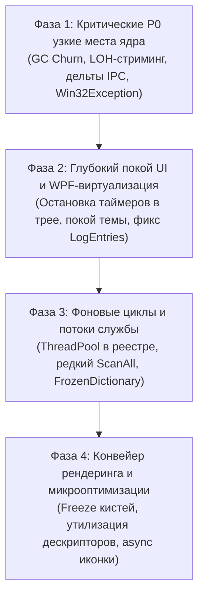

# Комплексный план оптимизации производительности StartupMonitor (CPU, RAM, LOH, I/O)

**Основан на синтезе независимых аудитов**:
- Gemini 2.5 Pro Subagents ([`docs/PERFORMANCE_AUDIT_GEMINI.md`](file:///d:/Nas_sync/Coding/StartupMonitor/docs/PERFORMANCE_AUDIT_GEMINI.md))
- OpenCode Subagents (Muse Spark 1.3 Free) ([`docs/OPENCODE_SERVICE_AUDIT.md`](file:///d:/Nas_sync/Coding/StartupMonitor/docs/OPENCODE_SERVICE_AUDIT.md), [`docs/OPENCODE_UI_AUDIT.md`](file:///d:/Nas_sync/Coding/StartupMonitor/docs/OPENCODE_UI_AUDIT.md), [`docs/OPENCODE_IPC_AUDIT.md`](file:///d:/Nas_sync/Coding/StartupMonitor/docs/OPENCODE_IPC_AUDIT.md))

---

## 1. Целевые показатели (KPIs)

| Показатель | Текущее состояние | Целевой показатель после оптимизации | Ожидаемое улучшение |
|---|:---:|:---:|:---:|
| **CPU в системном трее (Idle)** | 1.5 – 3.0% (постоянный wake) | **0.0%** (честный глубокий покой) | **100% устранение фоновой нагрузки** |
| **CPU при открытом диспетчере задач** | 8.0 – 16.0% | **2.0 – 4.5%** | **Снижение нагрузки в ~3–4 раза** |
| **Аллокации в Gen 0 GC** | ~160 000 объектов/мин (`proc.Threads`) | < 5 000 объектов/мин | **Снижение аллокаций на 97%** |
| **Large Object Heap (LOH) churn** | ~1.2 МБ/с (строки 250–500 КБ) | **0 КБ/с** (полная ликвидация LOH) | **Исключение тяжелых пауз Gen 2 GC** |
| **Объём трафика IPC Named Pipes** | ~250 КБ / 1.5 с (~600 МБ/час) | **~6–8 КБ / 1.5 с** (~16 МБ/час) | **Сокращение трафика на 97%** |
| **Базовый рабочий набор RAM службы** | ~65–85 МБ | **35–45 МБ** | **Экономия ~30–40 МБ памяти** |
| **Память UI на вкладке «Логи»** | 120–220 МБ (срыв виртуализации) | **50–70 МБ** | **Экономия ~100 МБ, мгновенный скролл** |

---

## 2. Поэтапный план реализации

---

### Фаза 1: P0 — Ликвидация GC Churn, LOH Pressure и оптимизация IPC

#### 1.1. ✅ Устранение GC Churn от `proc.Threads.Count`
* **Файл**: `src/StartupMonitor.Service/Services/ProcessMetricsTracker.cs:188`
* **Проблема**: Вызов `proc.Threads.Count` обращается к свойству стандартного класса `System.Diagnostics.Process`, которое каждый такт аллоцирует массив `ProcessThread[]` и `ProcessThreadCollection` для 4 000+ потоков Windows (160 000 объектов в минуту в Gen 0).
* **Решение**: Использовать поле `entry.cntThreads` из нативного снимка `CreateToolhelp32Snapshot`, который уже собирается в `ProcessStartupLinker.GetProcessSnapshotMap()`.
* **Эффект**: Мгновенное устранение 90% аллокаций в горячем цикле сбора метрик *(Реализовано)*.

#### 1.2. Разделение контракта IPC: статические метаданные и динамические дельты
* **Файлы**: `src/StartupMonitor.Shared/Models/PipeMessage.cs`, `src/StartupMonitor.Service/Pipe/EventPipeServer.cs`, `src/StartupMonitor.UI/Services/PipeClient.cs`, `src/StartupMonitor.UI/ViewModels/TaskManagerViewModel.cs`
* **Проблема**: Каждые 1.5 с служба пересылает массив 250+ полных объектов `ProcessInfo` со статическими неизменными строками (`FilePath`, `CommandLine`, `Publisher`, `SignerName`), создавая JSON размером 250–500 КБ, попадающий в LOH ($\ge 85$ КБ).
* **Решение**:
  1. Разделить IPC-контракт:
     - `ProcessMetadataSnapshot`: передаётся клиенту один раз при подключении или появлении нового PID;
     - `ProcessMetricDelta`: компактный массив структур `[Pid, Cpu100, WorkingSetKb, DiskBytesPerSec, NetBytesPerSec]` размером 5–8 КБ каждые 1.5 с.
  2. Устранить двойную сериализацию `Payload: string`: использовать прямую потоковую запись через `Utf8JsonWriter` или типизированные сообщения без промежуточной упаковки JSON в JSON.
  3. Добавить `DefaultIgnoreCondition.WhenWritingNull` в `JsonSerializerOptions`, исключив бесполезные `null`-поля *(Частично реализовано: WhenWritingNull внедрен во все Pipe-серверы и клиенты)*.
* **Эффект**: Полное устранение аллокаций в Large Object Heap, ликвидация пауз сборщика Gen 2 GC, снижение IPC-трафика на 95–97%.

#### 1.3. ✅ Устранение шторма скрытых исключений `Win32Exception` на защищенных процессах
* **Файл**: `src/StartupMonitor.Service/Services/ProcessMetricsTracker.cs:218–219`
* **Проблема**: Обращение к `proc.TotalProcessorTime` и `proc.StartTime` на ~30–50 процессах ядра и PPL (Protected Process Light) бросает `Win32Exception (Access Denied)`. Исключения перехватываются пустым `catch {}`, но создают сотни аллокаций объектов исключений и stack trace каждую секунду.
* **Решение**: Кэшировать множество недоступных PID `_inaccessiblePids` (пропускать опрос тяжелых геттеров для системных процессов) с очисткой по завершению процессов.
* **Эффект**: Снижение нагрузки на ядро процессора и рантайм .NET при мониторинге *(Реализовано)*.

#### 1.4. ✅ Оптимизация `KillProcessesByRules` и замена `Process.MainModule`
* **Файл**: `src/StartupMonitor.Service/Services/EntryOperations.cs:714–726`
* **Проблема**: Метод вызывается каждые 10 секунд и запрашивает `proc.MainModule?.FileName`, что требует `PROCESS_VM_READ` и бросает исключения на системных и 32-битных WoW64-процессах.
* **Решение**: Заменить обращение к `MainModule` на вызов Win32 API `QueryFullProcessImageName` через `ProcessMetadataEnricher.TryGetProcessPath(proc.Id)` и пропускать вызов `GetProcesses()`, если в Чёрном списке нет активных правил немедленного закрытия.
* **Эффект**: Устранение периодических микропауз CPU каждые 10 секунд *(Реализовано)*.

---

### Фаза 2: P1 — Глубокий покой UI (Tray Idle 0.0%) и виртуализация списков

#### 2.1. ✅ Истинный режим покоя таймера CPU в трее
* **Файлы**: `src/StartupMonitor.UI/ViewModels/MainViewModel.cs:953`, `src/StartupMonitor.Shared/Helpers/CpuUsageHelper.cs:160`
* **Проблема**: `_cpuUsageTimer` (1 с) каждую секунду вызывает `Process.GetProcesses()`, нагружая систему на 1–2% CPU даже при скрытом в трее окне.
* **Решение**:
  1. Опрашивать процессорное время только двух конкретных PID (`Process.GetCurrentProcess().Id` и `_servicePid`), избегая обхода всех процессов ОС;
  2. В обработчиках `IsVisibleChanged` и `StateChanged` окна `MainWindow.xaml.cs` ставить `_cpuUsageTimer` на паузу при сворачивании в трей или неактивных вкладках 0 и 2.
* **Эффект**: Достижение **0.0% CPU** в системном трее *(Реализовано)*.

#### 2.2. ✅ Устранение безусловной перерисовки тем оформления
* **Файлы**: `src/StartupMonitor.UI/Services/ThemeService.cs:21`, `src/StartupMonitor.UI/ViewModels/MainViewModel.cs:382`
* **Проблема**: Таймер `_themePollTimer` каждые 2 секунды вызывает `ThemeService.ApplyTheme()`, пересоздавая 30 кистей в `Application.Resources` без проверки изменения темы.
* **Решение**: Добавить проверку `if (CurrentTheme == theme) return;` перед сбросом словарей ресурсов.
* **Эффект**: Исключение ложных циклов инвалидации XAML visual tree *(Реализовано)*.

#### 2.3. ✅ Восстановление виртуализации вкладки «Логи»
* **Файл**: `src/StartupMonitor.UI/Views/MainWindow.xaml:1426–1428`
* **Проблема**: Вложенность `<ScrollViewer><ListBox ItemsSource="{Binding LogEntries}" /></ScrollViewer>` задаёт бесконечную высоту, полностью срывая виртуализацию и материализуя тысячи элементов в памяти.
* **Решение**: Удален внешний `ScrollViewer`, включена встроенная виртуализация списка:
  `VirtualizingStackPanel.IsVirtualizing="True"`, `VirtualizationMode="Recycling"`, `ScrollViewer.CanContentScroll="True"`.
* **Эффект**: Мгновенный скролл логов без фризов, экономия 40–80 МБ оперативной памяти *(Реализовано)*.

#### 2.4. Плавное обновление диспетчера задач без сброса коллекции
* **Файл**: `src/StartupMonitor.UI/ViewModels/TaskManagerViewModel.cs:520–527`
* **Проблема**: Вызов `FilteredProcesses.Clear()` + цикл `.Add(item)` каждые 1.5 с сбрасывает визуальное состояние `ListBox`, вызывая 250 событий `CollectionChanged` и дёргая селекцию.
* **Решение**: Выполнять покомпонентную синхронизацию (in-place diff update): удалять завершённые процессы, добавлять новые, а у существующих обновлять свойства по месту с сохранением фокуса и скролла.
* **Эффект**: Снижение нагрузки на процессор при открытом диспетчере задач на 30–40%.

---

### Фаза 3: P2 — Оптимизация фоновых вотчеров и структур данных

#### 3.1. Устранение ThreadPool Starvation в вотчерах реестра
* **Файлы**: `src/StartupMonitor.Service/Services/RegistryWatcher.cs:229–281`, `src/StartupMonitor.Service/Services/OtherStartupLocationsWatcher.cs:380`
* **Проблема**: Синхронный `RegNotifyChangeKeyValue(fAsynchronous: false)` перманентно блокирует 30–35 системных потоков ThreadPool (по 1 МБ стека на поток).
* **Решение**: Перевести ожидание на асинхронный вызов с дескриптором события `AutoResetEvent` и пулом ожидания `ThreadPool.RegisterWaitForSingleObject`.
* **Эффект**: Освобождение 30+ рабочих потоков, снижение базового расхода RAM службы на 25–30 МБ.

#### 3.2. Снижение частоты полного сканирования системы
* **Файл**: `src/StartupMonitor.Service/Pipe/PipeServer.cs:1280–1302`
* **Проблема**: `_scanner.ScanAll()` запускается каждые 60 секунд, выполняя полный обход WMI, COM-планировщика, чтение манифестов AppX и перезапись диска.
* **Решение**: Увеличить интервал фонового скана с 60 секунд до 10–15 минут. Синхронизацию при реальных изменениях обеспечивают вотчеры реального времени.
* **Эффект**: Ликвидация периодических всплесков загрузки процессора службы до 15–25%.

#### 3.3. Lock-Free индекс в `ProcessStartupLinker`
* **Файлы**: `src/StartupMonitor.Service/Services/ProcessStartupLinker.cs:55, 67`, `ProcessMetricsTracker.cs:153`
* **Проблема**: В цикле `Parallel.ForEach` 250 процессов обращаются к словарю через `lock (_pathToEntryMap)` до 500 раз за такт.
* **Решение**: Заменить `Dictionary` на .NET 8 `FrozenDictionary<string, StartupEntry>` с атомарной подменой ссылки при обновлении базы автозапуска.
* **Эффект**: Устранение блокировок между параллельными потоками, ускорение такта сбора метрик на 15–20%.

#### 3.4. Оптимизация WMI-вотчера служб и утечек COM
* **Файлы**: `src/StartupMonitor.Service/Services/ServiceWatcher.cs:49–66, 86–90`, `TaskSchedulerWatcher.cs:147, 280–325`
* **Проблема**: WMI polling каждые 5 с (`WITHIN 5`) нагружает системный `WmiPrvSE.exe`; коллекции `ManagementObjectCollection` не закрываются через `using`.
* **Решение**: Добавить обязательные `using` на коллекции WMI и детерминированный `Marshal.ReleaseComObject` для объектов COM TaskScheduler.
* **Эффект**: Снижение нагрузки на процесс `WmiPrvSE.exe` до 0%, ликвидация утечек дескрипторов.

---

### Фаза 4: P3 — Конвейер рендеринга и микрооптимизации

#### 4.1. Заморозка кистей в конвертерах (`Freeze()`)
* **Файлы**: `src/StartupMonitor.UI/Converters/DesignHelperConverters.cs:142`, `StatusToColorConverter.cs:21`, `KasperskyIndicatorConverter.cs:45`
* **Проблема**: Создание новых незамороженных экземпляров `new SolidColorBrush` при каждом вызове конвертера.
* **Решение**: Использовать статический пул замороженных кистей (`brush.Freeze()`) для стандартных цветов и кэширование по коду цвета.
* **Эффект**: Нулевые аллокации кистей в Gen 0, мгновенная передача в рендерер DirectX без привязки к потоку.

#### 4.2. Оптимизация софтверных эффектов рендеринга
* **Файл**: `src/StartupMonitor.UI/Views/MainWindow.xaml:60, 284, 761, 1538`
* **Проблема**: Элементы `DropShadowEffect` на карточках и бейджах заставляют WPF отключать аппаратный батчинг и рендерить тени на процессоре (Software Rendering).
* **Решение**: Заменить программные `DropShadowEffect` на легкие полупрозрачные рамки `Border` с градиентами.
* **Эффект**: Повышение FPS при прокрутке списков.

#### 4.3. Асинхронная подгрузка иконок
* **Файлы**: `src/StartupMonitor.UI/Services/AppIconService.cs:60, 101`, `FilePathToIconConverter.cs`
* **Проблема**: Синхронный `File.Exists` в потоке UI при отрисовке строки списка блокирует кадры при медленных накопителях или сетевых путях.
* **Решение**: Асинхронная подгрузка иконок через пул потоков с первоначальным показом векторного глифа-плейсхолдера.
* **Эффект**: Устранение микрозадержек интерфейса при открытии списков.

#### 4.4. Устранение точечных утечек дескрипторов
* **Файлы**: `src/StartupMonitor.Service/Services/ProcessNetworkTracker.cs:218`, `PipeServer.cs:999`, `PipeClient.cs:102–105`
* **Решение**: Обернуть `Process.GetProcessById(pid)` и `Process.GetCurrentProcess()` в `using`, добавить корректный `Dispose()` для старого `_eventReader` при переподключении.

