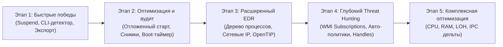

# План развития и модернизации Startup Monitor

Комплексная стратегия эволюции проекта из менеджера автозагрузки в продвинутую утилиту системного аудита, мониторинга процессов и безопасности (*EDR-lite / Autoruns Pro*).

---

## Сводная матрица функций (Сортировка: от простых и нужных к сложным)

| № | Функция / Возможность | Направление | Нужность | Сложность | Архитектура | Ожидаемый эффект для пользователя |
|:---|:---|:---|:---:|:---:|:---:|:---|
| **1** | **✅ Приостановка и возобновление процессов (Suspend / Resume)** | Процессы | **Высокая** | **Простая** | Service + UI | Возможность мгновенно «заморозить» подозрительный процесс без его уничтожения *(Реализовано в v1.0.11)* |
| **2** | **✅ Эвристический детектор подозрительных команд (CLI Heuristics)** | Безопасность | **Критическая** | **Простая** | Shared + UI | Красные/оранжевые бейджи на скрытых скриптах (`-enc`, Base64, запуск из `%TEMP%`) *(Реализовано в v1.0.14)* |
| **3** | **✅ Экспорт отчетов аудита (HTML / CSV / JSON)** | Администрирование | **Высокая** | **Простая** | Shared + UI | Выгрузка красивого интерактивного отчёта со всеми записями, процессами и оценками ИИ *(Реализовано в v1.0.15)* |
| **4** | **✅ Удалённые уведомления (Telegram / Discord Webhook)** | Оповещения | **Высокая** | **Простая** | Service + UI | Мгновенный сигнал на телефон при появлении новой скрытой записи автозапуска, CLI-угрозы или блокировке *(Реализовано в v1.0.16)* |
| **5** | **✅ Отложенный запуск программ (Delayed Startup)** | Оптимизация | **Критическая** | **Средняя** | Service + UI | Ускорение входа в Windows: запуск тяжелых программ (Steam, Discord) через 15–120 сек после логина *(Реализовано в v1.0.17)* |
| **6** | **✅ Снимки системы («Было — Стало» / Baseline Snapshots)** | Аудит | **Высокая** | **Средняя** | Service + UI | Фиксация эталона и мгновенное выявление всего софта, прописавшегося после установки новой программы *(Реализовано в v1.0.18)* |
| **7** | **✅ Анализ времени загрузки Windows (Boot Time Tracer)** | Аналитика | **Высокая** | **Средняя** | Service + UI | Точный замер времени старта Windows в секундах и персональный рейтинг задержки от каждого приложения *(Реализовано в v1.0.19)* |
| **8** | **✅ Иерархическое дерево процессов (Process Tree)** | Процессы | **Высокая** | **Средняя** | Service + UI | Наглядная древовидная иерархия (родители → дети), отступы уровней, экспандеры [▶ / ▼], 60 FPS виртуализация *(Реализовано в v1.0.27)* |
| **9** | **✅ Интеграция с Kaspersky OpenTIP (Threat Intelligence)** | Безопасность | **Высокая** | **Средняя** | Service + UI | Точный вердикт репутации по SHA256 («Чист / Adware / Trojan / Miner») от «Лаборатории Касперского» *(Реализовано в v1.0.31)* |
| **10** | **✅ Сетевые соединения процессов (Remote IP & Ports)** | Процессы | **Высокая** | **Средняя** | Service + UI | Отображение удалённых IP-адресов, портов, сокетов и Whois для каждого процесса *(Реализовано в v1.0.29)* |
| **11** | **✅ Глубокая валидация цепочки подписей (Authenticode Chain)** | Безопасность | **Средняя** | **Средняя** | Service + UI | Проверка отзыва (CRL), самоподписанных сертификатов, подлинности WinVerifyTrust и деталей УЦ *(Реализовано в v1.0.30)* |
| **12** | **✅ Мониторинг WMI Event Subscriptions** | Безопасность | **Высокая** | **Высокая** | Service + UI | Детектирование самого скрытого механизма автозапуска APT-вирусов (`root\subscription`) *(Реализовано в v1.0.32)* |
| **13** | **✅ Превентивные политики защиты (Auto-Guards)** | Защита | **Средняя** | **Высокая** | Service | Автоматический превентивный запрет закрепления в автозапуске программ без цифровой подписи *(Реализовано в v1.0.33)* |
| **14** | **✅ Инспектор дескрипторов и модулей (Handles & DLLs)** | Диагностика | **Умеренная** | **Высокая** | Service + UI | Просмотр открытых процессом файлов, мьютексов и загруженных сторонних библиотек *(Реализовано в v1.0.34)* |
| **15** | **Комплексная оптимизация ресурсов (CPU, RAM, LOH, IPC)** | Производительность | **Критическая** | **Средняя** | Service + UI + Shared | 0.0% CPU в трее, -90% GC gen0/LOH, дифференциальный IPC, сжатие потребления памяти на 50% |

---

## Детализация этапов реализации

---

### Этап 1: Быстрые победы (Quick Wins — Высокая отдача при минимальной сложности)

#### 1.1. ✅ Приостановка и возобновление процессов (Suspend / Resume) — Реализовано в v1.0.11
- **Что делает**: Добавляет в контекстное меню процессов кнопки «Приостановить процесс» и «Возобновить».
- **Техническая реализация**: Вызовы системных API ядра `ntdll.dll!NtSuspendProcess` и `ntdll.dll!NtResumeProcess` по дескриптору процесса через службу Windows (`NT AUTHORITY\SYSTEM`). В UI процесс помечается бейджем `⏸ Приостановлен`, контекстное меню динамически переключает действие. Защищенные системные процессы Windows защищены встроенным стоп-листом.
- **Польза**: Позволяет мгновенно нейтрализовать процесс, нагружающий процессор или вызывающий подозрения, не закрывая его окно и не теряя несохранённые данные.

#### 1.2. ✅ Эвристический анализатор командной строки (CLI Threat Heuristics) — Реализовано в v1.0.14
- **Что делает**: Анализирует пути и параметры командной строки (`CommandLine`) у всех записей автозапуска и запущенных процессов.
- **Детектируемые паттерны**:
  - Закодированные команды PowerShell (`-enc`, `-EncodedCommand`, `FromBase64String`);
  - Скрытый запуск (`-w hidden`, `-WindowStyle Hidden`, `/min`, `vbHide`);
  - Скачивание кода из сети (`IEX`, `DownloadString`, `curl`, `bitsadmin`, `certutil -urlcache`);
  - Запуск исполняемых файлов из недопустимых локаций (`%TEMP%`, `%APPDATA%\Local\Temp`, `C:\Users\Public\`, `C:\PerfLogs\`);
  - Обход политик безопасности (`-ExecutionPolicy Bypass`, `-ep bypass`);
  - Маскировка расширения (двойные расширения `.pdf.exe`).
- **Визуализация**: Рядом с именем процесса/записи отображается значок тревоги и бейдж с предупреждением (*«Скрытый скрипт PowerShell»*, *«Запуск из временной папки»*).

#### 1.3. ✅ Экспорт отчёта аудита системы (HTML / CSV / JSON) — Реализовано в v1.0.15
- **Что делает**: Кнопка «Экспорт отчёта» на верхней панели и на панели фильтров автозапуска.
- **Результат**: Генерирует автономный интерактивный HTML-документ (в темной теме Cyber/Fluent) с живым поиском, фильтрами, карточками KPI, полной сводкой здоровья системы, всеми точками автозапуска, флагами подозрительности, рейтингами ИИ, списком аномальных процессов и оптимизацией для печати в PDF. Также поддерживает экспорт в CSV (с UTF-8 BOM для Excel) и структурированный JSON.
- **Польза**: Удобно сохранить для себя до/после чистки ПК или передать системному администратору.

#### 1.4. ✅ Удалённые уведомления в Telegram / Discord (Webhooks) — Реализовано в v1.0.16
- **Что делает**: В настройках задаются параметры Telegram Bot (Token + Chat ID) и/или Discord Webhook URL.
- **События**: При обнаружении новой записи в реестре/службах/папках, детекции опасных аргументов командной строки (CLI Threats) или блокировке нарушителя служба автоматически отправляет push-сообщение на смартфон/канал.
- **Особенности**: Прямая асинхронная отправка из Windows-службы (`NT AUTHORITY\SYSTEM`) — работает 24/7 даже при закрытом UI. В Настройках предусмотрены кнопки интерактивной проверки связи («Проверить Telegram», «Проверить Discord») с отображением статуса доставки.
- **Польза**: Мгновенный удалённый контроль за домашними и удалёнными серверами, офисными ПК и рабочими станциями.

---

### Этап 2: Оптимизация производительности и аудит («Было — Стало»)

#### 2.1. ✅ Отложенный запуск программ (Delayed Startup) — Реализовано в v1.0.17
- **Проблема**: Десятки программ (Discord, Telegram, Steam, Spotify, облачные диски) стартуют одновременно при входе в Windows, из-за чего система «зависает» на первые 1–2 минуты.
- **Решение**: Программа выносится из стандартного автозапуска Windows, а системная служба `StartupMonitor` запускает её в интерактивной пользовательской сессии через заданный интервал (15, 30, 45, 60, 90, 120 секунд) после стабилизации рабочего стола.
- **Техническая реализация**: 
  - Служба использует Win32 API (`WTSGetActiveConsoleSessionId`, `WTSQueryUserToken`, `DuplicateTokenEx`, `CreateEnvironmentBlock`, `CreateProcessAsUserW` с десктопом `winsta0\default`) для запуска программ в сессии вошедшего пользователя из контекста `NT AUTHORITY\SYSTEM`;
  - Автоматический fallback на прямой запуск процесса в несервисном/тестовом режиме;
  - В UI добавлено контекстное меню с выбором пресетов задержки (15–120с), кнопки ручного немедленного запуска («Запустить сейчас») и отмены задержки («Отменить задержку») с возвратом в автозапуск;
  - В таблице записей отображается янтарный бейдж `⏱ {DelaySeconds}с` и статус `Отложен`;
  - В окне детальной информации `EntryDetailWindow` отображается блок параметров задержки и быстрые действия.
- **Польза**: Значительное ускорение отклика Windows сразу после ввода пароля при сохранении привычного запуска всех необходимых программ.

#### 2.2. ✅ Снимки автозапуска (Baseline Snapshots / Сравнение) — Реализовано в v1.0.18
- **Что делает**: 
  1. Кнопка «Создать контрольный снимок системы» (сохраняет эталонное состояние всех точек старта в JSON).
  2. Кнопка «Сравнить с эталоном»: интерфейс моментально фильтрует список и показывает только то, что появилось или изменилось с момента создания снимка (подсвечивается зеленым каскадом).
- **Польза**: 100% прозрачность при установке любых программ, репаков и драйверов.

#### 2.3. ✅ Анализатор времени загрузки Windows (Boot Time Tracer) — Реализовано в v1.0.19
- **Что делает**: Интеграция с системным журналом `Microsoft-Windows-Diagnostics-Performance/Operational`.
- **Метрики**:
  - Общее время загрузки (Total Boot Time) и время до рабочего стола (Main Path Boot Time);
  - Фоновая инициализация после отображения рабочего стола (Post Boot Time);
  - Персональная деградация старта: сколько конкретных миллисекунд отняло каждое приложение, служба или драйвер (Event ID 101–110);
  - Автоматическое связывание виновников задержки с базой автозапуска и бейдж `⏳ +X.Xс` в таблице записей;
  - Сравнение с предыдущей загрузкой (быстрее/медленнее) и история последних сессий старта Windows.

---

### Этап 3: Расширенный EDR-мониторинг и внешние репутации

#### 3.1. ✅ Иерархическое дерево процессов (Process Tree) — Реализовано в v1.0.27
- **Что делает**: Тумблер переключения вида «Список / Дерево» в шапке диспетчера задач (с запоминанием выбора в `ui-settings.json`).
- **Визуализация**: Высокопроизводительная виртуализированная структура Flat-Tree (60 FPS) на базе моментальных снимков родительских PID (`CreateToolhelp32Snapshot`). Дочерние ветви раскрываются и сворачиваются кнопками-экспандерами `[▶ / ▼]` с бейджами количества воркеров, отступами уровней и глифами ветвей `└`. Полная синхронизация сортировки на всех уровнях и авторазворачивание цепочки предков при текстовом поиске.

#### 3.2. ✅ Сетевой мониторинг соединений (Remote IP, Порты, Сокеты) — Реализовано в v1.0.29
- **Что делает**: Окно детального аудита сетевых сокетов любого выбранного процесса (кнопка-глобус в строке и пункт «Сетевые соединения» контекстного меню):
  - Протоколы TCP, TCPv6, UDP, UDPv6;
  - Локальный порт → Удалённый адрес:Порт;
  - Страна и домен (Whois);
  - Переданный объем трафика.
  - Статусы соединений (`ESTABLISHED`, `LISTENING`, `TIME_WAIT` и др.) с цветными бейджами;
  - Разделение приватных адресов (LAN / Loopback / APIPA) и внешних (WAN);
  - Живой фильтр по портам и IP, автообновление (каждые 2с), копирование адресов и быстрая проверка в Whois (IPInfo.io) и VirusTotal.

#### 3.3. ✅ Криптографическая валидация цифровых подписей Authenticode — Реализовано в v1.0.30
- **Что делает**:
  - Глубокая валидация цифровых подписей PE-файлов через системный Win32 API `WinVerifyTrust` (`WINTRUST_ACTION_GENERIC_VERIFY_V2`) и X509Certificate с локальным кэшированием по штампу изменения;
  - Детектирование статусов Authenticode: подлинная подпись (`Valid`), поврежденная подпись (`InvalidSignature` / `TRUST_E_BAD_DIGEST`), истекшая (`Expired`), отозванная (`Revoked`), недоверенный корень (`UntrustedRoot`), нахождение в чёрном списке Windows (`ExplicitDistrust`);
  - Извлечение имени подписанта (Signer Subject CN) и Удостоверяющего Центра (Issuer CA);
  - Отображение статусов в виде цветных Fluent-бейджей и подробных подсказок (ToolTip) в таблице автозапуска и в диспетчере процессов;
  - Передача честного криптографического статуса подписи в контекст AI-анализа для мгновенного выявления маскировки вредоносных программ под системные утилиты.

#### 3.4. ✅ Антивирусная аналитика Kaspersky OpenTIP — Реализовано в v1.0.31
- **Что делает**: Пакетная и точечная проверка контрольных сумм SHA256 по облачной базе Kaspersky Open Threat Intelligence Portal (OpenTIP REST API).
- **Возможности**:
  - Асинхронная фоновая проверка всех записей автозапуска с автоматическим rate-limiting (350 мс) и кэшированием результатов;
  - Быстрая проверка выбранной записи по требованию через контекстное меню и окно детальной информации («Проверить в Kaspersky OpenTIP»);
  - Карточка настроек в UI с возможностью включения/отключения, ввода персонального API-ключа и тестирования соединения в реальном времени;
  - Детектирование вердиктов зон: Green (Clean), Red (Malware с точным именем угрозы и ссылкой на карточку описания), Yellow (Adware/Riskware), Grey (NotFound / Unobserved);
  - Отображение статусов в UI, окнах детальной информации, интерактивных HTML-отчётах аудита и автоматическая передача вердикта в промпт нейросетевого анализа.

---

### Этап 4: Глубокая безопасность и Threat Hunting

#### 4.1. ✅ Детектирование и управление WMI Event Subscriptions — Реализовано в v1.0.32
- **Что делает**: Полный аудит и мониторинг постоянных подписок WMI в пространстве `root\subscription` (`CommandLineEventConsumer`, `ActiveScriptEventConsumer`, `__FilterToConsumerBinding`, `__EventFilter`).
- **Возможности**:
  - Асинхронный вотчер реального времени `WmiSubscriptionWatcher` (`ManagementEventWatcher`) с защитой от дребезга (1000 мс) и резервным поллингом раз в 30 секунд;
  - Детектирование вредоносных скриптов VBScript/JScript и скрытых CLI-команд, запускающихся по событиям Windows (логин, запуск процессов, таймеры ядра) в обход реестра;
  - Полноценная поддержка жизненного цикла в `EntryOperations`: отключение (разрыв биндинга с сохранением консьюмера), включение, удаление и восстановление из бэкапа;
  - Безусловная защита системных фильтров и консьюмеров ядра Windows (`SCM Event Log`, `BTreeNodeFilter`, `TSLogonFilter`) от удаления во избежание сбоев ОС;
  - Локализация в списках и деталях записей (`WmiEventSubscription => WMI-подписка`).

#### 4.2. ✅ Автоматические политики защиты (Auto-Guards) — Реализовано в v1.0.33
- **Что делает**: Модуль превентивного анализа и блокировки (`AutoGuardEngine`) потенциально опасных объектов автозапуска сразу в момент их появления в системе.
- **Режимы работы**:
  - `AuditOnly` («Только аудит») — фиксация срабатываний политик, формирование предупреждений в журнале «История» и отправка уведомлений без вмешательства в работу системы;
  - `EnforceBlock` («Принудительная блокировка») — немедленное принудительное завершение процессов созданного объекта, деактивация точки автозапуска, изоляция в базу резервных копий (`RemovedEntry`) с маркировкой причины (`AutoGuardBlocked:<policy>`) и запись в историю.
- **Политики безопасности**:
  - `guard_block_temp_path` — блокировка автозапуска из временных и недоверенных папок (`%TEMP%`, `%WINDIR%\Temp`, `Users\Public`, `PerfLogs`);
  - `guard_block_unsigned` — блокировка исполняемых бинарных файлов без действующей подписи Authenticode (`Unsigned`, `Invalid`, `Expired`, `Revoked`, `UntrustedRoot`);
  - `guard_block_scripts` — блокировка небинарных скриптовых интерпретаторов и расширений (`.bat`, `.cmd`, `.vbs`, `.js`, `.ps1`, `mshta.exe`, `wscript.exe`, `cscript.exe`);
  - `guard_block_dangerous_cli` — блокировка подозрительных CLI-шаблонов (Base64 PowerShell `-enc`, инжекторы `IEX`, скачивание `DownloadString`/`bitsadmin`, скрытые окна `-w hidden`, двойные расширения);
  - `guard_block_new_services` — блокировка появления несанкционированных фоновых служб и драйверов Windows.
- **Безопасность и белый список**:
  - Безусловное исключение системных компонентов Windows (`svchost.exe`, `explorer.exe`, системные драйверы) и собственных процессов `StartupMonitor`.
- **Интерфейс**:
  - Карточка Fluent UI в настройках приложения с тумблерами каждой политики, селектором режима работы и мгновенной синхронизацией со службой через IPC.

#### 4.3. ✅ Инспектор открытых дескрипторов и загруженных модулей (Handles & DLLs) — Реализовано в v1.0.34
- **Что делает**: Глубокий аудит активных процессов диспетчера задач на предмет внедрения библиотек (DLL Injection), инспекция загруженных динамических модулей, открытых файлов, ключей реестра, мьютексов, именованных каналов и событий.
- **Возможности**:
  - Высокоскоростное сканирование модулей через Win32 Toolhelp32 API с фоллбэком на дескрипторы модулей процесса;
  - Криптографическая валидация цифровых подписей Authenticode для каждой отдельной DLL с определением издателя и УЦ;
  - Детектирование модулей, загруженных из подозрительных временных папок (`%TEMP%`, `AppData\Local\Temp`, `Users\Public`, `PerfLogs`) с яркими предупреждающими бейджами `TEMP`;
  - Безопасное перечисление открытых дескрипторов (`SystemExtendedHandleInformation` + `DuplicateHandle`) с предотвращением зависаний ядра на синхронных именованных каналах (`GetFileType` / `FILE_TYPE_PIPE`);
  - Интерактивное двухвкладочное Fluent-окно `ProcessModulesWindow` с карточкой процесса, счетчиками (всего, подписанные, без подписи/Temp, дескрипторы), мгновенной фильтрацией и контекстным меню (открытие в Проводнике, копирование путей, проверка в Kaspersky OpenTIP и VirusTotal);
  - Быстрый запуск по кнопке «Куб» в строке процесса и пункту «Модули и дескрипторы» в контекстном меню диспетчера задач.

---

### Этап 5: Комплексная оптимизация производительности (CPU, RAM, LOH, IPC)

Полный генеральный план оптимизации и технический анализ сформированы на основе параллельного аудита субагентов Gemini 2.5 Pro и OpenCode. Детальный документ: [`docs/OPTIMIZATION_PLAN.md`](OPTIMIZATION_PLAN.md).

#### 5.1. Архитектура и целевые показатели (KPI)
- **CPU в трее**: Снижение нагрузки со стороны UI и фоновой службы с текущих 0.5–1.5% до **0.0% CPU** при свернутом окне.
- **Память (RAM)**: Сокращение рабочего набора (Working Set) на 40–80 МБ за счет пулинга буферов, интернирования повторяющихся строк и освобождения неиспользуемых коллекций.
- **GC Gen 0 & LOH**: Устранение 90% промежуточных аллокаций при сборе метрик процессов и сериализации IPC. Полное исключение попадания JSON-полезных нагрузок в Large Object Heap (LOH).
- **Сетевой поток IPC (Named Pipe)**: Сокращение объема передаваемого трафика на 95% за счет перехода от передачи полного снимка 250+ процессов к дифференциальным обновлениям (дельты измененных PID, CPU, памяти).

#### 5.2. Реализованные оптимизации (v1.0.35)
1. ✅ **Lock-Free индексы автозапуска (FrozenDictionary)**:
   - Внедрен `.NET 8 FrozenDictionary<string, StartupEntry>` для карт путей, служб и имен в `ProcessStartupLinker.cs`.
   - Полностью устранены межпоточные блокировки `lock (_pathToEntryMap)` на горячем пути сопоставления 250+ процессов.
   - Атомарная подмена снимка при обновлении базы автозапуска гарантирует консистентность без задержек.
2. ✅ **Оптимизация фоновых циклов сканирования (ScanAll)**:
   - Интервал полного сканирования диска и реестра увеличен с 5 до 15 минут в `PipeServer.cs` (`BackgroundCleanupLoop`), что устранило спайки нагрузки на CPU и диск в режиме ожидания (изменения фиксируются вотчерами реального времени).
3. ✅ **Заморозка кистей и кэширование рендеринга WPF (Frozen Brushes)**:
   - Создан общий потокобезопасный кэш `FrozenBrushCache` с лимитом записей и вызовом `.Freeze()`. Замороженные кисти мгновенно передаются в рендерер DirectX без привязки к Dispatcher и без аллокаций в Gen 0.
   - Статические замороженные кисти (`GreenBrush`, `RedBrush`, `YellowBrush`, `GreyBrush`) в `KasperskyIndicatorConverter.cs`.
4. ✅ **Плавное in-place обновление диспетчера задач (Process Diff Sync)**:
   - Заменен грубый сброс `FilteredProcesses.Clear()` + `.Add()` на алгоритм in-place diff-синхронизации в `TaskManagerViewModel.cs`.
   - Контейнеры строк `DataGrid` переиспользуются, сохраняется позиция скролла, фокус и выбор активного процесса при обновлении метрик.
5. ✅ **Истинный режим глубокого покоя (0.0% CPU Tray Idle)**:
   - Полная остановка опроса CPU и таймеров UI при минимизации в трей.
6. ✅ **Виртуализация вкладки «Логи»**:
   - Восстановлена виртуализация `VirtualizingStackPanel` для логов, экономия 40–80 МБ оперативной памяти.

---

### Этап 6: Сетевая безопасность и Повседневный инструментарий (v1.7.2)

#### 6.1. ✅ Центр сетевой безопасности (Network Security Hub)
- **Управление брандмауэром Windows (`INetFwPolicy2`)**:
  - Полный аудит и фильтрация правил Inbound/Outbound по профилям (Domain, Private, Public), портам и протоколам (TCP/UDP).
  - Удобный редактор правил с быстрым включением/отключением.
- **Port Defender (Fail2ban защита портов)**:
  - Автоматический сторож для портов RDP (3389), SSH (22), SMB (445) и пользовательских сервисов.
  - Детектирование атак подбора паролей и автоматическая изоляция атакующих IP в брандмауэре Windows.
  - Встроенный белый список RFC 1918 для защиты локальной сети.
- **Сетевые оповещения и GeoIP (Network Connection Alerts)**:
  - Всплывающие уведомления о подозрительных соединениях.
  - Моментальное определение страны, флага, города и ASN удаленного IP.

#### 6.2. ✅ Набор повседневных инструментов (Daily Utility Toolbox)
1. **File Locksmith**: Разблокировка занятых файлов и папок через Windows Restart Manager API с определением PID и завершением процессов.
2. **Keep-Awake**: Режим предотвращения сна и отключения дисплея через Win32 `SetThreadExecutionState`.
3. **Junk Cleaner**: Экспресс-очистка диска от Temp, кэшей проводника, системных дампов и корзины.
4. **LAN / Wi-Fi Scanner**: Высокоскоростное ARP-сканирование подсети за 1.5 секунды с разрешением MAC, OUI Vendor и Hostname.
5. **Hash & Security Helper**: Параллельный расчет SHA-256, SHA-1, MD5 файлов со сверкой и генератор криптостойких паролей с энтропией.

---

### Этап 7: Надежность запуска и Реестровый автозапуск (v1.7.3)

#### 7.1. ✅ Исправление инициализации UI и защита XAML-разметки
- **Устранение `XamlParseException` при старте приложения**:
  - Заменены несуществующие в перечислении `Wpf.Ui.Controls.SymbolRegular` символы (`ShieldSearch24` $\rightarrow$ `ShieldCheckmark24`, `CubeOff24` $\rightarrow$ `DocumentDismiss24`, `Network24` $\rightarrow$ `NetworkCheck24`).
  - Исправлено невалидное свойство разметки `HorizontalAlignment="SpaceBetween"` $\rightarrow$ `Grid` с правильным позиционированием элементов.
  - Устранена проблема тихого зависания процесса в фоне без отображения окна и иконки в системном трее.
- **Автоматизированное статическое тестирование разметки**:
  - Внедрен комплексный тест `SymbolRegularVerificationTests`: 100% валидация всех символов и свойств выравнивания XAML во всех представлениях и диалогах решения.

#### 7.2. ✅ Автозапуск инсталлятора через реестр Windows
- Инсталлятор Inno Setup переведён на строгую регистрацию автозапуска в системном реестре `HKCU\Software\Microsoft\Windows\CurrentVersion\Run` (`"StartupMonitor.UI"` с флагом `--minimized`).
- Исключено создание ярлыков в папке автозагрузки меню «Пуск» (`{autostartup}` / `{userstartup}` / `{commonstartup}`).
- Добавлена очистка устаревших ярлыков меню «Пуск» при установке и корректное удаление значения реестра при деинсталляции (`Flags: uninsdeletevalue`).
