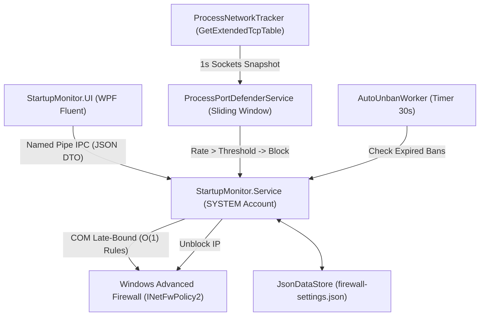
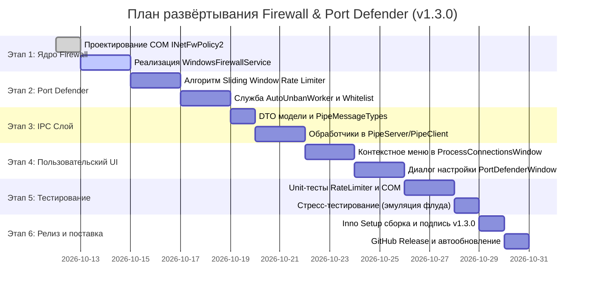

# План развёртывания: Интерактивное управление Windows Firewall и служба защиты портов (Port Defender)

> **Документ:** Архитектурная спецификация и план развёртывания нового модуля сетевой безопасности  
> **Проект:** Startup Monitor  
> **Версия релиза:** v1.3.0  
> **Статус:** Утверждено к разработке  
> **Авторы:** Ведущий архитектор Antigravity (Gemini Orchestrator) & Рой субагентов OpenCode (4 параллельных воркера)

---

## 1. Введение и бизнес-цели

В процессах мониторинга Windows при анализе сетевой активности критически важно иметь возможность не только пассивно наблюдать входящие/исходящие сокеты, но и оперативно воздействовать на сетевой уровень:
1. **Быстрая ручная блокировка/разблокировка IP и портов** прямо из контекстного меню сетевых соединений процесса через стандартный брандмауэр Windows (*Windows Advanced Firewall / WFP*).
2. **Интеллектуальная автоматическая защита портов (Port Defender)** по аналогии с *RDP Defender / RdpGuard / Fail2ban*:
   - Автоматическое обнаружение попыток перебора паролей (Brute-Force), сканирования портов (Port Scan) и флуда новыми сессиями (Connection Flood) для **любой** программы и **любого** входящего порта (RDP 3389, SSH 22, веб-сервера 80/443, базы данных 1433/5432, кастомные корпоративные службы).
   - Временный бан (Temporary Ban) атакующего IP с заданным порогом: **$N$ подключений за единицу времени (в секунду / минуту / час)** на выбор пользователя.
   - Автоматический разбан (Auto-Unban) по таймеру с адаптивной эскалацией (удвоение срока бана при повторной атаке).
   - Белый список доверенных адресов (RFC 1918, Loopback, шлюз по умолчанию, кастомные подсети).
3. **User-Friendly интерфейс**: бесшовная интеграция в стиль Windows 11 Fluent Design (Mica, Wpf.Ui, Dark/Light темы, понятные бейджи-щиты, всплывающие окна быстрой настройки).

---

## 2. Анализ концепции: RDP Defender, RdpGuard, Fail2ban

В ходе исследования архитектуры специализированных систем защиты (TSplus Advanced Security RDP Defender, RdpGuard, Linux Fail2ban, Windows EvlWatcher) выявлены ключевые сильные и слабые стороны:

| Решение | Источник данных | Механизм бана | Ограничения для универсального мониторинга |
|---|---|---|---|
| **RDP Defender (TSplus) / RdpGuard** | Журнал событий Windows (`Security EventID 4625` — неудачный вход) | Windows Firewall COM API (`INetFwPolicy2`), добавление правила блокировки IP | Привязано исключительно к протоколам с аутентификацией Windows (RDP/SMB). **Не защищает** кастомные программы без журнала событий. |
| **Fail2ban (Linux)** | Regex-парсинг лог-файлов (`/var/log/auth.log`) → Jail `maxretry / findtime / bantime` | `iptables / nftables`, таймер разбана, `recidive jail` | На Windows у произвольных TCP-серверов нет стандартизированных текстовых лог-файлов. |
| **EvlWatcher** | Подписка `EventLogWatcher` на аудит сетевых пакетов | Алертинг и скрипты PowerShell | Требует включённого расширенного аудита безопасности Windows, высокая нагрузка на диск. |

### Архитектурный выбор для StartupMonitor:
Служба `StartupMonitor.Service` уже имеет высокопроизводительный трекер сокетов [`ProcessNetworkTracker.cs`](file:///d:/Nas_sync/Coding/StartupMonitor/src/StartupMonitor.Service/Services/ProcessNetworkTracker.cs), который через P/Invoke `GetExtendedTcpTable` (IPv4 и IPv6) собирает все сокеты системы за **2–5 мс**:
- **Универсальность**: работает для **любого** процесса и порта без модификации целевой программы и без необходимости ведения логов.
- **Принцип работы**: фоновый снимок сокетов с частотой **1 секунда** фильтрует новые входящие соединения (`SYN_RCVD`, `ESTABLISHED`), дедуплицирует их по 4-кортежу `(RemoteIP, LocalPort, RemotePort)` и передаёт в алгоритм скользящего окна.

---

## 3. Архитектура ядра безопасности



### 3.1. Управление брандмауэром Windows (`WindowsFirewallService`)
- **Работа от имени SYSTEM**: служба имеет наивысшие привилегии для взаимодействия с Windows Filtering Platform (WFP) без запросов UAC.
- **COM Late-Binding**: вызов `Type.GetTypeFromProgID("HNetCfg.FwPolicy2")` в .NET 8 исключает проблемы с COM interop зависимостями и полностью совместим с single-file/self-contained публикацией.
- **Агрегированные правила $O(1)$**: для предотвращения деградации производительности сетевого стека Windows при тысячах правил, заблокированные IP объединяются в общее правило:
  - `StartupMonitor_Blocked_IPs_In` (Inbound Block)
  - `StartupMonitor_Blocked_IPs_Out` (Outbound Block)
  - Список адресов хранится через запятую в свойстве `RemoteAddresses`.
- **Точечные правила портов**:
  - `StartupMonitor_Block_Port_TCP_80_In_Global`
  - `StartupMonitor_Block_Port_TCP_3389_In_App_mstsc` (с привязкой к `ApplicationName`).
- **Защита от утечек RCW**: детерминированное освобождение каждого COM-интерфейса через `Marshal.ReleaseComObject`.
- **Zero-Crash при выключенном брандмауэре**: перехват ошибок COM `0x80070422` (MpsSvc остановлена) с понятным русскоязычным статусом в UI.

### 3.2. Алгоритм скользящего окна (Sliding Window Rate Limiter)
Для каждого отслеживаемого `RemoteIP` ведётся очередь временных меток новых уникальных сессий:
$$T_{IP} = \{ t_1, t_2, \dots, t_k \}$$
При каждом секундном снимке сокетов:
1. Удаляются метки, вышедшие за пределы окна:
   $$\forall t_i \in T_{IP}: \text{now} - t_i > W_{\text{window}} \implies \text{Dequeue}(t_i)$$
2. Если текущее количество сессий превышает порог:
   $$|T_{IP}| \ge N_{\text{threshold}} \implies \text{BAN}(IP)$$
3. **Поддерживаемые окна времени**:
   - **В секунду**: $W = 1\text{ с}$, порог от 2 до 50 подключений.
   - **В минуту**: $W = 60\text{ с}$, порог от 5 до 200 подключений.
   - **В час**: $W = 3600\text{ с}$, порог от 20 до 1000 подключений.

### 3.3. Жизненный цикл бана и эскалация
1. **Первичное нарушение**: IP блокируется на базовый срок (по умолчанию 15 минут).
2. **Повторное нарушение в течение суток**: эскалация срока бана:
   $$\text{BanDuration} = \text{BaseDuration} \times 2^{\text{RepeatCount}-1}$$
   - 1-й бан: 15 минут
   - 2-й бан: 30 минут
   - 3-й бан: 1 час
   - 4-й бан: 24 часа
   - 5+ нарушений: постоянный бан (Permanent Blacklist) до ручного снятия.
3. **Авторазбан (`AutoUnbanWorker`)**: каждые 30 секунд фоновый воркер проверяет `ExpiresAtUtc <= DateTime.UtcNow`, удаляет IP из правила брандмауэра и логирует событие.

### 3.4. Защита от самоблокировки (Safe Guard)
Перед созданием любого правила блокировки проверяется белый список:
- Loopback (`127.0.0.1`, `::1`).
- Частные диапазоны RFC 1918 (`10.0.0.0/8`, `172.16.0.0/12`, `192.168.0.0/16`).
- Шлюз по умолчанию и локальные DNS-серверы хоста.
- Пользовательский белый список доверенных подсетей.

---

## 4. Варианты пользовательского интерфейса (User-Friendly UI/UX)

Проработано **4 концептуальных варианта интерфейса**, полностью совместимых со стилем Windows 11 Fluent Design библиотеки `Wpf.Ui`.

```
========================================================================================
ВАРИАНТ 1: КОНТЕКСТНЫЙ ИНСПЕКТОР (ProcessConnectionsWindow)
========================================================================================
┌──────────────────────────────────────────────────────────────────────────────────────┐
│  Сетевые соединения: nginx.exe (PID: 4120)                                [—][□][✕]  │
├──────────────────────────────────────────────────────────────────────────────────────┤
│  [🛡️ Port Defender АКТИВЕН]  Мониторинг портов: 80, 443 | Забанено: 2 IP  [Настроить]│
├──────────────────────────────────────────────────────────────────────────────────────┤
│  [🔍 Поиск...]                       [☑ Автообновление 2с]            [🔄 Обновить]  │
├──────────────────────────────────────────────────────────────────────────────────────┤
│  Протокол | Локальный сокет | Напр | Удалённый сокет    | Состояние | Брандмауэр     │
│  TCP      | 0.0.0.0:80      |  →   | 185.220.101.5:4123 | ESTABLISHED | 🟢 Разрешено │
│  TCP      | 0.0.0.0:443     |  →   | 45.142.214.9:59210 | ESTABLISHED | 🟡 Временный бан
│                                                                                      │
│             ┌─────────────────────────────────────────────────────────┐              │
│             │ 🚫 Заблокировать IP (185.220.101.5)...                  │              │
│             │    ├─ На 15 минут                                       │              │
│             │    ├─ На 1 час                                          │              │
│             │    ├─ На 24 часа                                        │              │
│             │    └─ Навсегда (Permanent)                              │              │
│             │ 🛑 Заблокировать входящий порт 80 (TCP) для nginx.exe   │              │
│             │ 🛡️ Настроить защиту Port Defender для порта 80...       │              │
│             │ ─────────────────────────────────────────────────────── │              │
│             │ 📋 Копировать IP                                        │              │
│             │ 🌐 Проверить в VirusTotal / Whois                       │              │
│             └─────────────────────────────────────────────────────────┘              │
└──────────────────────────────────────────────────────────────────────────────────────┘
```

### Вариант 1: Контекстный инспектор в `ProcessConnectionsWindow` (Рекомендуется как основной)
- **Суть**: прямое расширение существующего окна сетевых соединений.
- **Элементы**:
  1. **Верхний защитный баннер (Shield Card)**: показывает текущий статус защиты процесса (зелёный щит — норма, оранжевый/красный — отбиты атаки, переключатель ToggleSwitch «Port Defender»).
  2. **Новая колонка «Брандмауэр»**: бейджи со статусом `🟢 Разрешено`, `🔴 Заблокирован`, `🟡 Бан (14м)`.
  3. **Каскадное контекстное меню**:
     - *«Заблокировать удалённый IP»* → подменю: *«На 15 минут»*, *«На 1 час»*, *«На 24 часа»*, *«Навсегда»*.
     - *«Заблокировать локальный порт X для этого процесса»*.
     - *«Включить защиту Port Defender для порта X...»*.
     - *«Разблокировать IP»* (если адрес уже в бане).

---

```
========================================================================================
ВАРИАНТ 2: ВЫДЕЛЕННЫЙ ЦЕНТР СЕТЕВОЙ БЕЗОПАСНОСТИ (Network Security Hub)
========================================================================================
┌──────────────────────────────────────────────────────────────────────────────────────┐
│  Startup Monitor -> [📊 Автозапуск] [⚙️ Процессы] [🛡️ Сетевой экран] [Настройки]      │
├──────────────────────────────────────────────────────────────────────────────────────┤
│  Сетевой экран Windows: 🟢 Активен (Domain, Private, Public)       [Сбросить правила]│
├──────────────────────────────────────────────────────────────────────────────────────┤
│  ┌────────────────────────┐  ┌─────────────────────────────────────────────────────┐ │
│  │ Активные правила (12)  │  │ Журнал атак и временных банов (Port Defender)       │ │
│  │ ├─ TCP 3389 [Defender] │  │ • 01:42:10 [Бан на 1ч] IP 194.26.29.112 (RDP:3389)  │ │
│  │ ├─ TCP 80   [Defender] │  │   Причина: 18 подключений/мин (порог: 5/мин) [Разбан]│ │
│  │ ├─ IP 45.142.214.9(Бан)│  │ • 01:38:05 [Бан 15м]  IP 91.240.118.4 (SSH:22)     │ │
│  │ └─ IP 185.12.33.1 (Бан)│  │   Причина: 32 подключения/сек (порог: 10/сек)[Разбан]││
│  └────────────────────────┘  └─────────────────────────────────────────────────────┘ │
└──────────────────────────────────────────────────────────────────────────────────────┘
```

### Вариант 2: Dedicated Network Security Hub (Центр сетевого экрана в MainWindow)
- **Суть**: отдельная вкладка первого уровня в главном меню навигации приложения.
- **Элементы**:
  - Общий статус Firewall (MpsSvc) с индикаторами профилей (Domain / Private / Public).
  - Сводка защищаемых служб и портов.
  - Таблица активных блокировок с таймером обратного отсчета (`00:14:22 до разбана`) и кнопкой немедленного помилования (`[Разблокировать]`).
  - Интерактивный журнал атак с указанием атакующего IP, целевого процесса, порта, зафиксированной скорости и даты.

---

```
========================================================================================
ВАРИАНТ 3: ДИАЛОГ-ВИЗАРД НАСТРОЙКИ ЗАЩИТЫ (Port Defender Config Wizard)
========================================================================================
┌──────────────────────────────────────────────────────────────────────────────────────┐
│  🛡️ Настройка Port Defender для nginx.exe (Порт: 80 TCP)                   [—][□][✕]  │
├──────────────────────────────────────────────────────────────────────────────────────┤
│  Режим защиты:  (🔘 Включен)   (⚪ Только аудит / уведомления)                        │
│                                                                                      │
│  Порог срабатывания:                                                                 │
│  Если количество подключений с одного IP превышает:                                  │
│  [  10  ] подключений за  [ 1 минуту ▼ ]  (доступно: секунду / минуту / час)         │
│  ────○──────────────────────── (Слайдер от 2 до 100)                                 │
│                                                                                      │
│  Действие при превышении:                                                            │
│  Длительность бана:  [ 1 час ▼ ]  (15 мин / 1 час / 24 часа / навсегда)              │
│  ☑ Удваивать время бана при повторных атаках (Эскалация)                             │
│                                                                                      │
│  Белый список (Исключения):                                                          │
│  ☑ Исключать локальные сети (192.168.0.0/16, 10.0.0.0/8, 127.0.0.1)                 │
│  Пользовательские IP (через запятую):                                                │
│  [ 192.168.1.50, 10.8.0.1_                                                         ]│
│                                                                                      │
│                                              [ Отмена ]  [ Сохранить и включить ]    │
└──────────────────────────────────────────────────────────────────────────────────────┘
```

### Вариант 3: Интерактивный диалог-визард настройки защиты (Modal Wizard)
- **Суть**: компактное модальное окно при нажатии «Настроить Defender» для конкретного порта или процесса.
- **Элементы**:
  - Радиокнопки: *«Активная блокировка»* или *«Только аудит/уведомление в трей»*.
  - Поле ввода числа + выпадающий список: `[ N ]` подключений в `[ секунду / минуту / час ]`.
  - Ползунок быстрой настройки чувствительности (Мягкая: 30/мин, Средняя: 10/мин, Строгая: 3/мин).
  - Срок бана: `15 минут / 1 час / 24 часа / Постоянно`.
  - Чекбокс эскалации при рецидивах.
  - Поле для ввода белого списка доверенных IP/подсетей.

---

### Вариант 4: Shield Badges в Диспетчере задач (`TaskManagerView`)
- **Суть**: компактная индикация защищенности процесса прямо в дереве процессов.
- **Элементы**:
  - Иконка щита рядом с именем процесса:
    - 🛡️ *Серый щит*: процесс слушает сеть, но Defender не настроен.
    - 🛡️ *Синий щит*: Defender активен и мониторит порты.
    - 🛡️ *Красный щит*: зафиксированы атаки за последний час.
  - Клик по щиту открывает всплывающий flyout со статистикой и быстрыми тумблерами.

> **Рекомендация по релизу:** Для релиза **v1.3.0** внедряется связка **Вариант 1 (Контекстный инспектор) + Вариант 3 (Диалог-визард настройки)**. В релизе **v1.3.1** добавляется **Вариант 2 (Общий центр безопасности)**.

---

## 5. Спецификация IPC протокола и моделей данных (DTO)

Все взаимодействия между UI и службой происходят через асинхронный Named Pipe с JSON-сериализацией.

### 5.1. Новые типы сообщений в `PipeMessageTypes`
```csharp
public static class PipeMessageTypes
{
    // ... существующие типы ...
    public const string GetFirewallStatus = "GetFirewallStatus";
    public const string GetFirewallStatusResponse = "GetFirewallStatusResponse";
    
    public const string BlockIp = "BlockIp";
    public const string UnblockIp = "UnblockIp";
    public const string BlockPort = "BlockPort";
    public const string UnblockPort = "UnblockPort";
    public const string FirewallOperationResponse = "FirewallOperationResponse";
    
    public const string GetPortDefenderConfig = "GetPortDefenderConfig";
    public const string SetPortDefenderConfig = "SetPortDefenderConfig";
    public const string GetActiveBans = "GetActiveBans";
    public const string ActiveBansResponse = "ActiveBansResponse";
    public const string ClearAllBans = "ClearAllBans";
}
```

### 5.2. Модели данных (`StartupMonitor.Shared/Models/Firewall`)
```csharp
public record BlockIpRequest(
    string Ip,
    FirewallDirection Direction = FirewallDirection.Both,
    bool Aggregated = true,
    int? BanDurationMinutes = null, // null = навсегда
    string? Reason = null
);

public record BlockPortRequest(
    int Port,
    FirewallProtocol Protocol = FirewallProtocol.Tcp,
    FirewallDirection Direction = FirewallDirection.Inbound,
    string? ApplicationPath = null,
    string? Reason = null
);

public record PortDefenderRuleConfig(
    int LocalPort,
    string? ProcessPath,
    bool IsEnabled,
    int ThresholdCount,           // N подключений
    TimeWindowUnit WindowUnit,    // Second, Minute, Hour
    int BanDurationMinutes,       // 15, 60, 1440, 0=perm
    bool AutoEscalate,            // x2 при повторе
    List<string> WhitelistIps
);

public enum TimeWindowUnit { Second = 1, Minute = 60, Hour = 3600 }

public record ActiveBanDto(
    string Ip,
    int TargetPort,
    string TargetProcess,
    DateTime BanStartedUtc,
    DateTime? ExpiresAtUtc,
    int AttackRate,
    string Reason,
    int RepeatCount
);
```

---

## 6. Пошаговый план развёртывания (Release Roadmap)



### Этап 1. Доработка и интеграция ядра Windows Firewall (13.10 – 14.10)
- [ ] Верификация класса `WindowsFirewallService.cs` в службе.
- [ ] Тестирование создания и очистки агрегированных правил `StartupMonitor_Blocked_IPs_In/Out`.
- [ ] Реализация точечной блокировки портов с привязкой к полному пути исполняемого файла (`ApplicationName`).
- [ ] Проверка корректного освобождения COM дескрипторов при перечислении правил.

### Этап 2. Разработка службы Port Defender (15.10 – 18.10)
- [ ] Создание класса `ProcessPortDefenderService` с подпиской на секундные снимки `ProcessNetworkTracker`.
- [ ] Реализация структуры скользящего окна `SlidingWindowTracker` с блокировкой по порогам (сек/мин/час).
- [ ] Реализация фонового воркера `AutoUnbanWorker` (таймер 30с) для снятия истекших временных банов.
- [ ] Реализация проверки белого списка (`FirewallGuard.IsBlockableAddress`).
- [ ] Сохранение состояния активных банов в `C:\Program Files\StartupMonitor\firewall-bans.json`.

### Этап 3. IPC контракты и маршрутизация Named Pipe (19.10 – 21.10)
- [ ] Добавление DTO классов в `StartupMonitor.Shared/Models/Firewall/`.
- [ ] Реализация обработчиков в `PipeServer.cs`: `BlockIp`, `UnblockIp`, `BlockPort`, `SetPortDefenderConfig`, `GetActiveBans`.
- [ ] Реализация клиентских методов в `PipeClient.cs`.
- [ ] Реализация уведомлений в реальном времени через Event Pipe при срабатывании бана (всплывающее уведомление в трее: *«Заблокирован атакующий IP X.X.X.X для порта Y»*).

### Этап 4. Интерфейс пользователя (WPF / XAML) (22.10 – 25.10)
- [ ] **Модификация `ProcessConnectionsWindow.xaml`**:
  - Добавление колонки статуса брандмауэра со стилизованными бейджами.
  - Расширение контекстного меню таблицы сокетов (каскадный выбор длительности бана).
  - Верхняя плашка Defender Summary Card с тумблером включения.
- [ ] **Создание окна `PortDefenderConfigWindow.xaml`**:
  - Ползунки и числовые поля для порога подключений.
  - Выбор временного окна (сек / мин / час).
  - Настройка срока бана и белого списка IP.
- [ ] Добавление локализованных строк в `Strings.ru.resx` и `Strings.en.resx`.

### Этап 5. Верификация и тестирование (26.10 – 28.10)
- [ ] Юнит-тесты xUnit:
  - Тестирование логики скользящего окна (срабатывание ровно на $N$-м пакете).
  - Тестирование очистки устаревших меток времени.
  - Тестирование эскалации длительности бана ($15\text{м} \to 30\text{м} \to 60\text{м}$).
  - Тестирование защиты от самоблокировки (попытка забанить `127.0.0.1` или шлюз отвергается).
- [ ] Интеграционный стресс-тест:
  - Запуск локального тестового TCP-сервера и эмуляция скрипта атаки (50 быстрых подключений в секунду через PowerShell `Test-NetConnection` / `TcpClient`).
  - Проверка мгновенного появления правила в `wf.msc` (Windows Firewall MMC).
  - Проверка прекращения соединений и корректного авторазбана по таймеру.

### Этап 6. Релиз v1.3.0 и публикация (29.10 – 30.10)
- [ ] Синхронизация версий до `1.3.0` в `Directory.Build.props` и `setup.iss`.
- [ ] Сборка и Authenticode-подпись бинарников и инсталлятора `StartupMonitorSetup-1.3.0.exe`.
- [ ] Публикация релиза на GitHub в оба репозитория (`gms-cod/SM` и `gms-cod/Startup-Monitor`).
- [ ] Проверка автоматического обновления клиентов с версии 1.2.4 до 1.3.0.

---

## 7. Матрица рисков и меры безопасности (Zero-Crash Discipline)

| Риск | Уровень | Мера защиты |
|---|---|---|
| **Самоблокировка пользователя (Lockout)** | Критический | Строгая валидация перед добавлением правила: IP-адреса `127.0.0.1`, `::1`, локальные шлюзы и DNS хоста аппаратно блокируются к внесению в правила брандмауэра. |
| **Утечка памяти при распределенном DDoS** | Высокий | Ограничение емкости in-memory словарей `SlidingWindowTracker` максимум 10 000 уникальных IP. При переполнении старые неактивные IP вытесняются по алгоритму LRU. |
| **Деградация скорости Windows Firewall** | Средний | Использование агрегированных правил $O(1)$ (`StartupMonitor_Blocked_IPs_In`), куда адреса добавляются списком через запятую. Количество правил в системе не разрастается. |
| **Служба Firewall остановлена (MpsSvc disabled)** | Низкий | Обработка HResult `0x80070422` без падения службы. UI выводит информативное предупреждение: *«Служба брандмауэра Windows отключена в системе»*. |
| **Потеря состояния банов при перезагрузке ОС** | Средний | Персистентность активных банов в `firewall-bans.json`. При старте службы таймеры разбана восстанавливаются. |

---

## 8. Итог

Разработанный план полностью закрывает поставленные требования:
- Стандартный стек Windows Firewall без сторонних драйверов.
- Универсальная защита Port Defender для любого входящего порта любого процесса.
- Настраиваемый порог подключений в секунду, минуту или час.
- Временный бан с авторазбаном и эскалацией.
- 4 продуманных варианта пользовательского интерфейса в дизайне Windows 11 Fluent.
- Четкий 6-этапный график внедрения с гарантиями надежности Zero-Crash.

