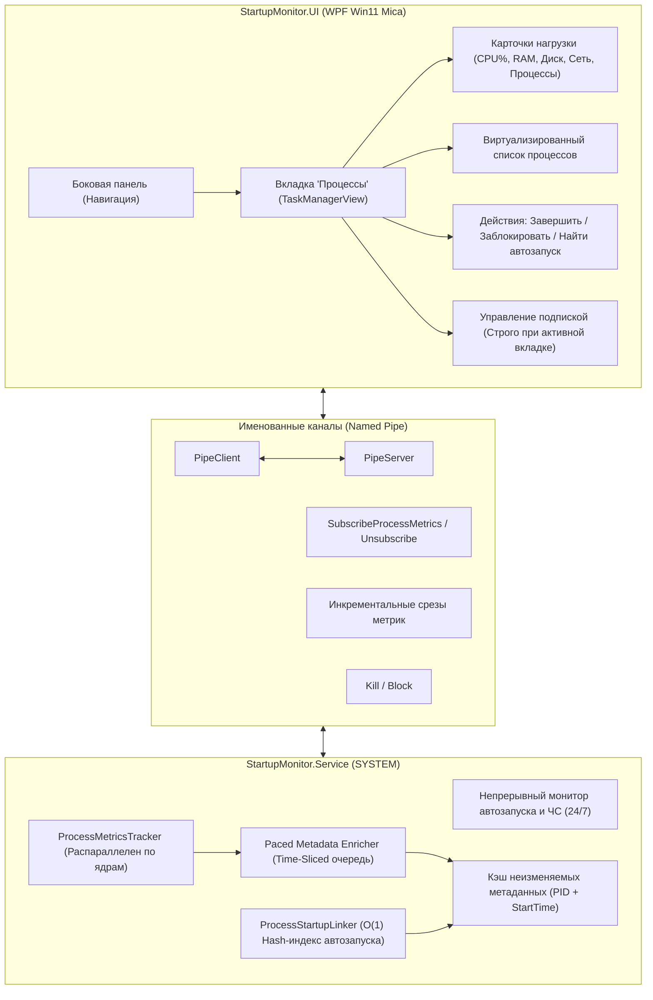

# План реализации: Диспетчер задач (Task & Process Manager) в Startup Monitor

## Введение и цели

Диспетчер задач в **Startup Monitor** превращает утилиту контроля автозапуска в комплексный инструмент оперативного мониторинга и нейтрализации нежелательных и вредоносных процессов в Windows.

**Главные цели**:
1. **Прозрачность процессов**: отображение всех активных процессов операционной системы с их метриками в реальном времени (CPU %, RAM, Диск, Сеть, PID, Издатель).
2. **Связь процессов с автозапуском**: мгновенное сопоставление работающего процесса с базой автозапуска программы (`startup-entries.json`) — отображение типа автозапуска (Реестр Run, Служба, Планировщик задач, Папка автозагрузки и др.) либо источника ручного запуска (родительский процесс, например `explorer.exe`).
3. **Оперативное реагирование**:
   - **Завершить процесс (Kill / End Task)**: безопасное завершение одного процесса или дерева процессов;
   - **Заблокировать (Block in Blacklist)**: создание правила в Чёрном списке по пути/хешу + немедленное завершение + запрет появления в автозапуске;
   - **Найти место запуска**: переход на вкладку «Автозапуск» с подсветкой соответствующей записи и подробностей.
4. **Единый дизайн Fluent Win11**: полное визуальное и стилевое соответствие существующей таблице автозапуска (карточки суммарной нагрузки сверху, неоновые бейджи, сортировка кликом по колонкам, контекстное меню, темная и светлая темы).
5. **Непрерывная защита 24/7 и бережное отношение к ресурсам («Не грузить процессор одномоментно»)**:
   - Полная функциональность мониторинга автозапуска и Чёрного списка работает постоянно в трее;
   - Высокочастотный сбор метрик процессов активируется **строго при открытой вкладке «Диспетчер задач»** (в трее и на других вкладках нагрузка равна 0% CPU);
   - Распараллеливание опроса по свободным ядрам CPU;
   - Квантование и распределение тяжелых задач (Time-Slicing);
   - Кэширование неизменяемых метаданных процессов.

---

## Архитектурные уровни и компоненты

---

## Архитектура сглаживания нагрузки: «Не грузить процессор одномоментно»

Главное требование к Диспетчеру задач — **абсолютная незаметность для системы**: программа мониторинга ни при каких обстоятельствах не должна вызывать пиковых скачков CPU, фризов в играх или подвисаний других приложений.

Для этого внедряется комплекс из 5 уровней оптимизации нагрузки:

### 1. Непрерывная защита 24/7 + Диспетчер задач строго по требованию
- **Непрерывность основной функциональности в трее (100% готовность)**:
  - Программа и фоновая служба **постоянно и непрерывно** выполняют весь спектр защитных функций, даже если UI свёрнут в трей:
    - Мониторинг реестра (`RegNotifyChangeKeyValue`), папок автозапуска (`FileSystemWatcher`), служб и задач в реальном времени;
    - Автоматический контроль Чёрного списка: превентивное обнаружение запрещённых процессов, их немедленное завершение (`KillProcessesByRules`) и удаление из автозапуска;
    - Приём и отображение push-уведомлений и toast-сообщений в трее при появлении подозрительных записей;
    - Периодическая проверка целостности и верификация записей.
- **Диспетчер задач — активность строго при открытом окне на вкладке**:
  - Высокочастотный сбор и расчет метрик процессов (CPU %, RAM, Диск I/O, Сеть, срез процессов) **обрабатывается ИСКЛЮЧИТЕЛЬНО тогда, когда окно программы открыто и пользователь находится на вкладке «Диспетчер задач»**;
  - При переключении на вкладку «Автозапуск», «Чёрный список», «История», «Настройки» или при сворачивании окна программы в трей:
    - Поток сбора метрик процессов **мгновенно деактивируется** (отправляется сигнал `UnsubscribeProcessMetrics` в Named Pipe, таймер в UI засыпает);
    - Нагрузка от Диспетчера задач в фоновом режиме равна **строго 0% CPU**;
    - Никакие лишние дескрипторы процессов не опрашиваются, освобождая память и ресурсы системы;
  - При повторном клике на вкладку «Диспетчер задач» в UI — подписка мгновенно возобновляется (`SubscribeProcessMetrics`), и актуальная таблица процессов с метриками отображается без задержек.

### 2. Разделение метрик на два эшелона (Fast Tier vs Heavy Tier)
- **Fast Tier (быстрый срез каждые 1.5 с)**:
  - Считываются только легковесные счетчики ядра ОС: `TotalProcessorTime`, `WorkingSet64` (RAM) и `IO_COUNTERS` (дисковые байты).
  - Выполняется за **3–6 мс** суммарно на всю систему.
- **Heavy Tier (тяжелые метаданные — разово при старте процесса)**:
  - Чтение пути к файлу с диска, проверка цифровой подписи (издатель Authenticode), чтение командной строки (`CommandLine`) через `NtQueryInformationProcess`, определение родителя.
  - **Кэш метаданных**: для процесса с известной парой `(PID, StartTime)` эти данные запрашиваются **ровно один раз** в момент первого обнаружения и помещаются в `ConcurrentDictionary`. При последующих циклах мониторинга тяжелые Win32/дисковые вызовы **не выполняются вовсе**.

### 3. Распределение тяжелых операций во времени (Time-Sliced Staggered Queue)
- Если в системе одновременно стартует много процессов (например, загрузка ОС или открытие браузера с 20 вкладками), служба **НЕ сканирует их скопом**.
- Новые процессы помещаются в сглаживающую очередь (`Staggered Enrichment Queue`).
- Обработка идет квантами времени (например, **не более 4–6 процессов за такт** с принудительным `Task.Delay(30-50ms)` между квантами).
- Нагрузка размазывается по временной шкале, пиковая загрузка ядра процессора срезается до минимума (< 1%).

### 4. Распараллеливание по ядрам процессора (Multi-core ThreadPool)
- Опрос быстрых счетчиков для 200+ процессов распараллеливается с помощью `Parallel.ForEach` с управляемым пулом потоков:
  $$\text{MaxDegreeOfParallelism} = \text{Clamp}\left(\frac{\text{ProcessorCount}}{2}, 2, 6\right)$$
- Работа распределяется по свободным ядрам, исключая монополизацию одного ядра.
- Фоновый рабочий поток сбора метрик исполняется с пониженным приоритетом (`ThreadPriority.BelowNormal`), гарантируя, что при любой конкуренции за ресурсы Windows отдаст предпочтение пользовательским приложениям и играм.

### 5. Мгновенное сопоставление с автозапуском за $O(1)$
- Вместо квадратичного перебора ($N_{\text{процессов}} \times M_{\text{записей}} \approx 35\,000$ сравнений строк в секунду):
- При изменении записей автозапуска служба один раз строит быстрый хеш-индекс:
  - `Dictionary<string, string> _pathToEntryIdMap` (по нормализованному пути `FilePath`);
  - `Dictionary<string, string> _serviceToEntryIdMap` (по имени службы).
- Сопоставление каждого процесса со статусом автозапуска происходит за $O(1)$ по хешу — **нулевая нагрузка на CPU**.

---

## Предлагаемые изменения по компонентам

### 1. Общий модуль (`StartupMonitor.Shared`)

#### [NEW] `Models/ProcessInfo.cs`
Модель данных процесса, передаваемая между службой и UI:
- `int ProcessId` — идентификатор процесса (PID);
- `int ParentProcessId` — PID родительского процесса;
- `string ProcessName` — имя исполняемого файла (например, `msedge.exe`);
- `string FilePath` — полный путь к исполняемому файлу;
- `string CommandLine` — строка запуска процесса;
- `string Publisher` — цифровой издатель / подпись (например, `Microsoft Corporation`);
- `double CpuUsagePercent` — процент использования CPU (0.0% – 100.0%);
- `long WorkingSetBytes` — использование оперативной памяти (байты);
- `long PrivateBytes` — выделенная память (Private Bytes);
- `long DiskReadBytesPerSec` — скорость чтения с диска (Байт/с);
- `long DiskWriteBytesPerSec` — скорость записи на диск (Байт/с);
- `long NetworkSendBytesPerSec` — сетевая активность (отправка);
- `long NetworkReceiveBytesPerSec` — сетевая активность (прием);
- `int ActiveConnectionsCount` — количество активных TCP/UDP соединений;
- `DateTime StartTime` — время запуска процесса;
- `string? StartupEntryId` — ID записи автозапуска (если процесс порожден автозапуском);
- `EntryLocation? StartupLocation` — тип автозапуска (реестр, служба, планировщик и др.);
- `string? StartupLocationDetail` — конкретная точка (например, `HKCU\Software\...\Run`);
- `string? ParentProcessName` — имя родительского процесса (если запущен не из автозапуска);
- `bool IsSystemProcess` — защищенный системный процесс Windows (запрет случайного завершения);
- `bool IsBlocked` — совпадает ли с правилами Чёрного списка.

#### [NEW] `Models/SystemPerformanceSnapshot.cs`
Суммарные системные метрики для верхней панели карточек:
- `double TotalCpuPercent` — общая загрузка процессора ОС;
- `long TotalMemoryBytes` — общая память ОС;
- `long UsedMemoryBytes` — занятая память ОС;
- `double MemoryPercent` — процент использования RAM;
- `long TotalDiskIoBytesPerSec` — суммарный обмен с диском;
- `long TotalNetworkBytesPerSec` — суммарный сетевой трафик;
- `int TotalProcessesCount` — общее число процессов;
- `int TotalThreadsCount` — общее число потоков;
- `List<ProcessInfo> Processes` — снимок процессов.

#### [MODIFY] `Models/PipeMessage.cs`
Добавление новых типов команд IPC:
- `SubscribeProcessMetrics` — подписка на поток срезов процессов (при открытии вкладки в UI);
- `UnsubscribeProcessMetrics` — отписка (при уходе с вкладки или сворачивании окна);
- `GetProcesses` — разовый запрос актуального списка процессов и метрик;
- `ProcessesSnapshot` — ответ службы со снимком процессов;
- `KillProcessById` — запрос на завершение процесса по PID;
- `BlockProcess` — запрос на завершение процесса и добавление в Чёрный список;
- `ProcessActionResponse` — результат выполнения операции.

---

### 2. Фоновая служба (`StartupMonitor.Service`)

#### [NEW] `Services/ProcessMetricsTracker.cs`
Высокопроизводительный сборщик метрик процессов под `SYSTEM`:
- Параллельный опрос через `Parallel.ForEach` с ограничением по ядрам;
- Сбор CPU % через дельту `TotalProcessorTime` на дельту времени и число ядер;
- Сбор памяти через `K32GetProcessMemoryInfo`;
- Сбор дискового I/O через `GetProcessIoCounters`;
- Поддержка мгновенной паузы и активации строго по сигналам Pipe (`Subscribe`/`Unsubscribe`).

#### [NEW] `Services/ProcessMetadataEnricher.cs`
- Асинхронная Time-Sliced очередь обогащения новых процессов;
- Кэширование издателя, путей и командной строки по `(PID, StartTime)`;
- Ограничение скорости: не более 5 процессов за такт с паузой между квантами.

#### [NEW] `Services/ProcessStartupLinker.cs`
- Хеш-индексы записей автозапуска для сопоставления за $O(1)$;
- Определение родительского процесса через `NtQueryInformationProcess` (BasicInformation) без вызова медленного WMI.

#### [MODIFY] `Services/PipeServer.cs` & `Services/EntryOperations.cs`
- Обработка команд подписки и управления процессами;
- Безопасный стоп-лист критических процессов ОС (`csrss`, `lsass`, `services`, `wininit`, `StartupMonitor*`).

---

### 3. Пользовательский интерфейс (`StartupMonitor.UI`)

#### [NEW] `ViewModels/TaskManagerViewModel.cs`
- Управление подпиской на срез процессов при навигации (подписка при входе на вкладку, отписка при уходе или сворачивании в трей);
- Сортировка по любой колонке таблицы (CPU, RAM, Disk, Net, PID, Имя, Издатель, Автозапуск);
- Поиск с debouncing (250 мс);
- Команды: `KillProcessCommand`, `BlockProcessCommand`, `LocateInStartupCommand`, `OpenLocationCommand`.

#### [NEW] `Views/TaskManagerView.xaml` & `TaskManagerView.xaml.cs`
- **Верхние карточки нагрузки**: CPU (с sparkline историей), Память, Диск, Сеть, Всего процессов;
- **Виртуализированный список процессов** (Fluent Win11 стилистика, неоновые бейджи, цветовые градиенты нагрузки);
- **Колонка статуса автозапуска**: интерактивный бейдж с переходом к конкретной записи в главном окне;
- **Контекстное меню** с быстрыми действиями (Завершить, Заблокировать в ЧС, Найти источник).

#### [MODIFY] `Views/MainWindow.xaml`
- Добавление пункта меню «Процессы / Диспетчер задач» с векторной иконкой в левую боковую панель навигации;
- Логика перехода между вкладкой автозапуска и диспетчером задач с подсветкой связанных записей.

#### [MODIFY] `Resources/Strings.ru.resx` & `Strings.resx`
- Локализация всех строк: названий колонок, кнопок контекстного меню, карточек нагрузки и подсказок.

---

---

## Статус выполнения и актуализация плана (Сентябрь 2026)

### ✅ Выполнено (Фазы 1–4):
1. **Модели и протокол IPC (`StartupMonitor.Shared`)**:
   - Реализованы `ProcessInfo.cs`, `SystemPerformanceSnapshot.cs`, новые сообщения `SubscribeProcessMetrics`, `UnsubscribeProcessMetrics`, `KillProcessById`, `BlockProcess`.
2. **Ядро службы Windows (`StartupMonitor.Service`)**:
   - Реализован `ProcessStartupLinker.cs` ($O(1)$ привязка к автозапуску, чтение Parent PID через NtQueryInformationProcess без WMI);
   - Реализован `ProcessMetadataEnricher.cs` (Time-Sliced квантованная очередь проверки Authenticode с кэшированием);
   - Реализован `ProcessMetricsTracker.cs` (распараллеливание по ядрам ЦП через `Parallel.ForEach`, On-Demand таймер 0% в фоне);
   - Обработка команд завершения и блокировки процессов в `PipeServer.cs`.
3. **Графический интерфейс (`StartupMonitor.UI`)**:
   - Создана модель представления `TaskManagerViewModel.cs`;
   - Внедрена вкладка «Процессы» (NavItem6 с векторной иконкой Pulse);
   - Карточки системной нагрузки (ЦП, ОЗУ, Диск, Сеть);
   - Виртуализированный список с фильтрацией и поиском (debounce 250 мс).
4. **Тесты и компиляция**:
   - 458 unit-тестов успешно пройдены (100% зелёные);
   - Служба Windows запущена и работает в статусе `RUNNING`.

---

### 🔨 Фаза 5: Устранение замечаний UI (Текущий этап)

1. **Кнопки действий в строке процесса (`MainWindow.xaml`)**:
   - [ ] Удалить красную кнопку «Снять задачу» (`ActionKillProcess`, воспринимавшуюся как «красная полоса») из строки таблицы (действие доступно в ПКМ-меню);
   - [ ] Переместить иконку щита («Найти в автозапуске») ПЕРЕД кнопкой «Блок»;
   - [ ] Оформить саму кнопку «Блок» красным цветом (стиль `ActionBlockButton`).

2. **Заголовки таблицы с сортировкой (`MainWindow.xaml` + `LocalizationService.cs`)**:
   - [ ] Добавить в `LocalizationService.cs` свойства заголовков колонок (`ColProcessName`, `ColPid`, `ColCpu`, `ColRam`, `ColDisk`, `ColNetwork`, `ColStartupOrigin`);
   - [ ] Заменить ссылки `Hyperlink` на стилизованные кнопки-заголовки со стрелками сортировки (`▲` / `▼`), реагирующие на клик по всей площади.

3. **Кнопки фильтрации процессов («Все», «Приложения», «Фоновые», «Службы», «Автозапуск»)**:
   - [ ] Добавить в `LocalizationService.cs` свойства `FilterApps`, `FilterBackground`, `FilterAutostart` (свойство `FilterServices` уже имелось, из-за чего была подписана только кнопка «Службы»);
   - [ ] Обеспечить единообразное отображение названий всех 5 фильтров;
   - [ ] Проверить корректность фильтрации процессов при кликах.

4. **Контекстное меню по правой кнопке мыши (устранение «чёрного прямоугольника»)**:
   - [ ] Добавить в `LocalizationService.cs` свойства пунктов меню (`ActionKillProcess`, `ActionBlockProcess`, `ActionLocateStartup`, `ActionOpenFileLocation`);
   - [ ] Исправить привязку команд и передачу `DataContext` через `PlacementTarget`;
   - [ ] Задать контрастные цвета текста и фона ContextMenu/MenuItem под Тёмную и Светлую темы.

5. **Финальная сборка и проверка**:
   - [ ] Прогон unit-тестов;
   - [ ] Публикация в `C:\Program Files\StartupMonitor\`;
   - [ ] Запуск и проверка интерфейса.
