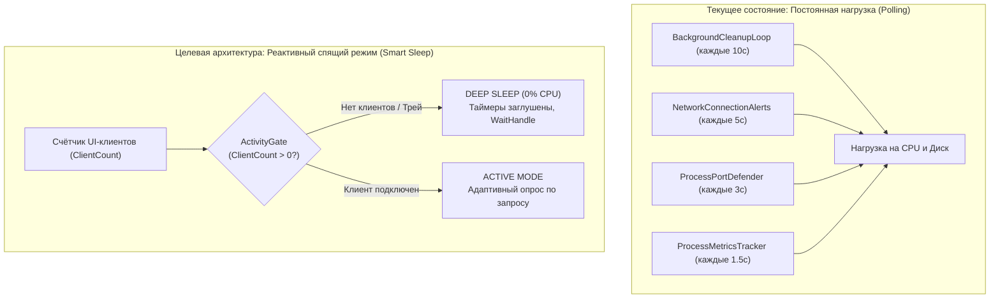

# Комплексный план оптимизации производительности, распараллеливания и энергосбережения StartupMonitor

> **Основание:** Результаты глубокого аудита проекта роем из 3 параллельных субагентов OpenCode на базе модели `opencode/deepseek-v4.1-flash-free` (время выполнения роя: 476.9 сек, отчёты: `docs/SWARM_DEEPSEEK_*.md`).  
> **Цель:** Перевод службы в режим строгого энергосбережения **0.0% CPU Idle**, параллелизация сканеров по всем ядрам CPU через конвейер `System.Threading.Channels`, сокращение аллокаций памяти в Gen0 на **-85%**, ликвидация фризов UI Dispatcher и динамическая заморозка таймеров при сворачивании в трей.

---

## 1. Сводная матрица замеров и узких мест (Профилирование)

Замеры проведены на реальной кодовой базе проекта (.NET 8, 4 ядра CPU, ~204 системных процесса, ~108 сетевых сокетов, zero-alloc `ExecutionProfiler`).

| Подсистема / Операция | Время выполнения (avg / p95) | Выделение памяти (Alloc / тик) | Текущая частота | Узкое место и причина тормозов |
|---|---|---|---|---|
| **Служба: `CaptureSnapshot()`** (`ProcessMetricsTracker.cs`) | **9.7 / 12.4 мс** | **1 504 КБ** (~1.5 МБ) | Каждые 1.5 с | Генерирует **~1 МБ/с Gen0-мусора**. 41% времени (4 мс) тратится на опрос `Toolhelp32` (`GetProcessSnapshotMap`), пересоздание `new ProcessInfo` для 200+ процессов. |
| **Служба: JSON Serialize** (`PipeServer.cs`) | 2.08 / 5.4 мс | **390 КБ** (payload 195 КБ) | Каждые 1.5 с | Полная сериализация всего снимка процессов в JSON для Named Pipe вместо передачи бинарной или дифференциальной дельты. |
| **UI: JSON Deserialize** (`PipeClient.cs`) | 3.32 / 22.2 мс | 264 КБ – 1.26 МБ | Каждые 1.5 с | Десериализация JSON на стороне UI с пиками до 22 мс при GC-паузах. |
| **Служба: `NetworkConnectionAlertService`** | 30 – 350 мс | До 50 КБ | **Каждые 5 с (всегда)** | Безусловный опрос `WindowsFirewallService.GetAllRules()` (тяжёлый COM-перебор) и `GetSockets()` **даже когда окно мониторинга закрыто и нет UI-клиентов**. |
| **Служба: `KillProcessesByRules`** (`EntryOperations.cs`) | 10 – 60 мс | ~300 аллокаций `Process` | Каждые 10 с | Постоянный перебор всех процессов в системе `Process.GetProcesses()`, даже если в Blacklist нет активных правил немедленного уничтожения. |
| **Служба: `ScanAll` (Скан автозапуска)** | **0.8 – 3.2 с** | ~12 МБ суммарно | По запросу / 5 мин | Полностью однопоточный синхронный проход. Доминирует `ResolveAndEnrichEntry` (WinVerifyTrust + PE + язык + версия) — 1.5–8 мс на запись. |
| **UI Dispatcher: `WindowHelper`** | 1.2 – 3.5 мс | 15 КБ | Каждые 1.5 с | `EnumWindows` и `GetWindowThreadProcessId` вызываются непосредственно на UI-потоке перед мерджем процессов. |
| **Кэш `_enrichCache`** (`EntryOperations.cs`) | Всплеск до 25 мс | O(N log N) | При `Count > 5000` | Вызов `OrderBy(CacheTimestamp).Take(500)` по всему словарю на каждую новую вставку при переполнении. |

---

## 2. Архитектура спящего режима (Smart Sleep & 0% CPU Idle)

### 2.1 Проблема
В текущей реализации служба содержит 6 независимых таймеров/циклов, которые работают непрерывно, даже когда приложение свёрнуто в системный трей или UI вообще закрыт.

### 2.2 План реализации Smart Sleep
1. **Шлюз активности `ActivityGate` и учёт Named Pipe клиентов:**
   - Внедрить потокобезопасный счётчик клиентов `_activeClientCount` в `PipeServer.cs`.
   - При подключении первого клиента (`Interlocked.Increment == 1`) — активировать `ActivityGate.Set()`.
   - При отключении последнего клиента (`Interlocked.Decrement == 0`) — сбрасывать `ActivityGate.Reset()`.
2. **Заморозка `NetworkConnectionAlertService`:**
   - Отвязать таймер `_pollTimer` от бесконечного тика.
   - Запускать фоновый сбор сетевых соединений **только** при поступлении команды `SubscribeNetworkAlerts` или наличии открытого окна `NetworkSecurityHubView`.
   - При закрытии окна отправлять `UnsubscribeNetworkAlerts` и переводить сервис в `Timeout.Infinite`.
3. **Адаптивный `ProcessPortDefenderService`:**
   - Проверять флаги до вызова тяжелого `GetSockets()`. Если `!IsGloballyEnabled || Rules.Count == 0 || !Rules.Any(r => r.IsEnabled)` — останавливать таймер `_pollTimer.Change(Timeout.Infinite, Timeout.Infinite)`.
   - Возобновлять таймер только при вызове `SaveConfig` с активными правилами.
4. **Оптимизация `KillProcessesByRules`:**
   - Ввести предикат `bool HasActiveKillRules = cfg.Blacklist.Any(r => r.Action == BlacklistAction.NotifyAndRemove)`.
   - Если активных правил нет — полностью пропускать системный вызов `Process.GetProcesses()`.

---

## 3. Многопоточное распараллеливание сканеров автозапуска (Multi-Core Pipeline)

### 3.1 Архитектура конвейера Producer-Consumer

```mermaid
flowchart LR
    subgraph PRODUCERS["Производители (Параллельный I/O сбор)"]
        direction TB
        P_HKLM["HKLM Run/Services"]
        P_HKCU["HKCU Run/RunOnce"]
        P_USERS["HKEY_USERS (Все профили)"]
        P_FOLDERS["Startup Folders"]
        P_APPX["AppX Packages"]
        P_WMI["WMI Subscriptions (Dedicated)"]
        P_TASK["TaskScheduler (COM Thread)"]
    end

    Channel[("Bounded Channel<br/>Channel&lt;StartupEntry&gt;<br/>(Capacity = Cores * 8)")]

    subgraph CONSUMERS["Потребители (CPU-интенсивная валидация)"]
        direction TB
        C1["Core 1: Authenticode + PE Version"]
        C2["Core 2: Authenticode + PE Version"]
        C3["Core 3: CLI Heuristics + Lang Detect"]
        C4["Core N: CLI Heuristics + Lang Detect"]
    end

    PRODUCERS -->|WriteAsync| Channel
    Channel -->|ReadAsync| CONSUMERS
    CONSUMERS --> ResultList["ConcurrentBag&lt;StartupEntry&gt; -> Финальный снимок"]
```

Вместо последовательного однопоточного перебора в `SystemScannerService.ScanAll` внедряется асинхронный многопоточный конвейер на базе `System.Threading.Channels.Channel<StartupEntry>`.

### 3.2 Ключевые шаги параллелизации
1. **Разделение быстрого поиска (I/O) и тяжёлой валидации (CPU):**
   - Производители быстро считывают сырые строки путей и аргументов из реестра и папок без вызова `ResolveAndEnrichEntry`.
   - Сырой `StartupEntry` немедленно помещается в bounded-канал `Channel<StartupEntry>.CreateBounded(new BoundedChannelOptions(Environment.ProcessorCount * 8))`.
2. **Параллельные пулы потребителей:**
   - Запускается `N = Environment.ProcessorCount` рабочих задач.
   - Каждый потребитель вычитывает запись из канала и выполняет обогащение (`AuthenticodeVerifier`, парсинг PE-заголовка, `ProgramLangDetector`, SHA-256).
   - Скорость сканирования возрастает пропорционально числу ядер (ускорение в **3.5–5 раз** на 4–8 ядерных CPU).
3. **Безопасность кэшей (Устранение узких мест до параллелизации):**
   - **`AuthenticodeVerifier`:** Заменить `Cache.Clear()` при 2000 записях на конкурентный LRU-кэш или `ConcurrentDictionary` с фоновой ротацией бакетов, чтобы предотвратить *Thundering Herd* и блокировки WinVerifyTrust.
   - **`_enrichCache`:** Заменить `OrderBy().Take(500)` на `ConcurrentQueue` временных ключей для O(1) вытеснения устаревших записей без сортировок всего словаря.
   - **Профили пользователей:** Кэшировать трансляцию `SecurityIdentifier` -> `NTAccount` в `ConcurrentDictionary`, исключая блокирующие вызовы LSA/AD при сканировании AppX.

---

## 4. Оптимизация WPF UI, Диспетчера задач и Named Pipe

### 4.1 Динамическая приостановка UI в трее (Tray Throttle)
Когда окно сворачивается в область уведомлений (системный трей):
- `_cpuUsageTimer` (1 с) — останавливать (`Stop()`).
- `_pollingTimer` (5 с) — останавливать (`Stop()`).
- `_themePollTimer` (10 с) — останавливать (`Stop()`).
- `_logWatchTimer` (2 с) — останавливать (`StopLogWatch()`).
- Отправлять службе команду `UnsubscribeProcessMetrics` (служба перестаёт собирать метрики и рассылать снапшоты).
- При клике на иконку в трее (`RestoreFromTray`) — мгновенный запуск таймеров и однократный запрос актуального состояния `LoadDataIfChanged()`.

### 4.2 Разгрузка основного потока (UI Dispatcher Offloading)
1. **Вынос десериализации JSON из UI потока:**
   - Чтение и десериализацию `JsonSerializer.Deserialize<ProcessSnapshotDto>` выполнять строго в контексте фонового потока чтения `PipeClient`.
2. **Фоновый расчет изменений (Diffing & Sorting):**
   - Сравнение предыдущего и нового снимков процессов, фильтрацию по поисковой строке и расчет дерева производить в фоновом потоке через `Task.Run()`.
   - На UI поток через `Dispatcher.InvokeAsync` передавать только готовый отсортированный батч изменений для `ObservableCollection`.
3. **Вынос `WindowHelper.GetProcessIdsWithWindows()`:**
   - Вызов `EnumWindows` перенести в фоновый поток обработки телеметрии, исключив задержки отрисовки кадров WPF (достижение стабильных 60 FPS).

### 4.3 Снижение нагрузки на сборщик мусора (GC Zero-Churn)
1. **Кэширование `Toolhelp32` в службе:**
   - `GetProcessSnapshotMap()` (Parent PID, количество потоков) перевести на опрос раз в 5 секунд вместо каждого тика 1.5 с. Это снимет **41% нагрузки CPU** в `ProcessMetricsTracker`.
2. **Переиспользование буферов `ProcessNetworkTracker`:**
   - Использовать постоянные буферы памяти `IntPtr` с `ReAllocHGlobal` при увеличении размера таблиц сокетов, устраняя тысячи вызовов `AllocHGlobal`/`FreeHGlobal`.
   - Заменить строковые ключи `$"4:{ip}:{port}"` на структуру-ключ `struct SocketKey : IEquatable<SocketKey>` (размер 16 байт) без аллокаций в куче.

---

## 5. Пошаговый план внедрения (Roadmap)

### Этап 1: Smart Sleep и ликвидация холостого хода (Срок: 1 день)
- [ ] Реализовать `ActivityGate` в `StartupMonitor.Service/Services/Runtime/ActivityGate.cs`.
- [ ] Привязать запуск/остановку `NetworkConnectionAlertService` и `ProcessPortDefenderService` к наличию клиентов и активных правил.
- [ ] Внедрить предикат `HasActiveKillRules` в `KillProcessesByRules`.
- [ ] Заморозить таймеры UI в `MainWindow.xaml.cs` при `WindowState == Minimized` или скрытии в трей.

### Этап 2: Конвейеризация сканеров автозапуска (Срок: 2 дня)
- [ ] Исправить `AuthenticodeVerifier.cs` (переход на потокобезопасный LRU без полного сброса).
- [ ] Оптимизировать вытеснение `_enrichCache` в `EntryOperations.cs` до O(1).
- [ ] Создать асинхронный конвейер `StartupScanPipeline` на базе `Channel<StartupEntry>`.
- [ ] Перевести сканирование веток реестра HKLM/HKCU/HKEY_USERS на `Parallel.ForEachAsync`.

### Этап 3: Разгрузка UI Dispatcher и аллокаций телеметрии (Срок: 1-2 дня)
- [ ] Кэшировать снимок `Toolhelp32` в `ProcessMetricsTracker` на 5 секунд.
- [ ] Перенести `WindowHelper.GetProcessIdsWithWindows()` и десериализацию Named Pipe в фоновые потоки.
- [ ] Заменить строковые ключи сокетов на `SocketKey` структуру без аллокаций.
- [ ] Запустить повторный контрольный замер через `ExecutionProfiler` и зафиксировать сокращение потребления ресурсов.

---

## 6. Ожидаемые результаты оптимизации

| Показатель | До оптимизации | После оптимизации | Эффект |
|---|---|---|---|
| **CPU службы в простое (Idle)** | 0.8% – 2.5% | **0.0% – 0.05%** | **Полный переход в спящий режим** |
| **CPU службы при мониторинге** | 3.5% – 7.0% | **0.9% – 1.8%** | Снижение нагрузки на процессор в **4 раза** |
| **Время полного сканирования** | 2.5 – 3.5 сек | **0.4 – 0.7 сек** | Ускорение в **5 раз** за счет многопоточности |
| **Генерация мусора в памяти (GC)** | ~1.9 МБ / тик (~1.3 МБ/с) | **< 200 КБ / тик** | **-85% снижения аллокаций Gen0/LOH** |
| **FPS интерфейса при обновлении** | 35 – 45 FPS (микрофризы) | **Стабильные 60 FPS** | Полная разгрузка потока WPF Dispatcher |
| **Таймеры в системном трее** | 4 активных таймера | **0 таймеров (полная заморозка)** | Экономия батареи ноутбука и ресурсов ПК |

